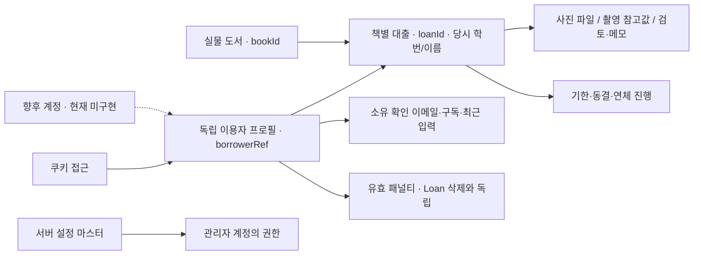

# 도서관리 시스템 — 요구사항 분석 기준선

2026-10-04 · 최신 후속 답변 반영 · 범위: Planning 정규화·OOA·요구사항 검토. **분석 모델 갱신 완료 / 구현 준비는 범위별 판정 / 제품 검증 미실행**이다. 고영향 작업 가정은 참으로 두고 분석하되 §12의 직접 확인 전 해당 기능을 구현하지 않는다.

이번 기준은 [질문형 확인 목록](library-management-confirmation-questions.md)의 Q26까지 첨부 답변 및 이번 Q28·29·32·33·34·35·37·40·41·45·46 답변을 반영했다. 사용자 직접 결정, 앞선 답으로 도출한 결론, 개발자의 가역 선택, 미확인 분석 가정을 구별한다. 이전의 숨김 책 연장 허용·금지일 연장 거부·시간 밖 회원 반납 허용·365일 쿠키·이메일 소유 미확인·5분 알림 지연 제한·관리자 확대에 따른 과거 연체 해소는 현행 규칙이 아니다.

- 출처와 보존된 조사 원문: [library-management.md](library-management.md). §14가 최신 변경 색인이고 §1~13은 수집 당시 자료다.
- 자체 판단 정본: [가정 대장](library-management-assumptions.md). 기존 AS를 교정하고 AS090~105를 별도로 모았다.
- 상세 정상·실패 흐름/AC: [유스케이스](library-management-use-cases.md).
- 사용자 확인이 필요한 영향 큰 해석과 기술 과제: §12 및 [구현 보류 문서](library-management-confirmation-required.md)의 최신 구분.
- 공통 후보: [검증 유틸 계약](library-management-validation-utils.md). 소비자가 없는 후보 구현은 수행하지 않았다.
- 후속 설계: [OOD 초안](library-management-design.md). 최신 사용자 설계 요청으로 책임·논리 데이터·인터페이스·경합/부분 실패·UI 연결을 작성했다. 이 분석을 다시 수집하거나 CF48~55를 확정한 것이 아니다. 물리 저장/인증의 실현성은 TV01~07 미검증이며 업무 구현·테스트 보류는 유지한다.

2026-10-05 후속 구현은 홈의 동급 Library 메뉴·준비 안내를 보존하고 `/library`에 예시 데이터 기반 회원·관리·상태 화면 껍데기를 추가했다([뼈대 기록 §6](library-management-skeleton.md#frontend-shell), [화면 계약](library-management-ui-draft.md#screen-contracts), [미실행 케이스](library-management-skeleton-cases.md)). 실제 회원 대출·관리자 인증·프로필·알림·삭제 기능은 미구현이다. 앱/모델 실행, 테스트, 타입 검사·린트·빌드·브라우저 제품 시험·실연동 확인은 하지 않았다. 분석 기준선·CF48~55·TV01~07의 상태는 바꾸지 않는다.

2026-10-05의 **후속 검증 결과가 최신**이다. 사용자 승인 범위의 회원·관리자 합성 브라우저 표본 30/30·DTO/gateway 단위 8/8·실행 차단 단위 1/1, 타입·린트·빌드를 통과했다. 환경·기존 경고·빌드의 공개 Sheets 읽기 차단 누락/재검증·남은 한계는 [케이스 §4](library-management-skeleton-cases.md#4-2026-10-05-실행-검증-재개)를 따른다. 앞 문단의 전부 미실행은 구현 당시 기록이다. 업무 요구/가정/운영 AC·CF48~55·TV01~07의 판정은 바꾸지 않는다.

## 1. 출처·분석 범위·판정의 의미

### 1.1 기준선과 증거의 우선순위

| 자료 | 이번 분석에서 사용하는 의미 | 확인 범위 |
| --- | --- | --- |
| 최신 사용자 요청/답변 | 요구 수집 종료 후 분석 계속, Q28~46 잔여 답변, 자체 해소 표식과 보수적 구현 분리 | 분석 위임과 구현 권한을 구별. 이번은 문서 분석이며 새 업무 코드/시험/발송은 수행하지 않음 |
| 조사 문서 §14 및 질문 목록의 수신 답변, 기존 DEC01~67/§13 | 사용자 확정 방향과 위임 기본안 | 기간 불소급·연체 연장 금지·날짜 동결·금지일 기한 유지·정확한 제재·삭제 후 제재 유지의 최신 결정 우선 |
| 조사 문서 §7~12 | 원 질문·답변·당시 제안의 출처 | 과거 추천/대체 결정은 현행 규칙이 아님. 원문은 보존 |
| 공통 검증 유틸 문서 | 입력/값/오류의 설계 후보 | U01~U14/O01~O04는 미구현. 예상 사례와 문서 검사를 실제 함수 테스트로 취급하지 않음 |
| 현재 src/package.json | 이미 존재하는 기능과 재사용 경계 | 게임/리뷰 공개 자료 읽기·리뷰 전송·사이트 표시, 도서용 서버/쿠키/사진/시계/알림은 미구현 |
| 개발 지침·판정 기준·방법 목록 | 작성/검토 절차와 종료 기준 | 학습 자료의 예시 수치·과제 분량·모든 패턴 적용을 제품 요구로 채택하지 않음 |

시작: `Namedo/Book-Management`, HEAD `ade092b3e71b061da31cba24d912a7cd43c85369`. 미추적 `AGENTS.md`/`docs/` 보존. 앱 실행 위치는 `game-dev-club-site/`다.

**현행 읽기 순서:** 최신 사용자 답변/조사 §14 → 이 분석과 AS 정본 → 상세 UC → §12의 구현 진입 구분. 최초 CF47개와 이전 리뷰 수치는 역사적 분리 근거이며 현재 전체 보류 목록이 아니다. 미확인 AS는 분석에 적용되지만 사용자 확정/실측과 구별한다.

### 1.2 적용 방법과 생략 이유

| 방법 | 선택 이유·산출물 | 수행/생략 경계 |
| --- | --- | --- |
| P02/P03 | 권한·영속 기록·동시성·Sheets/Drive·알림 때문에 위험 항목을 포함한 기능 기록 | 역할·경계·목표/범위 표, 기존 사이트 전체 소급 문서화 없음 |
| P05/P06/P07/M10 | 넓은 FR을 독립 결과 SR로 나누고 기존 결정 충돌을 해소 | 모든 자체 답을 AS로 추적. 이번 사용자 위임에 따라 재질문 없이 분석에 적용 |
| P08/P09 | 무결성·신뢰성·모바일 사용성·접근권한·향후 식별 교체·무료 운영의 영향 | QAS와 실현 가능성 확인 목록. 근거 없는 성능 수치는 AS027로 표시 |
| P10 | 쓰기/권한/상태 변경 목표를 Fully Dressed로 상세화 | 단순 조회는 필수 축약 필드를 유지. UC08/11은 summary이고 실제 목표를 별도 분리 |
| P11 | 도서/대출/쿠키 참조/제재/사진의 정체성과 수명이 다름 | 개념 관계·다중성·사전·불변조건. DB 탭/열·구체 타입 설계는 OOD |
| P12 | 경계 사건의 입력/결과/상태 계약이 필요 | OP 표와 복잡한 연산 사후조건. HTTP 엔드포인트·내부 호출 설계 없음 |
| P13/P15 | 사용자 목표 중심 OOAD, 외부 자료 처리만 흐름 표로 보완 | 같은 내용을 DFD/UML로 중복 작성하지 않음. 흐름 표는 정식 DFD로 부르지 않음 |
| P14 | 동결/연체/반납/삭제/제재/알림 상태의 겹침·중복·종료 확인 | 독립 상태 축·전이표·결정표·도달성 워크스루 |
| P16 | 모델 산술 및 명세 반례를 확인 | 앱과 같은 코드를 작성해 증거를 만드는 프로토타입은 없음. 운영 동등성 주장 없음 |
| P17 | 제품 맥락→요구→외부 인터페이스→품질→검증으로 배치 | ISO/IEEE 표준 전체 준수나 인증 주장은 하지 않음 |
| M01/M02/M07/T03/T11/T12 | 필수 범위·의존·위험·결정표 규칙·분모·검증 계획을 연결 | 구현 순서 후보와 분석 리뷰까지. 테스트 실행 완료로 집계하지 않음 |

## 2. 해결할 문제·행위자·시스템 경계

문제는 별도 폼을 찾아 대출 기록을 남겨야 했고 반납 기한 안내가 없어 관리가 되지 않는 것이다. 결과 목표는 동방 QR/직접 링크에서 책별 사진·학번/이름·기한을 기록하고, 자기 대출을 확인/반납하며, 관리자가 사진/자료/정책/예외를 관리할 수 있는 상태다.

| 행위자/이해관계자 | 목표 | 시스템이 맡는 결과 | 시스템 밖의 책임 |
| --- | --- | --- | --- |
| 방문자/EDGE 이용자 | 가능한 책 찾기, 지금 대출, 기한 확인·연장·반납 | 공개 목록/검색, 쿠키 소유 범위의 업무 및 수신 설정 | 가입 사실·실물 이동·자발적 사진/반납 표시의 진실성 |
| 관리자(1명 이상, 동일 관리 범위) | 도서/정책/사진/정정/대리 반납/정리/예외·시험 | 서버 권한 검사와 관리 목표별 결과 | 실물 확인·회원에게 기존 수단으로 문의·학기 말 정리 판단 |
| 마스터/동아리 운영자 | 서버 설정의 마스터와 관리자 권한·동아리 계정/서버 운영 | 설정/상태/장애 확인에 필요한 정보 | 계정 소유·권한 인계·HTTPS/서버/메일 경로 운영 |
| 브라우저/알림 플랫폼 | 파일/쿠키/권한/푸시 수신 기능 제공 | 가능한 기능 안내·구독 상태 처리 | 브라우저 자체 쿠키 삭제·수신 권한·전달 정책 |
| Google Sheets/Drive | 기록/사진 저장·조회·정리 | 사이트의 읽기 검증·쓰기 완료 확인·부분 결과 책임 | 외부 가용성·할당량·공동 편집·실제 파일 권한 |
| 이메일/푸시 전달 경로 | 승인된 수신 설정의 알림 전달 | 발송 결정/제출·확인 가능한 결과 | 수신함 도착·스팸/기기 차단. 전달 성공은 웹앱 결과와 구별 |

서버의 예약 시각 사건은 외부 주기 실행 요청으로 분석한다. 서버 시계/유틸/프레임워크를 사용자 행위자로 만들지 않는다.

| 포함 | 초기 제외/보류 | 근거 |
| --- | --- | --- |
| 실물 한 권씩 약 20권, 학기당 5명 미만, 사실상 무료·정해진 출시일 없음 | 제목별 수량·예약·기존 폼/활성 대출 이관 | DEC21/31/43 |
| 쿠키 접근·독립 이용자 프로필·대출 당시 학번/이름·책별 사진/기한·개별 반납 | 일반 회원 로그인·가입 검증·분실 쿠키 복구·회원 반납 취소·공용 기기 대응 | DEC11/12/16/20/32; 최신 Q37 |
| 영구 마스터 계정·관리자 승격/박탈·대리 반납·사후 확인·정정 | 일반 회원 로그인·Discord·NFC·OCR·회원 사진 열람. 후보 관리자 계정의 발급 해석은 AS100 | 최신 Q33; DEC35/46 |
| 현재 정책/QR 연장·동결·예외·연체/제재·정책 이력 | 미래 자동 예외/보상 일수·연체 회원 연장 허용 옵션 | DEC54~67, AS037 |
| 선택 채널 알림·iPhone 안내·격리 시간 시험 | 모든 브라우저 푸시 보장·실패 원인별 자동 재시도·운영 시각 조작 | DEC25/44/50 |
| Sheets DB·Drive 사진, 직접 수정, 사진만/DB 포함 수동 정리 | 두 학기 자동 TTL·콘솔 로그 삭제·별도 복구/엑셀 다운로드 기능 | DEC26~29/41/42 |

## 3. 원자화한 시스템 요구사항

기존 FR01~24의 ID는 유지하고 변화한 의미는 최신 답변으로 교정한다. SR001~059를 갱신하고 새 결과는 SR060~070으로 추가했다. 필수 기능과 후보/고영향 가정의 상태는 근거 열·§12에서 구별하며, AS 연결만으로 사용자 확정이나 구현 허용이 되지 않는다. 각 TC/AC는 검증 계획이고 실제 실행은 전부 미실시다.

각 행의 조건을 Given, 요청/시간 사건을 When, 결과·보존 조건을 Then으로 읽는다. 상세 입력/기대값은 §10과 UC별 AC에 있다.

| SR ID | 조건·사건 | 시스템의 관찰 가능한 결과 | 실패·금지 부작용 | 근거·AS 표식 | UC·OP | 인수 묶음 |
| --- | --- | --- | --- | --- | --- | --- |
| SR-LIBRARY-001 | 공개 목록 요청 | 숨김/신규 대출 불가/현재 점유/상태 불확실 도서를 제외하고 실물별 대출 가능 목록을 제공한다. | 읽기 실패를 정상 빈 목록으로 바꾸지 않음. | FR08/16; DEC21/33; AS023 | UC21; OP01 | TC001/017 |
| SR-LIBRARY-002 | 검색어/분야 입력 | AS009의 제목·저자 검색과 분야 AND 결과 및 정상 빈 결과를 제공한다. | 다른 제목의 실물 항목을 같은 제목으로 합치지 않음. | FR16; AS009 | UC21; OP01 | TC001 |
| SR-LIBRARY-003 | 회원 대출 입력 | AS010의 학번·이름을 대출 기록의 관리자 정보로 보관한다. | 이를 소유/조회/제재 대상 찾기용 인증으로 사용하지 않음. | FR06; DEC12; AS010 | UC01; OP03 | TC002 |
| SR-LIBRARY-004 | 같은 쿠키의 다음 입력 | 프로필의 최근 학번·이름을 미리 채우고 이번 입력을 해당 대출의 스냅샷으로 기록한다. | 프로필 수정/관리자 개별 Loan 정정으로 다른 과거 대출을 일괄 변경하지 않음. | FR17; Q16/37; AS010/035 | UC01; OP03/29 | TC002/027 |
| SR-LIBRARY-005 | 책별 대출 사진 제출 | 한 권 한 장을 해당 대출과 연결해 관리자만 확인할 수 있게 보관한다. | 사진 실패를 대출/사진 전체 저장 성공으로 표시하지 않음. | FR01; DEC34/35; AS011/080 | UC01; OP03 | TC002/018 |
| SR-LIBRARY-006 | 사진 메타데이터 존재/누락 | 추출 가능한 값은 참고 정보, 누락/알 수 없음은 별도 상태로 기록한다. | 사진 진위/현장 확인 보증으로 사용하지 않으며 누락만으로 대출 거부하지 않음. | FR01/12; DEC49; AS011 | UC01/07; OP03/08 | TC018 |
| SR-LIBRARY-007 | 대출 확정 요청 | 미래 예약 없이 서버 판정 시각에 지금의 대출 사건을 기록한다. | 촬영 시각/클라이언트 시각을 확정 시각으로 대체하지 않음. | FR02; DEC04/31; AS038 | UC01; OP03 | TC002/016 |
| SR-LIBRARY-008 | 신규 반납일 선택 | 당일을 첫날로 센 현재 최대 기간 안의 반납 가능 날짜를 허용한다. | 없거나 금지/범위 밖 날짜는 거부하고 임의 날짜로 보정하지 않음. | FR02/09; DEC37/45; AS001/014/036/070 | UC01; OP03 | TC005 |
| SR-LIBRARY-009 | 같은 실물의 동시 대출 요청 | 실물별 활성 대출 하나만 확정한다. | 경합의 패배 요청은 새 활성 대출을 남기지 않음. | FR08; BR02; AS026 | UC01/10/13; OP03/09/14 | TC015 |
| SR-LIBRARY-010 | 회원 신규 대출 판정 | 같은 borrowerRef의 미반납 권수와 현재 상한으로 제한한다. | 쿠키 유실 후 학번/이름으로 합계를 추정하지 않음. | FR09; DEC19/36 | UC01; OP03 | TC004/015 |
| SR-LIBRARY-011 | 같은 쿠키에 연체 미반납 존재 | 신규 대출을 차단하고 먼저 반납할 대출을 안내한다. | 동결이 이전 연체를 해소했다고 처리하지 않음. | FR20; BR03; DEC58; AS004 | UC01/03; OP02/03 | TC004/008 |
| SR-LIBRARY-012 | 같은 쿠키에 유효 패널티 존재 | 종료 전 신규 대출을 거부하고 정확한 종료 시각을 안내한다. | 제재 없는 다른 쿠키의 도서 대출까지 차단하지 않음. | FR20; DEC62/63 | UC01/03; OP02/03 | TC011 |
| SR-LIBRARY-013 | 회원 대출/연장/반납 완료 경계 | 당시 해당 날짜의 허용 이용 시간 안에서만 확정한다. | 선택/업로드/QR 확인 당시만으로 승인하지 않음. 관리 업무에 시간 제한 전파 없음. | FR15; Q10/12/40/41; AS071/099 | UC01/02/09; OP03/04/13 | TC003/004/016 |
| SR-LIBRARY-014 | 활성 대출의 알림 규칙 | 선택하고 유효한 채널에 D 구간/H 시각 안내를 판정한다. | AS095/096의 구간·동결 해석은 구현 전 확인. 푸시 미지원 상태를 지원으로 표시하지 않음. | FR04/09; Q18~20; AS002/095/096 | UC04/06; OP07/21 | TC009/010 |
| SR-LIBRARY-015 | 기한/정책/수신 변경·실행 지연 | 현재 기한과 남은 기간에 맞춰 재평가하고 동일 대출·채널·발송 사건은 중복 적용하지 않는다. | Q19의 다음 알림 시점에 도달한 이전 지연 안내는 생략. 지난 안내 전체 발송/고정 5분 제한 없음. | Q18~20; AS041/084/095 | UC04/06/09/17; OP05/07/13/21 | TC009/010 |
| SR-LIBRARY-016 | 반납/DB 삭제 확정 이후 | 대상 대출의 이후 발송 결정을 중단한다. | 이미 외부 전달을 시작한 메시지 회수를 보장하지 않음. | FR04/05/13; DEC25; AS034/085 | UC02/14/15; OP04/10/12/21 | TC010 |
| SR-LIBRARY-017 | 대출 완료 결과 | 책·기한·내 대출 경로·쿠키 유실 한계/연체 안내를 제공한다. | 원본 쿠키 문자열을 화면에 표시하거나 복구 방법을 꾸며내지 않음. | FR03/14; DEC32/34; AS028 | UC01; OP03 | TC002/019 |
| SR-LIBRARY-018 | 자기 기록 조회 | 같은 쿠키에 연결된 현재 대출과 DB에 남은 반납 이력을 표시한다. | 다른 쿠키 기록·사진·관리자 메모는 제공하지 않음. 유실 자체로 원본을 삭제하지 않음. | FR07; DEC11/20/35; AS008/018 | UC03; OP02 | TC003/019 |
| SR-LIBRARY-019 | 회원 반납 요청 | 자기 활성 대출의 반납 확인을 받고 현재 이용 시간 안이며 반납 금지일이 아닐 때 반납한다. | 회원 반납 취소/실제 과거 반납일 입력 없음. 시간·날짜 거부 시 상태 보존. | FR05/15; Q40; DEC67 | UC02; OP04 | TC003/005 |
| SR-LIBRARY-020 | 최초 반납 확정 | 서버 판정 시각을 반납 처리 시각으로 보관한다. | 중복 요청으로 반납 시각·기존 제재 종료를 바꾸지 않음. | FR05; DEC62; AS038 | UC02/14; OP04/10 | TC011/016 |
| SR-LIBRARY-021 | 관리자 실물 반납 확인 | 소유 쿠키와 별개로 대리 반납하고 회원과 같은 연체 제재를 판정한다. | AS073의 날짜/시간 예외를 제재 자동 면제로 해석하지 않음. | FR12; DEC40; AS073 | UC14; OP10 | TC003/008 |
| SR-LIBRARY-022 | 첫 대출/설정의 알림 선택 | 이메일과 브라우저 채널을 각각 선택하며 미선택/권한 거부여도 대출 가능하다. | 수신 설정 실패를 이미 확정한 대출의 취소로 처리하지 않음. | FR11; DEC15/34/50; AS012 | UC01/04; OP05 | TC019 |
| SR-LIBRARY-023 | 수신 설정 변경/해제 | 같은 쿠키의 대출에 공통 적용하고 이후 발송 주소/구독을 바꾼다. | 해제를 주소 삭제와 강제로 묶지 않으며 다른 쿠키 설정을 바꾸지 않음. | FR11; DEC30; AS012 | UC04; OP05 | TC019 |
| SR-LIBRARY-024 | 관리자 도서 등록 | 실물별 불변 ID, 필수 제목·저자·분야를 등록한다. 등록용 사진은 선택이며 후속 추가/교체 가능하다. | 제목별 수량/예약 없음. 등록 사진 선택성을 일반 대출 증빙에 전파하지 않음. | FR08; Q15; AS008 | UC05; OP06 | TC001/018 |
| SR-LIBRARY-025 | 도서 정보 변경/숨김/대출 불가 | 과거 대출의 당시 도서 정보와 활성 대출을 유지한다. | 현재 제목 수정으로 과거 스냅샷·대출 점유를 덮어쓰지 않음. | FR08; DEC33; AS007 | UC05; OP06 | TC001/012 |
| SR-LIBRARY-026 | 신규 최대 기간 변경 | 이후 새 대출에 적용하고 기존 기한을 유지한다. | 기존 기한을 새 상한으로 앞당기지 않음. | FR09; BR04; DEC36; AS036 | UC06; OP07 | TC005/012 |
| SR-LIBRARY-027 | 비연체 대상의 회원 연장 | 기존 기한에 현재 별도 연장 일수를 더한다. 숨김 책은 거부하고 신규 대출 불가 설정만으로는 거부하지 않는다. | 다른 책 연체·패널티·권수 초과로 대상 연장 차단 없음. 결과 금지일도 허용하되 당일 반납은 금지. | FR19; Q05~07; AS006/007/072 | UC09; OP13 | TC004/005 |
| SR-LIBRARY-028 | 연장 횟수 판정·저장 | 대출별 현재 N과 기존 성공 횟수를 비교하며 성공한 한 시도만 1 증가한다. | 실패/중복 시도는 횟수 소비하지 않음. | FR19; DEC47/54; AS024 | UC09; OP13 | TC004/016 |
| SR-LIBRARY-029 | 대상 대출의 연체 후 연장 | 동결 전 연체를 포함하여 회원 연장을 항상 거부한다. | 관리자 연체 허용 toggle/회원 연장으로 과거 연체 면제 없음. | FR19; DEC55/58; AS004 | UC09; OP13 | TC004/008 |
| SR-LIBRARY-030 | 발생한 연체 이후 동결/기간 확대 | 과거 연체 사실을 보존한다. 동결·추가 남은 기간 중에는 추가 연체 진행을 멈춘다. | 미래 기한으로 과거 연체/반납 시 제재 근거 자동 소멸 없음. 세부 누적 단위 AS094/097은 구현 보류. | FR24/21; Q09; DEC58; AS004/094 | UC16/17; OP15~17 | TC008/012/031 |
| SR-LIBRARY-031 | 관리자 날짜 동결/해제 | AS003의 정지 날짜를 중복 없이 계산하며 점유/미반납 권수는 유지한다. | 겹친 동결을 별도 보상으로 누적하거나 일부 해제로 전체 정지를 풀지 않음. | FR24; DEC57; AS003/037/083 | UC17; OP16/17 | TC006/007 |
| SR-LIBRARY-032 | 비연체 동결 중 회원 연장 | 성공 연장 기간은 늘리고 날짜 진행의 정지는 유지한다. | 해제까지 무조건 연장을 막거나 연장으로 동결을 자동 해제하지 않음. | FR19/24; DEC59 | UC09/17; OP13/16/17 | TC007 |
| SR-LIBRARY-033 | 대출자 포함/제외 필터 확정 | 적용 당시의 실제 대상 ID를 고정하고 이후 새 대출은 포함하지 않는다. | 재시도 때 필터를 다시 펼쳐 새 대출을 조용히 넣지 않음. | FR21; DEC61; AS076/077/032 | UC16/17/18; OP15~18 | TC007/020 |
| SR-LIBRARY-034 | 관리자 기간 확대 | 선택한 현재 대출의 기존 기한에 양의 정수 일수를 더하고 회원 count를 유지한다. | 발생 연체는 유지; 추가 기간 소진 후 증가 재개. 최종 날짜 입력은 선택 후보 AS105. | FR21; Q09; AS082/094/104 | UC16; OP15 | TC012/020/031 |
| SR-LIBRARY-035 | 관리자 제재 해제 | 명시적으로 고른 제재만 사유와 함께 해제한다. | 다른 유효 제재나 미반납 연체 차단은 자동 해제하지 않음. | FR21; DEC63/66 | UC18; OP18 | TC011/013 |
| SR-LIBRARY-036 | 쿠키 연결 연체 반납 | 반납 사건 시각에 현재 활성 제재 기간만큼 정확한 시간 제재를 생성한다. | 해당 날짜 끝으로 올리거나 같은 반납 재시도에서 새 기간을 시작하지 않음. | FR20; DEC62/65; AS038 | UC02/14/15; OP04/10/12 | TC011/016 |
| SR-LIBRARY-037 | 여러 유효 제재 존재 | 가장 늦은 종료 시각을 신규 대출 제한에 사용한다. | 제재 길이를 합산하거나 한 건 삭제로 전체 제재를 풀지 않음. | FR20; DEC63 | UC01/18; OP03/18 | TC011 |
| SR-LIBRARY-038 | 제재 기간 정책 변경 | 기존 종료를 유지하고 이후 새 제재에만 새 기간을 적용한다. | 기존 제재 종료 자동 재계산 없음. | FR20; DEC64 | UC06; OP07 | TC011/012 |
| SR-LIBRARY-039 | 오래된 자료 정리 선택 | 반납 처리 날짜/항목에서 사진만 또는 DB 항목+사진을 고르고 대상별 삭제 결과를 제공한다. | 사진만은 점유/제재/연체를 바꾸지 않고 촬영 참고값·검토·메모 유지. | FR13; Q34/35; AS032 | UC15; OP11/12 | TC013/014 |
| SR-LIBRARY-040 | 활성 DB 항목 강제 삭제 | 시간/반납 금지일과 무관하게 경고·재확인 뒤 반납 동일 제재 판정, 점유 해제, 이력 제거, 알림 중단을 적용한다. | 실물 확인을 했다고 주장하지 않음. 정리 미완료 중 해당 책 새 대출 보류. | FR13/20; Q23/41; AS022/086 | UC15; OP12 | TC013/014 |
| SR-LIBRARY-041 | 제재 생성 후 대출 DB 정리 | 기존 제재의 독립 수명과 종료를 유지한다. | 학번/이름/사진 전체 사본을 제재에 복제하거나 삭제를 제재 해제로 사용하지 않음. | FR13/20; DEC66; AS019 | UC15/18; OP12/18 | TC013 |
| SR-LIBRARY-042 | 선택/일괄 삭제의 일부 실패 | DB·사진 및 대상별 성공/실패/불확실 결과를 나누어 제공한다. | 일부 실패를 전체 완료로 표시하거나 이미 삭제한 자료 자동 복구를 보장하지 않음. | FR13; AS022/077/086 | UC15; OP12 | TC014 |
| SR-LIBRARY-043 | 대출 후 관리자 사진 검토 | 미확인/일치/불일치/확인 불가와 내부 메모를 기록한다. | 사후 확인을 선행 대출 승인/불일치 자동 취소로 바꾸지 않음. | FR10; DEC18/40; AS031 | UC07; OP08 | TC018 |
| SR-LIBRARY-044 | 관리자 기록/도서/사진 정정 | 현재 입력을 교체하고 도서 점유 충돌을 확인한다. 사진 교체가 확인되면 재검토 대상으로 두고 이전 사진 자료를 정리한다. | 실패/불확실 교체는 기존 유효 증빙 보존. 학번 정정으로 소유를 변경하지 않음. | FR12; Q14/46; AS031/075/079 | UC13; OP09 | TC012/018 |
| SR-LIBRARY-045 | 장애 보충 대출 | 관리자 확인한 과거 시각/예정일로 쿠키 없는 기록을 등록하고 도서 점유에 포함한다. 사진 없음+사유, 최대 기간 초과, 시간 밖 허용. | 사진/쿠키 없는 정보를 만들거나 학번으로 조회·권수·알림·제재를 연결하지 않음. | FR18; Q32; AS033/081/090 | UC10; OP14 | TC021 |
| SR-LIBRARY-046 | 관리자 정책 이력 조회 | 정책의 변경 시각·전후 값을 대출 DB와 구별해 확인하는 기존 목표를 추적한다. | Q29와 장기 보관/조회 범위 해석 AS091은 구현 전 확인. 별도 종료업무 아카이브/정리 화면 추가 없음. | FR22; Q25/29; AS029/091 | UC12; OP19 | TC012 |
| SR-LIBRARY-047 | 정책 입력 오류/외부 손상 | 직접 요청은 거부하여 유효 설정을 보존하고 읽기 손상은 검증된 직전 값/초기 값과 오류를 제공한다. | 잘못된 값의 암묵 변환·조용한 제한 해제 없음. | FR23; DEC37/41; AS013/014/025 | UC06; OP07/22 | TC017 |
| SR-LIBRARY-048 | 외부 자료 검증 오류 | ID/참조/시간·상태/중복 활성 오류를 보고하고 불확실 범위의 쓰기를 보류한다. | 손상 행 삭제/uniqueBy 처리/빈 배열로 도서 가용 상태를 만들지 않음. | FR23; QR01; AS023 | UC08; OP22 | TC017 |
| SR-LIBRARY-049 | 외부 직접 수정/행 삭제 관측 | 유효 수정은 다음 재조회에 반영한다. 이전 활성 근거가 있는 행 삭제는 최초 발견 시각 자동 반납 취급·새 패널티 없음. | 이전 상태 불명은 해당 책 신규 대출만 보류, 쿠키 전체 업무 보류/과거 시각 추정 없음. 직접 편집 사전 잠금 절차 없음. | Q22/26/28; AS020/021/087 | UC08; OP22 | TC017 |
| SR-LIBRARY-050 | 식별 쿠키의 사용 수명 | 동일 호스트/경로의 한 식별 쿠키로 프로필 접근을 재사용하고 접속 시 만료를 갱신한다. 장기 미접속 2달 예외를 적용한다. | 브라우저 자체 유실 복구 없음. 2달=달력2개월 해석 AS092. 프로필/대출 삭제와 쿠키 만료를 분리. | FR14; Q01/37; AS017/018/092 | UC01/03; OP02/03 | TC019/027 |
| SR-LIBRARY-051 | 관리자 요청 | 현재 유효 계정/세션의 관리자 또는 마스터 역할을 서버가 확인한 뒤 관리 연산을 허용한다. | 조작 쿠키/공개 모드 토글은 권한이 아님. 박탈된 계정은 기존 세션으로 관리 업무를 계속할 수 없음. | Q33; AS088/101 | UC20/25; OP23/30 | TC022/029 |
| SR-LIBRARY-052 | 관리자 격리 시간 시험 | 운영과 격리된 자료/시계/알림 대역에서 날짜·기한·제재·예약 경계를 조절/실행/초기화한다. | 운영 기록/OS 시각/실제 회원 수신을 시험 목적으로 변경하지 않음. | DEC44; QR02; AS089 | UC19; OP20 | TC023 |
| SR-LIBRARY-053 | 쓰기 결과 유실/중복 요청 | AS024의 시도 연결로 확인 중과 확정 결과를 구별하고 동일 효과를 한 번만 적용한다. | 응답을 읽을 수 없다는 이유로 성공을 가정하지 않음. | 쓰기 FR01/05/13/19/20; AS024/080 | 관련 쓰기 UC; OP03/04/12/13 | TC015/016 |
| SR-LIBRARY-054 | 정책 변경 완료 | 유효 새 값과 대응 변경 기록이 둘 다 확인될 때 새 정책을 활성화하고 완료를 알린다. | 일부 저장/불확실이면 기존 유효 정책 유지·관리자 오류/재처리 안내. | FR09/22/23; Q25/26; AS025/078 | UC06; OP07 | TC012/017 |
| SR-LIBRARY-055 | 발송 오류/불확실 | 성공 확인/실패/불확실을 구분하고 AS034의 최소 진단 결과를 제공한다. | 보류한 실패 원인별 자동 재시도나 전달 SLA를 확정하지 않음. | FR04; DEC25; AS034 | UC04; OP21 | TC010 |
| SR-LIBRARY-056 | 향후 회원 계정 식별 도입 | 프로필 borrowerRef와 쿠키 접근을 분리하고 향후 계정이 같은 프로필을 참조할 수 있는 경계를 둔다. | 회원 로그인/Discord/분실 복구/자동 병합은 지금 구현하지 않음. 초기 관리자 계정은 Q33 별도 포함. | DEC20; Q33/37; AS035 | UC01/03/20; OP02/03/23/29 | TC024/027 |
| SR-LIBRARY-057 | 도서 대출 DB/사진 열람 | 학번·이름·대출 기록/저장 사진은 관리자 보호 범위에 둔다. | 기존 공개 게임 CSV·공개 이미지 URL에 그대로 배치하지 않음. | FR12; DEC30/35/41; AS030 | UC07/08/13/20; OP08/09/22 | TC022 |
| SR-LIBRARY-058 | 정리/보관 운영 | 관리자가 판단한 항목/날짜의 수동 정리만 제공한다. | 두 학기 자동 TTL·콘솔 로그 삭제·사이트 복구·반납 사진·예약·OCR·NFC를 추가하지 않음. | FR13; DEC21/26~29/46 | UC15; OP11/12 | TC013/014 |
| SR-LIBRARY-059 | 관리 자료 조회/선택 | 검증된 관리자가 전체 도서/대출·사진 상세/미연결 보충/독립 제재를 구분해 조회·검색하고 관리 목표의 대상을 선택한다. | 공개/자기 조회 범위로 관리자 대상을 누락하지 않으며 권한 없음/정상 빈 결과/읽기 실패를 구별한다. | FR08/10/12/21; AS008/019/023/074/088 | UC23; OP25/26 | TC026/022 |
| SR-LIBRARY-060 | 이용자 정보 저장/마지막 Loan 삭제 | 최근 학번·이름·이메일·구독을 독립 프로필로 유지하고 쿠키 접근에 연결한다. | Loan 삭제가 프로필 삭제로 전파되지 않음. 프로필 보관 종료는 AS102/구현 전 운영 확인. | Q37; AS035/102 | UC01/04; OP29 | TC027 |
| SR-LIBRARY-061 | 이메일 등록/변경 | 주소 소유를 서버가 확인한 뒤 그 주소로 대출 알림을 보낸다. | 형식 검사/클라이언트 확인 플래그를 소유 확인으로 신뢰하지 않음. 새 주소에는 재확인 필요. | Q17; AS012 | UC24/04; OP27/28/05 | TC028 |
| SR-LIBRARY-062 | 서버 시작/마스터 접속 | 서버 설정에서 준비하는 영구 마스터 계정을 유지하고 도서 관리자 업무도 허용한다. | 재시작을 새 무작위 계정/권한 전체 초기화로 해석하지 않음. 영구 계정≠영구 브라우저 세션. | Q33; AS088/101 | UC20; OP23 | TC029 |
| SR-LIBRARY-063 | 마스터 관리자 승격/박탈 | 다른 계정의 관리자 권한을 부여/회수하고 다음 요청부터 현재 권한을 적용한다. | 일반 관리자의 권한 관리까지 자동 부여하지 않음. 승격 대상/발급 의미 AS100 구현 전 확인. | Q33; AS100/101 | UC25; OP30 | TC029 |
| SR-LIBRARY-064 | 매우 오래된 미반납 판정 | 임시 자동 반납 기능으로 활성 기록을 반납 상태로 옮기는 요구를 추적한다. | 기준일/기간·동결·제재·실물 점유 효과 AS093은 전체 기능 구현 보류. Loan 자동 삭제가 아님. | Q01; AS093 | UC08 후속; OP31 | TC030 |
| SR-LIBRARY-065 | 최초 연체/연체 후 D+n | 선택 채널에 최초 연체와 설정한 후속 안내를 제공한다. | 누적 연체 진행 기준/동결/관리자 확대 AS094/097은 구현 전 확인. 반납/DB 삭제 후 중단. | Q11/20; AS097 | UC04 후속; OP21 | TC009/031 |
| SR-LIBRARY-066 | 사진만 정리 | 삭제 확인 뒤 사진 부재를 표시하고 촬영 참고값·사후 확인 결과·내부 메모를 유지한다. | 사진 접근 불가를 새 불일치 판정으로 만들지 않음. DB 포함 삭제에서는 함께 정리. | Q34/35 | UC07/15; OP12 | TC013/018 |
| SR-LIBRARY-067 | 증빙 사진 교체 성공 | 이전 파일·그 파일의 이미지 복사본·이전 촬영 참고값을 정리하고 새 사진/참고값으로 재검토한다. | 교체 실패/불확실 때 기존 유효 사진을 먼저 삭제하지 않음. 사진만 삭제와 보존 효과 다름. | Q46; AS031 | UC13; OP09 | TC018 |
| SR-LIBRARY-068 | 사진 삭제 실행 | 영구 삭제 우선, 지원·권한 등의 이유로 영구 삭제가 불가능하다고 확인되면 Drive 휴지통 이동을 수행하고 실제 결과를 구별한다. | 휴지통 이동을 영구 삭제라고 표시하지 않음. 불확실을 실패로 단정해 중복 파괴 작업하지 않음. | Q45; AS022 | UC15; OP12 | TC013/014 |
| SR-LIBRARY-069 | 새 정책 일부 저장 | 새 값/변경 기록 불일치 중 회원 업무는 마지막 유효 정책으로 운영하고 손상 영향만 격리한다. | 미확인 새 값 활성화/정상 전체 중단 없음. 유효 값 없으면 검증된 초기 기본값 사용. | Q25/26; AS013/025 | UC06; OP07/22 | TC017 |
| SR-LIBRARY-070 | 관리자 후보 마련 | 분석은 마스터가 별도 관리자 접근 계정을 발급하고 이어 권한을 부여하는 최소 범위로 진행한다. | 공개 가입/기존 회원 쿠키 승격을 확정하지 않음. AS100 확인 전 해당 발급/연결 구현 보류. | Q33; AS100 | UC25; OP32 | TC029 |

## 4. 사용자 목표와 상세 유스케이스 배치

| 기존/신규 UC | 목표·수준 | 상세 형식·분리 이유 | 경계 연산 |
| --- | --- | --- | --- |
| UC-LIBRARY-01 | 지금 빌리는 책 기록, user-goal | 사진/대출/제재 검사/동시 요청 → Fully Dressed | OP03 |
| UC-LIBRARY-02 | 반납 완료 표시, user-goal | 소유/금지일/제재/알림 중단 → Fully Dressed | OP04 |
| UC-LIBRARY-03 | 자기 대출 조회, user-goal | 필수 축약 필드. 소유·빈 목록·유실/읽기 오류 구별 | OP02 |
| UC-LIBRARY-04 | 알림 설정, user-goal | 수신 권한/구독·해제/주소 → Fully Dressed | OP05 |
| UC-LIBRARY-05 | 대출 도서 등록/관리, user-goal | 제목·분야·숨김/불가·스냅샷 → Fully Dressed; 공개 목록은 전후 입력 흐름 | OP01/06 |
| UC-LIBRARY-06 | 대출 정책 설정, user-goal | 정책별 적용 시점/이력/부분 저장 → Fully Dressed | OP07 |
| UC-LIBRARY-07 | 사후 도서/사진 확인, user-goal | 검사 결과와 관리자 메모 → Fully Dressed | OP08 |
| UC-LIBRARY-08 | DB 항목/사진 관리, summary | 서로 다른 성공/최소 보장을 UC13/14/15로 분해 | OP09~12/22 |
| UC-LIBRARY-09 | 대출 연장, user-goal | QR/현재 정책·동결/중복 → Fully Dressed | OP13 |
| UC-LIBRARY-10 | 장애 대출 보충, user-goal | 소유 미연결·예외 입력 → Fully Dressed | OP14 |
| UC-LIBRARY-11 | 제재/예외 관리, summary | 다른 상태/보장을 UC16/17/18로 분해 | OP15~18 |
| UC-LIBRARY-12 | 정책 이력 조회, user-goal | 축약 필드·관리자 권한/읽기 오류 | OP19 |
| UC-LIBRARY-13 | 관리자 정정, user-goal | 점유 충돌·사진 재확인·완료→활성 | OP09 |
| UC-LIBRARY-14 | 관리자 대리 반납, user-goal | 실물 확인·사유·제재 판정 | OP10 |
| UC-LIBRARY-15 | 선택 자료 정리, user-goal | 날짜/항목/일괄·강제 삭제·부분 결과 | OP11/12 |
| UC-LIBRARY-16 | 관리자 기간 확대, user-goal | 적용 당시 대상·회원 연장과 별도 | OP15 |
| UC-LIBRARY-17 | 동결/해제, user-goal | 겹침·기존 연체·날짜 계산·알림 | OP16/17 |
| UC-LIBRARY-18 | 제재 해제, user-goal | 최소 독립 제재 수명/다른 제재 보존 | OP18 |
| UC-LIBRARY-19 | 격리된 시간 시험, user-goal | 관리자 전용·운영 시각/자료/수신 격리 | OP20 |
| UC-LIBRARY-20 | 관리자 계정 접근, user-goal | 영구 마스터/발급 계정 인증·현재 역할/세션 검사 | OP23 |
| UC-LIBRARY-21 | 대출 가능한 책 찾기, user-goal | 방문자 조회/검색·분야·정상 빈 결과/읽기 실패의 축약 분석 | OP01 |
| UC-LIBRARY-22 | 처리 결과 재확인, subfunction | 동일 시도 소유/관리 권한·확인 중/확정/부분 결과 구분 | OP24 |
| UC-LIBRARY-23 | 관리 자료 조회, user-goal | 전체 도서/대출·사진/미연결·제재의 권한/상태/손상·빈 결과를 상세화 | OP25/26 |
| UC-LIBRARY-24 | 이메일 소유를 확인한다, subfunction | 주소 소유 확인·수신 설정 분리 → Fully Dressed | OP27/28 |
| UC-LIBRARY-25 | 관리자 접근 계정과 권한을 관리한다, user-goal | 마스터의 발급/승격/박탈 → Fully Dressed; 발급 의미 AS100 보류 | OP30/32 |

세부 시나리오/Extensions/관심사/성공·최소 보장/AC는 [상세 UC 문서](library-management-use-cases.md)에 단일 정본으로 작성한다.

## 5. 도메인 개념·관계·불변조건·데이터 사전

### 5.1 개념과 정체성

업무 개념이며 저장소 탭·테이블·구현 클래스의 확정 설계가 아니다.

| 개념 | 정체성·관계 | 수명·책임 |
| --- | --- | --- |
| CatalogBook | bookId의 실물 한 권, Loan 0..N/활성 0..1, 필수 제목·저자·분야, 선택 등록 사진 | 숨김은 신규/연장 차단, 신규 불가만 설정하면 기존 연장 유지. 제목은 식별자가 아님 |
| BorrowerProfile | 기존 borrowerRef를 유지하는 독립 이용자 프로필. Loan 0..N, 수신 설정 0..1, Penalty 0..N | 최근 학번·이름/이메일/구독 저장. 쿠키 유실·마지막 Loan 삭제가 프로필 삭제는 아님. 실명 인증 아님 |
| CookieAccessContext | 검증된 접근 수단→프로필 1. 한 브라우저 문맥에서 일관된 쿠키 하나 | 쿠키는 프로필 자체가 아님. 유실해도 서버 참조는 남지만 회원 접근 복구는 없음 |
| FutureAccountLink | 향후 확인된 계정→기존 프로필 연결의 개념 경계 | 현재 회원 계정/자동 병합/이전 실행 없음. 같은 학번·이메일만으로 연결하지 않음 |
| Loan/BookSnapshot | loanId, 도서 1, 프로필 0..1, 대출 당시 입력/도서/기한/반납 | 일반 회원 참조·사진 필수. 관리자 보충은 처음부터 미연결 허용. 대출 당시 입력은 프로필 최근값과 독립 |
| PhotoFile/PhotoReference | 처리된 사진 파일과 그 촬영 참고값의 별도 의미 | 처리 원본 버림. 사진만 삭제는 참고값 유지, 성공 교체는 이전 파일/참고값 정리, DB 삭제는 Loan의 참고값도 정리 |
| PhotoReview | Loan의 사진/선택 도서 조합에 대한 결과·메모 | 사진만 정리는 결과/메모 유지. 교체/도서 정정은 새 조합 pending. DB 포함 정리는 해당 결과/메모 제거 |
| LoanPolicy/PolicyChange | 현재 유효 버전 1, 변경 전후/시각의 대응 기록 | 둘 다 확인 전 새 정책 미활성. 종료 이력 관리 기능 추가 없음; 조회/보관 해석 AS091 |
| Renewal/AdminException/Freeze | 회원 성공 count와 관리자 기간 확대·사유별 정지·해제의 현재 효과 | 대상 snapshot 고정. 종료 동결 구간은 기한 계산에 필요할 때 유지. 과거 업무 아카이브 기능과 구별 |
| OverdueProgress | Loan에 이미 발생한 연체 사실·누적 진행·추가 남은 기간 | 동결/관리자 확대가 과거 발생분을 지우지 않음. AS094/097 날짜 진행 세부는 확인 전 보류 |
| Penalty | penaltyId, 프로필 1, sourceLoanId 0..1, 사건/종료/해제 | Loan 삭제와 독립. 유효 제재 상태 유지. 전체 학번/이름/사진 사본 없음 |
| NotificationPreference/EmailOwnership | 프로필별 채널·주소·확인 상태·브라우저 구독 | 주소 변경은 새 소유 확인 필요. 확인 도구가 회원 로그인/대출 복구 권한을 만들지 않음 |
| ReminderOccurrence | Loan/채널/규칙·기한 의미에 대한 발송 사건과 결과 | 남은 기한/동결/다음 안내 재검사. 이미 외부 전달한 메시지 회수 없음 |
| AdminAccount/AdminSession | 불변 계정 참조와 현재 master/admin/비관리 역할, 인증된 세션 | 영구 마스터는 서버 설정에서 마련. 관리자 박탈 후 기존 세션으로 권한 유지 불가. 후보 발급 AS100 |
| OperationOutcome/DataObservation | 최소 시도 결과/외부 검증 상태·활성 점유 근거 | 중복/삭제 탐지/재처리에 필요한 제어 상태. 원본 개인정보 DB의 숨은 복사본 아님 |

Loan.borrowerRef=null은 처음부터 미연결 관리자 보충만 뜻한다. 쿠키 유실로 기존 Loan의 참조를 지우지 않는다. 프로필·Loan·관리자 계정은 별도 정체성이며 일반 회원 쿠키를 관리자 계정으로 자동 승격하지 않는다(AS100).

그림은 관계를 설명하며 계정 구현·저장 위치·마이그레이션 완료를 뜻하지 않는다.

### 5.2 항상 유지할 불변조건

| INV ID | 불변조건 | 관련 요구·반례 검사 |
| --- | --- | --- |
| INV-LIBRARY-01 | 사이트가 정상 확정하는 활성 대출은 실물별 최대 하나. 임의 외부 직접 편집으로 생긴 중복은 유효 상태로 채택하지 않음 | SR009/048; Q28 충돌 수용·사후 정정. 외부 편집 원자성은 보장 밖 |
| INV-LIBRARY-02 | 회원 소유는 검증된 프로필 참조만 사용하며 쿠키는 그 접근 수단 | SR003/018/060; 학번/이메일 일치로 복구·병합 없음 |
| INV-LIBRARY-03 | 활성·동결·연체 대출은 모두 점유/미반납 권수에 포함 | SR010/030/031. 동결로 책 해제되는 반례 |
| INV-LIBRARY-04 | 반납/삭제된 대출은 회원 연장·동결·알림으로 되살아나지 않음 | SR016/027/040. 반납과 연장 동시 사건 |
| INV-LIBRARY-05 | 신규 기간 변경으로 과거 기한을 바꾸지 않음 | SR026. 새 상한 축소 |
| INV-LIBRARY-06 | 회원 성공 연장 한 시도는 기간/성공 횟수를 정확히 한 번 변경 | SR027/028/053. 응답 유실/같은 요청 |
| INV-LIBRARY-07 | 동결의 같은 서비스 자정 경계를 한 번만 계산 | SR031. 중첩·일부 해제·해제 재시도 |
| INV-LIBRARY-08 | 동결·관리자 기간 확대는 이미 발생한 연체를 자동 소멸시키지 않음 | SR030/034; 과거 발생 보존·추가 남은 기간/정지 동안 증가 보류 |
| INV-LIBRARY-09 | 최초 반납 사건 시각/정책/제재 종료는 중복 요청으로 변경 안 됨 | SR020/036/038. 재시도 사이 정책 변경 |
| INV-LIBRARY-10 | 대출 DB/사진 삭제와 제재 해제는 다른 사건 | SR039~041/035. 삭제 후 제재 유지 |
| INV-LIBRARY-11 | 예외 대상 snapshot 밖의 새 대출에는 효과 없음 | SR033. 일괄 작업 중 새 대출/재시도 |
| INV-LIBRARY-12 | 사진 확인은 선행 승인/자동 반납 취소가 아님 | SR043/044. 불일치/사진 미확인 |
| INV-LIBRARY-13 | 손상/불확실/읽기 실패는 “활성 대출 없음”으로 해석 안 함 | SR048/049/053. 필터된 행/빈 배열 |
| INV-LIBRARY-14 | 확정 성공은 확인한 사후조건만 뜻함 | SR042/053/054/055. DB만 삭제·사진 남음 |
| INV-LIBRARY-15 | 반납/해제/수신 변경이 발송 결정보다 앞서 확정되면 새 외부 발송 없음 | SR015/016. 예약 작업 경합 |
| INV-LIBRARY-16 | 관리자 시험의 시각/자료/알림은 운영에 영향을 주지 않음 | SR052. 실제 수신·운영 DB/OS 시각 |
| INV-LIBRARY-17 | 미연결 보충의 학번/이름으로 회원 제재/소유를 새로 연결하지 않음 | SR045. 같은 이름 쿠키 자동 귀속 |
| INV-LIBRARY-18 | 대출 당시 스냅샷·프로필·현재 제어 상태·기술 로그의 수명과 삭제 범위를 구분 | SR041/057/058/060; Loan 삭제로 프로필/유효 제재를 지우거나 숨은 Loan 사본을 만들지 않음 |
| INV-LIBRARY-19 | 마스터/관리자 권한은 매 요청 현재 상태로 판정 | SR051/063; 박탈 전 세션·일반 관리자 역할 관리 우회 |
| INV-LIBRARY-20 | 사진만 삭제와 성공 교체의 참고값/검토 보존 효과를 혼합하지 않음 | SR066/067/068; 휴지통과 영구 삭제도 구별 |

### 5.3 데이터 사전

정수는 안전한 정수, 시각은 한 사건의 절대 시각, 날짜는 서비스 달력 날짜다. 아직 Sheets의 실제 셀 형식/타임존 직렬화와 같다고 가정하지 않는다. 단위 변환의 책임은 경계, 업무 적용은 OP가 맡는다.

| DD ID·값 | 업무 의미·논리 형식·단위 | 필수/없음/0·유일성 | 입력/출처·변환·오류 | 사용처 |
| --- | --- | --- | --- | --- |
| DD-LIBRARY-01 bookId | 실물의 불투명 문자열 ID | 필수/유일/불변. 제목과 다름 | 서버 부여 또는 관리자 시스템 입력 검증. 중복/없는 참조 오류 | catalog·loan·점유 |
| DD-LIBRARY-02 loanId | 한 책의 한 대출 ID | 필수/유일/불변. 행 번호 아님 | 서버 부여. 외부 수정으로 손상 시 AS023 | 소유/사진/연장/반납/정리 |
| DD-LIBRARY-03 borrowerRef | 내부 독립 프로필 참조 | 회원 필수, 처음부터 미연결 보충만 null. 불변/유일 | 서버에서 검증한 접근 문맥→참조; 입력 학번/이름과 분리 | Loan/제재/수신·향후 계정 연결 |
| DD-LIBRARY-04 studentNumber | 기록용 9자리 숫자 문자열 YYYYNNNNN | 회원 필수·유일 아님 | trim 후 9 ASCII 숫자, 앞4 연도+뒤5 번호; 선행0 유지. 재학 인증/연도 범위 확인은 추가하지 않음 Q16 | 당시 Loan/최근 프로필 |
| DD-LIBRARY-05 borrowerName | 기록용 이름 문자열 | 필수·유일 아님 | 양끝/내부 공백 제거, 비어 있으면 오류, 문자 제한 없음·한국어 권장 Q16 | 당시 Loan/최근 프로필 |
| DD-LIBRARY-06 title/author/category | 현재 catalog 및 당시 스냅샷 값 | 모두 필수·비어 있지 않은 문자열 | Q15; 검색 정규화 AS009와 저장 원문 구분. 등록 사진은 선택 | 목록·snapshot·알림 |
| DD-LIBRARY-07 borrowedAt | 최초 대출의 서버 사건 시각 | 회원 필수. 보충은 관리자 확인 시각 별도 구분 | 클라이언트/촬영 시각은 참고. 보충 원 시각 AS081 | 신규 최대 날짜·기록 정렬 |
| DD-LIBRARY-08 dueDateBase | 성공 연장/명시적 관리자 확대를 반영한 기준 날짜 | 활성 대출 필수. 최초 예정일과 이후 변화 구분 | DateOnly YYYY-MM-DD/실제 달력 검증 U06; 신규+기간-1/연장+기간 | 기한·동결·알림 |
| DD-LIBRARY-09 effectiveDueDate | 기준 날짜 + 유일한 정지 자정 수 | 동결 중 관측 시각에 따라 값 변함 AS005 | 달력 계산 U08 후보. 잘못된 날짜 자동 보정 없음 | 화면·연체·반납 |
| DD-LIBRARY-10 deadlineExclusive | effectiveDueDate 다음 날 00:00 KST | 비교 상한. 해당 날짜 마지막 분 포함 AS070 | 같은 시간대 절대 시각으로 변환. 23:59:00과 구별 | 연체 비교·알림 기준 AS002 |
| DD-LIBRARY-11 freezeStart/resumeAt | 날짜 진행 정지/해제 사건 시각 | 해제 안 했으면 resume=null. 종료가 시작보다 앞서면 오류 | 운영 서버 사건/시험 시계. 소급 운영 설정 없음 AS037 | 자정 합집합 AS003 |
| DD-LIBRARY-12 hasOverdueHistory | 현재 Loan에 이미 발생한 연체 근거 | false/true; 누락을 false로 치환 금지 | 첫 연체 진입 후 보존. 동결/확대로 자동 false 변경 없음 Q09/AS094 | 신규/회원 연장 차단·반납 제재 |
| DD-LIBRARY-13 returnedAt | 최초로 반납 전이를 확정한 시각 | 활성은 null; 반납 완료는 필수 | 서버 시각. 직접 행 삭제는 관측 시각 및 출처 AS021 | 제재·정리 날짜·이력 |
| DD-LIBRARY-14 renewalCount/limit | 회원 성공 횟수/현재 N | count>=0; N=-1 무제한/0 금지/양수 상한 | 안전 정수. 허용=N=-1 또는 count<N; 관리자 확대/실패는 소비 없음 Q11 | 회원 연장 |
| DD-LIBRARY-15 initialMaxDays/renewalDays | 신규/연장 달력 일수 | 둘 다>=1, 서로 독립 | 안전 정수·계산 가능한 범위 AS014. current 값과 당시 값 구분 | 신규/연장 날짜 |
| DD-LIBRARY-16 maxActiveLoans | 현재 프로필의 신규 대출 권수 상한 | -1 무제한/0 금지/양수 상한 | 안전 정수; 허용=-1 또는 activeCount<상한. 손상은 fallback+오류 Q11 | 신규 대출 |
| DD-LIBRARY-17 allowedWindows | 현재 KST 날짜의 허용 시간 합집합 | 제한 없음 별도, 빈 구간은 차단 | [시작,끝), 요일 복수구간 + 해당 날짜 추가구간. 자정 이후 해당 날짜 정책. 반납에도 적용 Q12/40/AS099 | 회원 신규·연장·반납 |
| DD-LIBRARY-18 forbiddenReturnDates/weekdays | 반납 불가 서비스 날짜/요일 집합 | 빈 집합=추가 금지 없음. 불리언 누락과 다름 | DateOnly/요일 허용값 검사. 운영 시간과 별개 | 반납일 선택·회원 반납 |
| DD-LIBRARY-19 penaltyDuration | 반납 후 신규 대출 제한의 정확한 시간 길이 | 0 새 제재 없음/양수, AS098 정수 시간 | 일 입력은 24h 변환. 반납 당시 정책; 소수시간은 초기 가정에 없음 | 제재 생성 |
| DD-LIBRARY-20 penaltyExpiresAt/cleared | 제재별 정확한 종료/명시적 해제 | expiry 필수; 현재 시각>=expiry면 차단 없음 | 첫 반납 사건/당시 정책. 최대 종료 선택; sourceLoanId 선택 AS019 | 신규 대출·관리자 해제 |
| DD-LIBRARY-21 reminderRule/channel | 기한 전 D-n 구간/H-n 시각, 연체 발생/D+n; email/browser | 기한 전 n>=1, 후속 n>=1; 채널 열거 | D와 H를 한 정확-duration 타입으로 환원하지 않음. AS095/097 구현 전 확인 | 알림 판정/중복/재계산 |
| DD-LIBRARY-22 email/subscription/verification | 프로필의 현재 주소·소유 확인 상태·브라우저 구독 | 미선택/주소없음 구별. 활성 이메일 발송은 현재주소 소유 확인 필수 | 서버 확인 결과를 주소+프로필에 연결. cookie 평문 true 신뢰 금지 Q17/37 | 수신 설정·발송 |
| DD-LIBRARY-23 photoFile/status/reference | 처리 파일1·present/permanentlyDeleted/trashed/missing/unknown·촬영 참고값 | 파일없음은 이유 필수; 참고값은 파일정리 후 유지 가능 | 원본 추출→변환/검증→처리파일만 저장. Q34/45/46; lastModified는 촬영증거 아님 | 증빙·교체·정리 |
| DD-LIBRARY-24 reviewStatus/note | pending/match/mismatch/unverifiable·내부 메모 | 초기 pending, 메모 선택/회원 미노출 | 사진만 삭제는 유지. 새사진/도서조합은pending, 기존 검토와 새조합 혼동 금지 Q35/46 | 사후 확인 |
| DD-LIBRARY-25 targetSnapshot | 적용 당시 고른 loanId/penaltyId의 집합 | include=null은 전체 후보, include=[]는 아무것도 없음; exclude 우선 | U12는 선택 기초. AS076/032로 적용 대상 재검증·고정 | 예외/정리 |
| DD-LIBRARY-26 reason | 관리자 예외/실물 반납 예외/정정 사유 | 예외·강제 삭제는 필수 비어 있지 않음 AS073/082 | U02/오류 경로 후보. 소유 인증에 사용 안 함 | 관리 기록 |
| DD-LIBRARY-27 policyVersion/change | 활성 유효 버전·전후/시각 대응 | 둘 다 확인돼야 활성화; 종료이력 장기조회 AS091 | Q25/26 정책+이력 미확인 중 기존활성. 외부 관측 출처 구별 | 정책/사건 재확인 |
| DD-LIBRARY-28 attemptRef/outcome | 같은 시도의 중복 적용 방지·결과 참조 | 확인 중≠거부/확정 성공. 대상별 부분 결과 가능 | 서버 검증, 클라이언트 값을 권한 증거로 안 씀 AS024/080 | 쓰기 결과 재확인 |
| DD-LIBRARY-29 cookieAccess | 불투명한 프로필 접근 수단·최근 접속/만료 의미 | 문맥 하나의 쿠키, 유실은 접근 상실 | AS017/092 달력2개월 갱신. 실제 서명/비밀/저장은 OOD | 프로필 접근 |
| DD-LIBRARY-30 profileValues | 최근 학번/이름·주소/소유확인·채널/구독 | borrowerRef에 종속, 마지막 Loan과 독립 | OP29 수정은 과거 Loan에 전파하지 않음; 보관 종료 AS102 | 미리 채움/설정/향후이식 |
| DD-LIBRARY-31 adminAccountRef/role | 지속 계정과 master/admin/비관리 상태 | 마스터1; 후보 계정 생성 AS100 | 서버 설정 마스터, 현재 권한 서버 확인. 인증 수단의 상세는 OOD | 관리자 접근·승격/박탈 |
| DD-LIBRARY-32 overdueProgress | 이미 발생한 연체·증가한 날짜 수·추가 남은 기간 | 현재 Loan에 필요한 최소 현재값, 전체 업무이력 기능 아님 | AS094/097 날짜 누적/중첩 동결. 모델 해석 확인 전 구현 보류 | 확대/동결/연체 안내 |
| DD-LIBRARY-33 autoReturnPolicy | 장기 미반납의 임시 종료 기준 | AS093의180일은 제안·운영확정값 아님 | 기준일/동결/제재/대상 직접 확인 전 전체 기능 보류 | OP31 |

### 5.4 데이터 수명과 선택 삭제의 효과

| 데이터/행동 | 쿠키 유실 | 사진만 삭제 | DB 항목+사진 삭제 / 성공 교체 |
| --- | --- | --- | --- |
| 대출 당시 학번/이름·도서·기한/반납 | 유지, 회원 접근만 상실 | 유지 | DB 포함은 항목 제거·회원 이력 제외; 교체는 나머지 Loan 유지 |
| 저장 사진·이미지 복사본 | 유지 | 영구 삭제 우선/불가하면 휴지통·실제 결과 표시 | DB 포함은 같은 정리; 교체는 새 증빙 확인 후 이전 증빙 정리 |
| 촬영 참고값 | 유지 | **유지** Q34 | DB 포함은 제거; 교체는 이전 참고값 정리 후 새 값 사용 Q46 |
| 사후 확인 결과·메모 | 유지 | **유지** Q35·사진 부재 구별 | DB 포함은 해당 정보 제거; 교체는 새조합 재확인, 이전 결과를 새사진 검토로 사용하지 않음 |
| 활성 점유 | 유지 | 유지 | DB 강제 삭제는 반납 동일 판정 후 해제. DB 정리 실패 중 그 책 신규 대출 보류 Q23 |
| 독립 프로필·이메일/구독·최근 입력 | 유지, 복구 없음 | 유지 | 마지막 Loan 삭제에도 유지 Q37. 별도 보관 종료 AS102 |
| 유효 Penalty | 기존 종료 유지 | 유지 | Loan 삭제 뒤도 유지. 별도 관리자 해제와 구별 |
| 동결/기간 확대의 현재 효과 | 유지 | 유지 | Loan 종료 시 새 진행 없음. 계산/확인에 필요한 현재정보만 보존, 종료 아카이브 기능 추가 없음 |
| 정책·대응 변경 정보 | 유지 | 유지 | 대출 정리와 별개; Q29 장기조회/보관 AS091 확인 전 보류 |
| 알림 발생/최소 처리 결과 | 유실 자체는 반납 아님 | 활성 알림 유지 | DB 삭제 후 중단. 재확인 필요한 최소 결과만 유지 |
| 콘솔/별도 수집 로그 | 대출 정리 범위 밖 | 범위 밖 | 범위 밖. 사진/학번/이메일 원본 전체를 기본 로그 복사본으로 남기지 않음 |

사진만 삭제, 성공 교체, Loan DB 포함 삭제, 프로필 수정/삭제, 제재 해제는 서로 다른 명령이다. 저장소를 추가하는 것과 독립 수명을 표현하는 것은 다르다. 어느 저장 방식이든 이 삭제 전파를 충족해야 하며 구체 탭/열/테이블은 OOD에서 정한다.

## 6. 시간·정책·권한 분석

### 6.1 기한·진행·정책의 적용

시간대는 KST(Q02), 표시 기한은 해당 날짜23:59까지이고 정확한 배타 경계는 다음날00:00이다. 기존 기한을 새 최대 기간으로 앞당기지 않는다.

1. 신규 최대 선택 날짜 = 대출 날짜 + 현재 신규 최대 일수 - 1. 신규 반납일은 현재 반납 가능 날짜여야 한다.
2. 회원 연장 = 기존 기준 기한 + 현재 별도 양의 정수 일수. 현재 N=-1 또는 count<N, 소유/활성/대상 비연체/숨김 아님/QR/이용 시간 조건을 검사한다. 다른 책 연체·패널티·권수 초과는 제외한다. 결과 금지일은 허용하고 당일 반납 불가 안내를 한다(Q05~07).
3. 날짜 동결은 AS003의 자정 합집합을 유지한다: start < 자정 <= 관측/해제. 같은 날 시작/해제는0일, 중첩 동일 자정은1회. 사유별 정지 하나라도 남으면 frozen.
4. 계산 기한 = 기준 날짜 + 유일한 정지 자정 수. 동결 중 값은 현재 관측까지의 투영값이며 미래 해제 날짜를 확정해서 표시하지 않는다.
5. 첫 연체는 active인 채 계산 기한의 다음날00:00에 도달하면 발생한다. **이미 발생한 사실은 동결/관리자 확대 뒤도 유지**한다. 신규 대출/회원 연장 차단·반납 제재 근거는 이 사실을 사용한다(AS094의 보수적 도출).
6. 관리자 확대는 기존 기준 기한에 일수를 더한다. 이미 쌓인 연체는 차감하지 않는다. 확대 후 남은 기간 동안 새 연체 증가는 보류하고 새 기한 경계 이후 재개한다. 결과가 여전히 과거이면 새 유예가 없어 증가를 계속한다(AS104). 최종 날짜 입력은 초기 필수 제외 후보 AS105.
7. 날짜 누적 가정(AS094/097): 연체가 진행하는 구간의 KST 자정 경계를 중복 없이 센다. 동결/추가 남은 기간은 진행 구간에서 제외한다. boolean만으로 D+n을 계산하지 않는다. 이 단위/차단 해석은 §12에서 구현 전 확인 대상으로 구분한다.
8. 반납 후 제재 = 최초 반납 사건 시각 + 그때 정책의 정확한 시간 길이. AS098은 비음수 정수 시간(일수 입력×24h)이다. 0은 새 제재 없음, 기존 제재 끝은 변경하지 않는다.
9. 회원 반납은 현재 허용 이용 시간 및 비금지 날짜에서만 가능(Q40). 관리자 작업은 이 두 시간/날짜 제한과 무관하게 허용(Q41)하되 권한·입력·점유·실물 확인 등 해당 목표의 조건을 유지한다.
10. 동결 해제 뒤 계산 기한이 금지일이면 날짜를 유지한다. 그날 회원 반납 불가, 23:59까지 기한 내, 다음날00:00 연체. 자동 앞당김/보상 없음.

**연체 확대 사례(서술 검토, 실행 아님):** 10일 기한인 책을12일12:00에 관리자가 +5일하면 새 기한은15일23:59이다. 11일00:00~12일12:00에 생긴 연체 사실은 남는다. 16일00:00 전까지 추가 진행은 멈추고 그 뒤 재개한다. 13일 반납도 기존 연체 근거로 당시 패널티를 판정한다. 확대 전에 쌓인 진행을 뒤에서 새로 소급 재계산해 삭제하지 않는다.

### 6.1.1 알림의 시간 의미 — 표식한 분석안

- AS095: D-n은 24n < 남은시간 <= 24(n+1)시간 구간의 첫 유효 실행1회, H-n은 n시간 지점에 도달한 안내1회. 구간 안에서 새 대출/수신 활성화가 되면 현재 유효 구간 안내1회로 분석한다. **사용자 원문 구간 표기의 보완이며 구현 전 확인**이다.
- 20일 기한의 경계는21일00:00이다. D-1은19일00:00 포함~20일00:00 제외, H-24는20일00:00이다. 두 규칙을 자동으로 같은 시점이라고 합치지 않는다. 실제 같은 발송 사건 시각이면 채널별1회로 묶는다.
- Q19: 유효한 지연 안내는 발송하되 다음 안내 시점 도달 후 앞선 안내는 생략한다. 마지막 기한 전 안내는 연체 경계를 상한으로 삼는 가정이다. 고정5분 중단은 폐기했다.
- AS096: 동결 중 미발송 안내 보류, 해제 시 계산 기한/남은 기간으로 재평가. 날짜 동결에서 같은 날20분 정지를 기한의20분 이동으로 보상하지 않는 분석안이다. 이는 Q20의 ‘남은 시간 자체 정지’와 결과 차이가 생길 수 있어 **날짜 동결/H알림 결합 구현 보류**다. 보류된 옛 예약만 보고 영구 생략하지 않는다.
- AS097: 최초 연체 발생 안내1회, D+n은 실제로 누적 진행한 연체 일수n에 도달할 때1회. 동결/추가 남은 기간은 진행을 멈추며 해당 알림도 동결 중 보류한다. 달력 경과 기준과 다른 결과이므로 **연체 후 알림 구현 전 확인**이다.
- 현재 주소 소유 확인/브라우저 구독/선택 채널·active 상태를 발송 결정 직전에 재검사한다. 반납/DB 삭제/수신 해제가 먼저 확정되면 새 외부 제출을 중단한다. 제출 후 회수/모든 기기 전달은 보장하지 않는다.

| 정책 | 현재 판정/기존 자료 효과 | 출처 |
| --- | --- | --- |
| 최대 기간 | 새 대출만 적용, 기존 기한 유지 | DEC36 |
| 권수/N | -1 무제한,0 금지,양수 상한; 현재값으로 새 판정, 과거성공 유지 | Q11 |
| 이용 시간 | 해당 날짜 평소 구간+추가 구간 합집합; 신규/연장/회원 반납 | Q12/40; AS099 |
| 반납 금지 | 신규 날짜 선택·회원 반납 검사; 일반 연장 결과 날짜는 거부하지 않음 | Q07; DEC67 |
| 숨김/신규 불가 | 숨김 연장 금지/신규 불가만 있으면 기존 연장 허용 | Q06 |
| QR | 확인10분/재사용; 교체·폐기 전 기존 확인은 원 만료까지 | Q13 |
| 동결/일괄 예외 | 즉시 적용/수동 종료/사유별 정지; 당시 확정대상만 | Q03/04/24; AUTO-Q30 |
| 제재 | 최초 반납 당시 현재 시간길이, 종료 최댓값; 변경은 새 제재만 | DEC62~66; Q11 |
| 정책 변경 | 새 값+변경 대응 확인 전 기존활성 유지 | Q25/26 |
| 관리자 권한 | master/admin의 현재 서버 판정; 박탈 후 기존세션 거부 | Q33 |
| 자료 손상/직접 편집 | 정상 독립업무 계속, 손상범위 격리; 사전편집절차 제외 | Q26/28 |

### 6.2 권한×목표

관리자와 회원은 역할이 다르며 “관리자 쿠키를 가진 브라우저의 회원 대출 소유”를 자동 부여하지 않는다. 관리자 미연결 기록의 회원 소유권도 만들지 않는다.

| 목표/정보 | 공개 방문자 | 자신의 cookie 문맥 | 다른 cookie 문맥 | 검증된 관리자 |
| --- | --- | --- | --- | --- |
| 가능한 책 목록/검색 | 허용 | 허용 | 허용 | 허용 |
| 신규 대출 | 새 문맥 발급 후 모든 규칙 | 모든 규칙 | 타인의 참조 지정은 거부 | 회원 경로는 회원 규칙, 보충은 별도 OP14 |
| 자기 기록/기한·이력 | 쿠키 없음 안내 | 허용 | 거부 | 관리 조회는 별도 권한 |
| 회원 반납/QR 연장 | 자기 연결 먼저 필요 | 규칙 검사 | 거부 | OP10/15는 관리자 별도 목표 |
| 수신 설정/주소/구독 | 자기 문맥 필요 | 허용 | 거부 | 다른 회원 설정 임의 대체 요구 없음 |
| 사진/EXIF/원본 DB·내부 메모 | 거부 | 거부 | 거부 | 허용 |
| 도서/정책/정정/보충/삭제/예외/이력 | 거부 | 거부 | 거부 | 현재 master/admin 검사 뒤, 시간/금지일 제한 없이 해당 목표 조건 |
| 관리자 계정 발급/승격/박탈 | 거부 | 거부 | 거부 | 마스터만 허용 AS100/101; 일반 관리자 거부 |
| 가상 시각/예약 실행/초기화 | 거부 | 거부 | 거부 | 격리 환경에서만 허용 |

AS088/100/101: 서버 설정에서 영구 마스터를 마련하고 별도 계정의 현재 권한을 확인한다. 영구 계정은 영구 세션을 뜻하지 않는다. 회원 쿠키 접근과 관리자 인증은 독립이다. 실제 인증 방식/비밀값·세션 정책은 OOD이며 문서에 비밀값을 보관하지 않는다.

## 7. 독립 상태 축·전이·결정표

### 7.1 상태의 의미와 도달 경로

| 축 | 값/초기·종료 | 도달 경로와 의미 |
| --- | --- | --- |
| 대출 수명 | 존재 전 → active → returned → removed | 대출 성공/반납 성공/DB 정리. removed는 자료 부재의 분석 종료이지 숨긴 원본 행의 필수 저장 상태가 아님 |
| 날짜 진행 | running / frozen | 유효 Freeze 0 / 1 이상. returned/removed에는 더 이상 기한 진행 효과 없음 |
| 기한 경과 | notOverdue / overdueHistory | 첫 연체 이후 사실 보존. 확대 후 남은 기간이 있어도 기존 근거를 없애지 않음 |
| 제재별 수명 | active / expired / cleared | 생성→시간 경과 또는 관리자 해제. Loan 삭제와 독립 |
| 도서 가용성 | available / occupied / disabled / hidden / uncertain | 점유와 설정/검증 상태에서 도출. 여러 이유가 겹칠 수 있음 |
| 사진 | present / cleaned / missing / unknown | 저장 성공/선택 정리/직접 파일 누락/결과 불확실. missing≠cleaned |
| 확인 상태 | pending / match / mismatch / unverifiable | 사후 검토. 사진/도서 교체는 pending으로 돌아감 |
| 알림 발생 | future / held / dispatchDecided / confirmed / failed / unknown / stopped | 예약/동결/발송 결정/외부 결과/반납·해제/기한 변경 중단 |
| 요청 결과 | rejected / confirmed / verifying / partial | 요청 검증/상태 확인/결과 유실/대상·저장소별 부분 결과 |

`active+frozen+overdueHistory`는 가능하다. `returned+Penalty.active`와 `removed+Penalty.active`도 가능하다. `returned+유효 회원 연장`은 불가능하다. 점유중 도서가 hidden/disabled인 것도 가능하며 목록에서만 빠진다.

### 7.2 대출/동결/제재 상태 전이

| 현재 상태 | 사건·Guard | 행동·부작용 | 다음/거부·실패 후 상태 | BR/INV·TC |
| --- | --- | --- | --- | --- |
| 도서 available, 대출 없음 | 회원 대출, 모든 신규 Guard | Loan/처리 사진/당시 입력·기한 확정, 도서 점유 | active/running 또는 verifying; 다른 요청 점유 확인 | INV01/02/14; TC002/015 |
| available | 관리자 보충, 권한·자료·점유 유효 | 미연결 Loan, 사진 없으면 이유 | active/running; 회원 권수/제재 합치기 없음 | INV17; TC021 |
| active/running/notOverdue | 회원 연장, 소유·QR·시간·N·숨김 아님 | 기한+기간/count+1/현재 유효 알림 재평가 | active/running/nonoverdue | INV06; TC004 |
| active/frozen/notOverdue | 같은 연장 Guard | 기준 기한+기간/count+1, 정지 유지 | active/frozen/nonoverdue·알림 held 유지 | INV06/07; TC007 |
| active/overdueHistory(동결 포함) | 회원 연장 | 거부 | 이전 기한/count/점유 유지 | BR03; TC004/008 |
| active/* | 관리자 기간 확대·양의 정수일수/사유 | 기한 확대·과거 연체/회원 count 보존, 새 남은 기간 중 추가 진행 보류 | active/동결 유지; 누적/차단 해석 AS094 보류 | INV08/11; TC031 |
| active/running | 관리자 동결, 대상 snapshot·사유 | Freeze 시작; 당시 연체 근거 유지 | active/frozen; 점유/count 유지 | INV03/08/11; TC006/008 |
| active/frozen | 추가 동결 | 별도 유효 정지; 같은 자정 한 번 | active/frozen | INV07; TC006 |
| active/frozen | 일부 동결 해제, 다른 정지 있음 | 해당 정지 종료 | active/frozen | INV07; TC006 |
| active/frozen | 마지막 동결 해제 | 날짜 합집합 반영·알림 현재 유효성 재평가 | active/running; 금지일 계산 날짜 유지 | INV07/08; TC007/005 |
| active/* | 회원 반납, 소유·허용시간·반납 가능일 | 최초 시각/연체·제재 판정, 점유 해제/알림 중단 | returned, 제재는 별도 active/없음 | INV09/15; TC003/011 |
| active/* | 회원 반납, 금지일 또는 시간 밖 | 거부 | active 상태·기한·제재 보존 | BR08; TC005 |
| active/* | 관리자 대리 반납, 실물 확인·사유 | AS073으로 시간/날짜 제한 예외, 동일 제재 판정 | returned | INV09; TC003 |
| active/* | 관리자 DB 포함 강제 삭제, 경고 재확인 | 반납 동일 판정/필요 제재 확인 후 DB/사진 정리 | removed 또는 대상/저장소별 partial/verifying | INV10/14; TC013/014 |
| returned | 회원 중복 반납 | 최초 완료 결과 반환 | returned; 새 제재/새 시각 없음 | INV09; TC016 |
| returned | 관리자 DB 포함 정리 | DB/사진 정리 | removed; Penalty 유지 | INV10; TC013 |
| active/returned | 사진만 정리 | 파일 영구삭제/휴지통 확인, 참고값·검토·메모 유지 | 같은 대출/점유/제재 상태 | INV10; TC013 |
| returned | 관리자 잘못된 반납 정정, 다른 활성 점유 없음 | 원 대출·쿠키·기한의 활성 상태 재판정; 기존 제재 별도 | active, pending 확인 필요; 충돌 시 거부 | AS075; TC012 |
| removed | 뒤늦은 연장/동결/반납/알림 | 없는/종료 대상 결과 | 부활 없음 | INV04; TC014/016 |
| Penalty.active | 시각>=expiry | 제재 차단 종료 | expired, 다른 유효 제재/연체는 유지 | INV10; TC011 |
| Penalty.active | 관리자 명시적 해제·사유 | 선택 제재 해제 | cleared, 다른 제재는 유지 | DEC63/66; TC011 |
| 외부 자료 uncertain | 관리자/다음 요청 재검증 | 원본 검증·직접 수정/삭제 제한적 반영 | valid 또는 uncertain 유지·범위 쓰기 보류 | INV13; TC017 |

AS075의 returned→active는 사용자 반납 취소가 아니라 관리자 수동 정정이다. 이미 다른 Loan이 책을 점유하면 새 정정으로 두 활성 대출을 만들지 않는다. 관리자 실물 확인/기한 확대/강제 정리의 종료 경로가 있어 반납 금지 날짜가 계속되더라도 운영자에게 영구 교착을 만들지 않는다.

### 7.3 신규 대출 결정표

각 G는 유한한 판정 조건이다. 순서는 거부 사유의 표시 순서이며 허용 규칙은 모든 G가 true여야 한다. `—`는 그 열의 앞선 false가 이미 거부를 결정하여 해당 값이 결과/부작용에 영향을 주지 않는다는 뜻이다. **거부 결과가 같더라도 R1~R8은 각각 필요한 규칙 열**이다. 형식/소유·자료 무결성 우선이며 같은 거부에는 상태 쓰기 없음.

| 조건/결과 | R1 | R2 | R3 | R4 | R5 | R6 | R7 | R8 | R9 |
| --- | --- | --- | --- | --- | --- | --- | --- | --- | --- |
| G1 입력/식별 문맥 유효 | F | T | T | T | T | T | T | T | T |
| G2 필요한 자료/정책 검증됨 | — | F | T | T | T | T | T | T | T |
| G3 도서 공개/신규 가능/비점유 | — | — | F | T | T | T | T | T | T |
| G4 이용 시간 허용 | — | — | — | F | T | T | T | T | T |
| G5 같은 쿠키 연체 미반납 없음 | — | — | — | — | F | T | T | T | T |
| G6 유효 패널티 없음 | — | — | — | — | — | F | T | T | T |
| G7 상한=-1 또는 현재 권수<상한 | — | — | — | — | — | — | F | T | T |
| G8 반납일/사진 입력 유효 | — | — | — | — | — | — | — | F | T |
| 행동 | 입력/식별 거부 | 확인 필요 | 도서 불가 | 시간 거부 | 반납 안내 | 제재 안내 | 권수 거부 | 입력 거부 | 대출 확정 |

G1에 입력 형식, G8에 날짜 범위/파일 내용의 업무 유효성을 나눈다. G3에는 공개 목록 선택 시점과 완료 경계의 재검증이 둘 다 필요하다. 상태 불확실로 거부된 책을 단순 available로 되돌리지 않는다.

### 7.4 회원 연장 결정표

이미 확정된 같은 시도는 원 결과를 반환한다. 아래는 아직 확정 결과가 없는 새 판정이다. —는 앞선 거부가 결과를 정하므로 뒤 값이 그 열의 결과에 영향을 주지 않음을 뜻한다.

| 조건/결과 | R1 | R2 | R3 | R4 | R5 | R6 | R7 | R8 |
| --- | --- | --- | --- | --- | --- | --- | --- | --- |
| G1 소유/QR/입력 유효 | F | T | T | T | T | T | T | T |
| G2 active·필요 자료 확인 | — | F | T | T | T | T | T | T |
| G3 대상 연체 발생 근거 없음 | — | — | F | T | T | T | T | T |
| G4 현재 이용 시간 허용 | — | — | — | F | T | T | T | T |
| G5 숨김 도서 아님 | — | — | — | — | F | T | T | T |
| G6 N=-1 또는 count<N | — | — | — | — | — | F | T | T |
| G7 현재 동결 있음 | — | — | — | — | — | — | F | T |
| 행동 | 접근 거부 | 종료/확인 필요 | 연체 거부 | 시간 거부 | 숨김 거부 | 횟수 거부 | 기간/count+1 | 같은 연장·정지 유지 |

현재 권수 초과·다른 책 연체·반납 후 패널티·신규 불가 설정만·결과 반납 금지일은 추가 거부 Guard가 아니다(Q05~07). 결과 금지일은 날짜 유지/회원 반납 금지 안내로 처리한다. N=0은 항상 횟수 거부, -1은 횟수 상한을 검사하지 않는다.

### 7.5 반납/삭제 결정표와 알림 경합

| 사건/조건 | 반납 기록/제재 | 점유/회원 이력 | 알림·사진 |
| --- | --- | --- | --- |
| 회원 소유 없음 또는 금지일/시간 밖 | 변화 없음·거부 | 유지 | 유지 |
| 회원/관리자 비연체 반납 | 최초 returnedAt, 새 제재 없음 | 점유 해제·이력 유지 | 후속 발송 중단·사진 유지 |
| 회원/관리자 연체 반납 | 최초 시각+당시 활성 제재 기간 | 점유 해제·이력 유지 | 후속 발송 중단 |
| 미연결 관리자 기록 반납 | 관리자 처리 시각·회원 제재 없음 | 점유 해제·관리 이력 | 자동 회원 알림 대상 아님 |
| 활성 DB 포함 강제 삭제(시간/금지일 무관) | 반납과 같은 판정; 필요 제재 독립 유지 | 점유 해제·회원 이력 제거 | 사진 정리·후속 발송 중단 |
| returned DB 포함 삭제 | 기존 제재 그대로 | 회원 이력 제거 | 사진 정리 |
| 사진만 삭제 | Loan/제재 변화 없음 | 유지 | 실제 파일 결과+참고/검토/메모 유지; 활성 알림 유지 |
| 외부 Sheet 활성 행 직접 삭제 | 최초 발견 시각 반납, 새 패널티 없음 Q22 | 점유 해제; 기존제재 유지 | 새 발송 중단·남은사진 정리 상태 별도 |
| 관리자 확대 뒤 기존연체 반납 | 기존 연체 근거에 따라 당시 제재 | 점유 해제·이력 유지 | 남은 기간이 있다고 과거 연체 면제 없음 |
| 중복 요청/불확실 재확인 | 기존 사건·제재 결과 재사용 | 원 사후조건 유지 | 중복 부작용/전체 성공 추정 금지 |

발송과 반납의 동시에 참인 조건은 순서로 분리한다. 반납/해제/동결이 발송 결정보다 먼저 확정됐으면 새 외부 전송을 시작하지 않는다. 발송 결정 후 이미 외부에 제출한 메시지는 도착할 수 있으며 회수를 보장하지 않는다. 실패 원인별 자동 재시도는 보류 범위를 유지한다(AS034/085).

## 8. 외부 사건·시스템 연산·사후조건

### 8.1 연산 목록

OP는 사용자/시간/외부 관측이 시스템에 요구하는 의도다. 함수 이름은 분석 이름이며 구현된 API/HTTP 경로가 아니다. 같은 OP가 화면/서버/예약 경계에 쓰일 수 있고 내부 호출 수와 같을 필요가 없다.

| OP ID·의도 | 요청자 | UC | 입력→외부 결과 | 상태 영향·최소 보장 |
| --- | --- | --- | --- | --- |
| OP-LIBRARY-01 listAvailableBooks(query,category) | 방문자 | UC21 | 검색 결과/정상 빈 결과/읽기 오류 | 영속 업무 변경 없음; 불확실 책은 가용이라고 내보내지 않음 |
| OP-LIBRARY-02 getMyLoans() | 회원 cookie 문맥 | UC03 | 현재/이력/제재·동결 안내 또는 쿠키 없음 | 소유 아닌 기록·사진·메모 반환 금지 |
| OP-LIBRARY-03 recordLoan(bookId,identity,photo,dueDate,attemptRef) | 회원 | UC01 | 확정 Loan·기한/거부/확인 중 | Loan+사진+점유; 시각/현재 정책·신규 Guard |
| OP-LIBRARY-04 markReturned(loanId,confirmation,attemptRef) | 소유 회원 | UC02 | 최초 반납/제재 결과 또는 거부/확인 중 | returnedAt·제재·도서 해제·후속 알림 중단 |
| OP-LIBRARY-05 setNotificationPreference(channels,address,subscription,attemptRef) | 회원 | UC04 | 새 수신 설정/권한 거부·부분 실패 | borrowerRef 설정·미래 예약; Loan 자체 취소 없음 |
| OP-LIBRARY-06 saveCatalogBook(bookId?,fields,visibility,availability,attemptRef) | 관리자 | UC05 | 등록/변경 도서 또는 거부 | catalog만 변경, Loan snapshot/점유 유지 |
| OP-LIBRARY-07 changePolicy(values,expectedVersion,attemptRef) | 관리자 | UC06 | 유효 버전+이력/입력 오류/충돌·확인 중 | 해당 정책·변경 이력; 항목별 적용 시점 |
| OP-LIBRARY-08 reviewPhoto(loanId,result,note,attemptRef) | 관리자 | UC07 | 사후 확인 결과 또는 조회/입력 오류 | 현재 사진/선택 도서의 확인 상태만 |
| OP-LIBRARY-09 correctLoan(loanId,changes,reason,expectedState,attemptRef) | 관리자 | UC13 | 정정 후 값/충돌/부분·확인 중 | 의도한 값/관계만. 소유 자동 재연결 없음 |
| OP-LIBRARY-10 markReturnedByAdmin(loanId,physicalConfirmation,reason,attemptRef) | 관리자 | UC14 | 대리 반납/제재 결과 | 시간/날짜 예외 AS073; 소유 cookie 불필요 |
| OP-LIBRARY-11 previewCleanup(range,ids,scope) | 관리자 | UC15 | 대상·활성 경고·현재 상태 snapshot | 삭제 없음. 범위/사진만/DB 포함 구분 |
| OP-LIBRARY-12 deleteSelectedMaterials(snapshot,scope,forceConfirmation,reason,attemptRef) | 관리자 | UC15 | 대상·DB·사진별 확정/실패/불확실 | 활성의 DB 포함 강제 삭제만 반납 동일 판정 먼저; 사진만은 Loan/점유/제재 보존 |
| OP-LIBRARY-13 renewLoan(loanId,qrContext,attemptRef) | 소유 회원 | UC09 | 새 기한/count/거부·확인 중 | 기존 기한+현재 기간; 동결/횟수/시간 검사 |
| OP-LIBRARY-14 recordSupplementalLoan(bookId,identity,sourceTime,photo?,reason,attemptRef) | 관리자 | UC10 | 미연결 관리자 Loan/충돌·오류 | 도서 점유만; 회원 귀속/자동 알림 없음 |
| OP-LIBRARY-15 extendLoansByAdmin(snapshot,days,reason,attemptRef) | 관리자 | UC16 | 대상별 새 기한·기존연체/진행보류·부분결과 | 과거연체 보존·추가남은기간/동결 유지; 회원 count 불변 |
| OP-LIBRARY-16 freezeLoans(snapshot,reason,attemptRef) | 관리자 | UC17 | 동결 적용/대상별 오류 | 적용 시각/대상·기존 연체 근거, 알림 held |
| OP-LIBRARY-17 resumeFreezes(freezeIds,snapshot,reason,attemptRef) | 관리자 | UC17 | 해제/정지 유지·계산 기한/부분 결과 | 선택 정지만 종료; 합집합 날짜·현재 알림 재평가 |
| OP-LIBRARY-18 clearPenalties(penaltySnapshot,reason,attemptRef) | 관리자 | UC18 | 대상별 제재 해제/부분 결과 | 선택 제재만; Loan 연체/다른 제재 유지 |
| OP-LIBRARY-19 getPolicyChanges(filter) | 관리자 | UC12 | 변경 전후/시각·정상 빈 결과/읽기 오류 | 업무 변경 없음 |
| OP-LIBRARY-20 controlTestClock(action,instant,fixture) | 관리자/격리 시험 | UC19 | 시각/시험 결과/초기화 결과 | 격리 자료만; 실제 운영/OS/수신 변경 금지 |
| OP-LIBRARY-21 processReminderOccurrences(runAt,executionContext) | 허가된 시간 실행 주체 | UC04의 자동 후속 사건 | 처리한 발생/중단/실패·불확실 결과 | 현재 소유 설정·Loan 상태 확인 후 외부 제출; 중복 방지 |
| OP-LIBRARY-22 revalidateExternalData(scope) | 관리자 또는 내부 읽기 경계 | UC08/06/13/15 | 검증 정상/오류 위치·직접 수정 반영·제한적 삭제 판정 | 원본 임의 덮어쓰기 없음; AS020/021/023 |
| OP-LIBRARY-23 enterAdminMode(accountProof)/exitAdminMode() | 관리자 계정 접속 요청자 | UC20 | 계정 인증/현재 역할/세션 또는 거부·종료 | 영구 마스터/별도 계정, 서버 검사; 회원 참조와 분리 |
| OP-LIBRARY-24 getOperationOutcome(attemptRef) | 해당 시도의 소유 문맥/관리자 | UC22 | 확정/거부/확인 중/부분 결과 | 새 부작용 없음; 타인 시도/개인정보 결과 노출 금지 |
| OP-LIBRARY-25 getAdminCatalog(filter,bookId?) | 관리자 | UC23/05 | 숨김/불가/점유/불확실 포함 전체 도서·정상 빈 결과/읽기 오류 | 도서 등록/정정 대상 선택; 조회 자체 업무 변경 없음 |
| OP-LIBRARY-26 getAdminRecords(kind,filter,detailId?) | 관리자 | UC23/07/08/13/15~18 | 전체 Loan·미연결 보충·사진 상세 또는 독립 Penalty·상태/오류 | 삭제된 Loan의 전체 개인정보를 제재 조회에서 복원하지 않음 |
| OP-LIBRARY-27 requestEmailVerification(address) | 프로필 소유 문맥 | UC24 | 확인 수단 제출/현재 확인중/실패 | Loan 취소 없음. 주소 입력만으로 발송허용 아님 |
| OP-LIBRARY-28 confirmEmailOwnership(verificationProof) | 확인 수단 보유자 | UC24 | 주소+프로필에 연결한 서버 확인 결과/거부 | 해당 알림 주소 확인만, Loan조회/쿠키복구/관리 권한 생성 없음 |
| OP-LIBRARY-29 saveBorrowerProfile(recentValues) | 프로필 소유 문맥 | UC01/04/24 | 현재 최근 학번/이름/수신정보 저장 결과 | 기존 Loan snapshot과 독립, 소유/이메일 확인 상태 임의 변경 금지 |
| OP-LIBRARY-30 manageAdministratorRole(accountRef,role,attemptRef) | 마스터 | UC25 | 승격/박탈 확정 또는 거부/확인중 | 다음 요청부터 현재 권한, 마스터 보존; AS100 발급 대상 확인 전 구현 보류 |
| OP-LIBRARY-31 reconcileLongOutstandingLoans(runAt) | 허가된 시간 실행 주체 | UC08 후속 | 임시 자동반납 대상/결과 | AS093 기준·제재·점유 영향 직접 확인 전 전체 기능 구현 보류 |
| OP-LIBRARY-32 provisionAdminAccount(accountInput,attemptRef) | 마스터 | UC25 | 후보 관리자 접근 계정/거부/확인중 | AS100 분석 가정, 공개 가입 아님. 인증 상세는 OOD |

모든 쓰기 OP는 입력 형식/권한/현재 자료·정책/동일 시도 결과를 확인한다. `expectedState/version`은 충돌 탐지 의미의 분석 입력이며 Sheets가 조건부 원자 쓰기를 제공한다는 가정이 아니다. 실제 사이트 요청 간 경쟁 제어·버전/재시도는 OOD/TV001에서 해결한다. Q28에 따라 외부 직접 편집의 사전 잠금은 요구하지 않으며 외부 편집 중 무충돌 원자성도 보장하지 않는다.

OP01/02/25/26의 조회 자체는 영속 업무 값을 바꾸지 않는다. 단, 한 요청에서 외부 수정 관측 OP22가 먼저 실행되면 직접 삭제의 반납 취급·점유 해제·기존 제재 보존이 선행될 수 있다(Q22: 새 제재 없음). 이는 조회의 숨겨진 소유 변경이 아니라 별도 관측 사건이며 결과·오류·최소 시각 근거를 구분한다. 조회의 무변경 보장은 OP22를 거친 원본이 전혀 달라지지 않는다는 보장이 아니다.

### 8.2 복잡한 연산 계약

| 계약 대상 | 전제와 완료 경계 검사 | 성공 사후조건 | 거부·실패·결과 불확실 사후조건 |
| --- | --- | --- | --- |
| OP03 대출 | 입력/참조·사진 내용 유효, 현재 자료 확인, 신규 결정표 통과 | Loan 인스턴스 하나, 도서/borrowerRef/사진 관계, 당시 snapshot/입력/기한/사건 시각, 도서 점유. opt-in은 별도 OP05 결과 | 거부는 Loan/count/점유 변화 없음. 사진만 저장됐거나 응답이 유실됐으면 verifying/부분 결과, 관련 도서/문맥 변경을 재확인 전 안전성 확인. 전체 저장 성공 추정 금지 |
| OP04/10 반납 | 회원은 소유·허용시간·비금지일; 관리자는 현재 권한·실물확인/사유, 시간·금지일 예외 | 최초시각/발생연체/당시제재, 점유해제·알림중단 | 거부 상태보존; 불확실 공유판정은 안전 확인, 재시도 원 사건 재사용 |
| OP13 회원 연장 | 동일 시도 확정 결과 먼저 반환. 새 판정은 연장 결정표·사진/소유 아닌 추가 인증 불필요 | base 기한+현재 기간, 성공 count+1, 기존 Freeze 유지, 미래 시점 재계산/동결 중 held | 거부는 기한/count/Freeze/알림 보존. 불확실은 count와 기한을 재확인하고 같은 효과 두 번 적용 없음 |
| OP16/17 동결/해제 | 관리자·현재 active 대상 snapshot·사유, 기존 연체 근거 | 선택 Freeze 시작/종료, 자정 합집합 한 번, 마지막 해제에 running, 점유/count 유지, 새 기한/알림 | 일부 대상 실패는 그 대상별 결과. 종료 Loan 부활 없음. 일부 해제로 다른 Freeze 종료 금지. 재시도는 처음 snapshot |
| OP12 자료 정리 | 관리자·대상 snapshot·삭제범위 확인, 활성DB포함 경고/재확인. 시간/금지일 예외 | 반납 동일 제재판정 후DB정리, 사진 영구 삭제/확인된 불가 시 휴지통, 실제결과 구별. 사진만은 참고/검토/메모·Loan유지 | 반납확정/DB실패 시 그책신규보류; DB삭제/사진실패는부분결과·재정리. 제재필요상태확인전 원본파괴금지 |
| OP09 관리자 정정 | 관리자 사유·목적 필드, 도서 이동/완료→활성의 현재 점유 검사 | 선택 값만 교체, 원 borrowerRef 유지, 사진/도서 변경 pending. 명시적 기한 정정 효과 별도 | 점유 충돌은 다른 Loan을 덮어쓰지 않음. 제재 자동 해제 안 함. 외부 직접 수정은 OP22 검증 실패 표시·원본 보존 |
| OP15 관리자 확대 | 관리자·active 대상 snapshot·양의일수/사유 | 기존기한+일수, 과거연체보존/남은기간증가보류, 회원count/동결/제재유지 | 항목별부분결과, 현재정책최대기간/N을 예외상한으로복사하지 않음; AS094/104 확인전누적구현보류 |
| OP18 제재 해제 | 관리자·실제 선택 penaltyId snapshot/사유 | 대상 cleared, 다른 유효 제재의 최대 종료 유지 | Loan/사진 삭제를 해제로 대신하지 않음. 실패/불확실이면 신규 대출을 자동 허용하지 않음 |
| OP07 정책 변경 | 관리자·형식/범위/현재버전유효 | 새값+변경시각/전후대응 모두확인후 새활성 | 일부/unknown이면 기존유효정책활성유지·오류·재처리. 손상fallback 출처표시 |
| OP22 외부 관측 | 원본읽기·ID/관계/상태/시간검증, 사전편집모드불요 | 유효수정 다음재조회반영; 이전활성근거있는삭제 최초관측반납·새제재없음 | 전상태불명은 해당책 신규대출보류·관리자실물확인. 쿠키전체보류 없음. 정상독립업무계속 |
| OP21 알림 처리 | 실행주체·현재기한/구간도달/유효지연·active·채널·주소확인·동결/중복검사 | 현재유효안내 외부제출/확인가능결과, 동일사건중복없음 | 동결held, 반납/해제stopped, 다음안내도달이전것생략. unknown자동재전송없음. AS095~097 해석확인전구현보류 |
| OP20 시험 | 검증된 관리자·격리 fixture/시계/저장/알림 대역 | 가상 시각 변경/예약 실행/초기화의 관찰 가능한 결과 | 운영 자료/시각/회원 수신 보존. 시각 후퇴만으로 이미 저장한 사건/발송 이력을 자동 되감지 않음(AS089) |
| OP24 결과 재확인 | 시도 소유 문맥 또는 검증된 관리자 | 원 confirmed/rejected/verifying/partial 결과와 안전한 다음 동작. 정리 후에는 최소 작업 결과만 제공 | 존재 여부/타인 결과 정보 유출 금지. 삭제한 학번/이름/사진 전체 응답을 숨겨 복원하지 않음. 새 Loan/제재/사진/알림 부작용 없음 |
| OP30/32 관리자 계정 | 현재마스터·대상계정·입력/현재권한 | 후보계정생성 또는관리자승격/박탈; 영구마스터보존 | 일반관리자/회원거부·권한변경없음; 불확실확인; AS100 발급범위확인전보류 |
| OP27/28/29 프로필 | 검증된소유문맥/주소확인수단·형식 | 독립프로필값/현재주소소유확인; 과거Loan불변 | 소유확인실패중메일알림없음, 미선택/실패로대출취소없음 |

### 8.3 외부 데이터 흐름의 의미

전체 DFD 대신 데이터 의미/책임과 실패를 추적하는 흐름 표를 선택했다.

| 흐름 | 제공자→처리 책임→소비자 | 변환과 오류/소멸 |
| --- | --- | --- |
| 대출 입력 | 회원→형식/소유/현재 정책/도서 검증→Loan/사진 저장·완료 표시 | 학번9자리/이름공백제거; 대출당시값과프로필최근값구분. 원본metadata추출참고·처리파일만보관. 저장 확인 안 된 결과는 완료가 아님 |
| 외부 원본 | Sheets→ID/관계/시각/상태 검증→정상 읽기 모델·오류 범위 | 손상 행을 삭제하지 않음. 자료 없음/취득 실패/손상은 별도 의미 |
| 도서 수정 | 관리자→catalog 값 검증→공개 목록 | 기존 Loan snapshot으로 전파하지 않음 |
| 제재 사건 | 최초 연체 반납→당시 기간 적용→독립 Penalty·신규 자격 | 정확한 시간 길이. Loan 삭제 후 전체 사본 없이 제재 수명 유지 |
| 알림 발생 | 현재 기한/연체진행/규칙/확인수신/Loan 상태→유효시점·동결/중단 확인→외부 채널 | 이미 제출한 안내 회수 없음. 실제 수신은 외부 책임 |
| 선택 정리 | 관리자 대상/범위·현재 상태→반납 동일 판정/삭제 확인→대상별 결과 | DB/사진 각 결과. Loan 정보와 독립 제재/정책 이력의 삭제 의미 구분 |
| 시험 사건 | 관리자 fixture/가상 시각→같은 업무 규칙·격리 저장/대역→시험 결과 | 운영·OS 시각 변경/실제 회원 발송 없음 |

행위자가 Drive/Sheets를 직접 편집하는 작업은 **사이트 경계 밖의 작업**이며 다음 OP22가 그 결과를 검증한다. 사이트의 직접 삭제 실행 OP12와 같은 즉시 확정 응답이라고 모델링하지 않는다.

### 8.4 동시 사건의 허용 결과와 종료 책임

| 경합 | 필요한 최종 결과 | 후속 설계에서 증명할 부분 |
| --- | --- | --- |
| 같은 실물 두 대출/보충/도서 이동 정정 | 하나의 active 관계. 패배 요청은 거부/충돌/확인 중 | bookId와 borrowerRef 권수의 함께 검사·확정 |
| 같은 쿠키가 서로 다른 책을 마지막 여유 1권에서 대출 | 활성 합계가 현재 상한을 넘지 않음 | 프로필 quota와 book 점유의 경쟁제어/조건 |
| 연장과 반납/삭제 | 먼저 확정된 사건 기준, 종료 대출을 뒤 연장이 부활시키지 않음 | 동일 Loan 직렬화·결과 재확인 |
| 연장과 마지막 동결 해제 | 기간+정지 날짜가 각각 한 번, 유효 count 1 | 17+7+3=27의 순서 독립 계산 |
| 정책 변경과 대출/반납 | 사건의 정책 버전을 하나로 선택, 이미 확정한 사건 재계산 없음 | 읽기/판정/쓰기 경계와 버전·최소 사건 정보 |
| 필터 일괄 처리와 신규 대출 | 고정된 대상 밖 새 Loan 미포함 | preview/confirm/apply/retry snapshot 일치 |
| 직접 편집과 사이트 쓰기 | Q28에따라충돌가능/사후수동정정수용. 사이트는불확실/중복을정상상태로숨기지않음 | 사전잠금요구없음. 검증/오류범위/관리자정정은필요; 외부원자무충돌보장밖 |
| 반납/수신 해제와 예약 실행 | 발송 결정 전에 종료되면 전송 없음; 제출 후 회수 보장 없음 | 결정과 외부 제출의 순서/중복·unknown 관측 |

실제 잠금/거래/재확인 방식은 아직 정하지 않았다. 위 결과는 요구 계약이다. 작은 사용자 수나 배치 호출만으로 사이트 요청 간 동시성 보장이 끝났다고 판정하지 않는다. 외부 직접 편집은 사용자 수용 경계(Q28)로 구분한다.

## 9. 품질 요구·실현 가능성·재사용 경계

### 9.1 품질 시나리오(QAS)

모든 실행 결과는 **미실시**다. 아래는 검증 환경·측정·통과 기준을 정의한 분석이다. QR01/02는 조사 초안을 상세화했고 QR03~09는 같은 목적에서 추가한 품질 요구다. 수치 출처가 없는 부분은 AS027/028/095~097로 명시했다.

| QR ID·목표 | 자극원/자극·대상 | 환경 | 응답 | 응답 측정·통과 기준/방법 | 근거·연결 |
| --- | --- | --- | --- | --- | --- |
| QR-LIBRARY-01 외부 오류 무결성 | 관리자 직접 편집/원본 오류→읽기 검증·가용성/권한·쓰기에 영향 | 정상+잘못된 ID/참조/중복 active/시각/설정 fixture, 외부 오류·빈 정상 응답 구분 | 영향 범위 오류·쓰기를 보류, 가능한 정상 조회 유지, 원본 임의 삭제/도서 해제 없음 | 각 입력군 TC017에서 오류 위치·사용 정책/도서 상태/저장 전후 확인. 손상 행 탈락 때문에 대출 허용되면 실패 | SR047~049; AS020/021/023 |
| QR-LIBRARY-02 시간 시험 격리 | 관리자 가상 시각 이동/실행/초기화→동일 업무 규칙 | 독립 fixture·clock·저장/사진·메일/푸시 대역 | 14일 기다림 없이 정확한 경계/예약 결과, 운영 무변경 | TC023에서 운영 저장/시각/외부 수신 변화0·허용 역할/초기화 확인. OS 변경/운영 발송이면 실패 | DEC44; SR052; AS089 |
| QR-LIBRARY-03 접근 범위 | 비관리자/다른 cookie가 유효한 요청 직접 호출→서버/사진/기록 | 권한표의 모든 조회/쓰기 OP·부정 문맥·QR | 거부·정보 비노출·쓰기 없음 | TC022/026/029의 역할×OP별 허용/거부·저장 전후·반환값 대조. 버튼 숨김만으로 통과 안 함 | SR018/051/057; AS088 |
| QR-LIBRARY-04 사이트 요청 경합 | 동시 사이트 대출/중복·정정/정책 경합→Loan/점유/권수 | 정상 원본 fixture, 같은책/여유1/응답유실 | 활성하나·상한준수·효과1회 | TC015/016에서저장상태/결과 대조. 외부임의편집충돌은Q28수동복구경계·TC017오류탐지 | SR009/010/028/053; AS024/026 |
| QR-LIBRARY-05 부분 처리의 진실성 | Drive/Sheet/제재·이력 저장 중 일부 실패→쓰기 완료/재확인 | 단계별 성공/오류/timeout 대역·재시도 | 대상/저장 종류의 확인 상태, 거짓 전체 완료 없음 | TC014/016에서 확인한 효과만 결과에 표시·후속 확인 중/남은 처리 경로·금지 부작용 확인 | SR042/053/054/055; AS022/025/034 |
| QR-LIBRARY-06 소규모 응답 | 사용자 조회/일반 쓰기→회원 완료 화면 | 20권·5cookie·동시5요청, 정상 네트워크/시험 서버, cold/warm 각각 명시 | 결과/처리중/오류가 보이는 응답 | AS027의 조회 p95<=3초·사진 제외 쓰기 p95<=5초, 정상 요청 오류0. 각 조건20회 표본/전부 관찰·nearest-rank p95. 실제 환경/원자료 명시, 업로드 별도 | SR001/007/019; AS027; TC025 |
| QR-LIBRARY-07 모바일 사용/호환 | 처음 쓰는 회원 파일·수신 권한 선택/거부→대출·조회·반납 | Android Chrome/Naver, iOS Safari/Chrome/Naver 및 홈 화면 조건, 관리자 PC/모바일 | QR/링크에서 목표 완료, 거부 채널 대체 경로·쿠키 유실 안내 | AS028의 320 CSS px·이름/오류/키보드·목표 과제. 실제 기기 지원/미지원/제약 구별, 개발자 실행과 사용자 관찰 분리 | SR017/022/050; AS011/018/028; TC019/025 |
| QR-LIBRARY-08 식별 교체의 국소성 | 쿠키 대신 검증된 계정 참조가 입력되는 대표 변경→소유/정책 연산 | 동일 독립프로필 borrowerRef·동일업무fixture, 회원계정구현없음/관리자계정은별도범위 | 권수/연장/제재/삭제 의미가 식별 공급 방식과 독립 | TC024에서 개념 계약/후속 설계의 변경 책임을 대조. 변경돼야 할 것은 식별/역할 해석과 명시적 연결; 분실 자료 자동 복구는 없음 | DEC20; SR056; AS035 |
| QR-LIBRARY-09 비용·운영 제약 | 운영자 구성/예약·저장/메일/푸시 사용→운영 비용/인계 | 기존 동아리 서버·클럽 계정·초기 소규모, 실제 서비스 권한/할당량 | 초기 필수 목표를 사실상 무료 구성으로 운영할 수 있는 근거 | TV001~007에서 필수 서비스/계정/할당량/비용 발생 여부/실행 주체 문서화. 근거 없이 영구 무료·외부 SLA 주장 금지 | DEC41/43/53; 전체 저장·알림 |

자동 접근성 검사만으로 전체 접근성 인증을 주장하지 않는다. 짧은 표본의 p95/사용 과제를 전체 사용자 만족·장기 가용성/서비스 SLA로 일반화하지 않는다. 시스템 로그의 원본 개인정보 기본 수집 금지는 AS030으로 이 권한/운영 경계에 연결한다.

### 9.2 기존 공통 기능에서 확인한 사실

| 근거·위치 | 현재 사실 | 분석에서 사용할 부분/재사용하지 않을 부분 |
| --- | --- | --- |
| [검증 유틸 기록](library-management-validation-utils.md) §2~6 | 14개 주 후보/4개 조건부/8개 예상 검증 사례, 구현·실행 없음 | 문자열/형식/DateOnly/시간 길이/중복 탐지/필터/오류 계약 참고. 업무 canBorrow/계산/권한은 별도 |
| [googleSheet.ts](../../game-dev-club-site/src/lib/googleSheet.ts) parseCsv/fetchGames/fetchReviews | 공개 게임/리뷰 CSV 읽기. null 행 제외·게임 1시간 캐시·리뷰 오류→빈 배열 | fetch/PapaParse 사용 경험. 도서 정본의 손상/현재성/빈 결과 계약에 그대로 재사용 불가 |
| [ReviewModal.tsx](../../game-dev-club-site/src/components/ReviewModal.tsx) handleSubmit | 이름/후기 화면 검사와 no-cors 전송 후 응답 확인 없는 성공 가정 | 기존 표시 구성 참고. 대출/반납/제재/삭제 완료 계약에 복사 불가 |
| [package.json](../../game-dev-club-site/package.json) | Next14/React18/TypeScript, googleapis/next-auth 의존성 선언 | 실제 사용/인증·쓰기 준비/Google 권한 확보의 증거가 아님 |
| [next.config.mjs](../../game-dev-club-site/next.config.mjs)와 UI | 공개 외부 이미지 호스트/반응형 사이트·아카이브 구성 | 브랜드/표시 스타일 참고. 관리자 Drive 사진 업로드/보호 열람 구현 아님 |
| src 파일/관련 심볼 조사 | 도서 쿠키/관리자/API route/Push·메일/EXIF/서버 시계/예약·시험 모드 미구현 | 신규 시스템 책임으로 분석, 존재하지 않는 코드 경로를 구현 완료라고 쓰지 않음 |

이번에는 공통 후보나 프레임워크/저장소를 구현·설치하지 않았다. 관리자 계정은 사용자 Q33의 초기 요구에 포함됐지만 인증 방식의 선택/구현은 후속 OOD 범위다. 실제 호출부의 필요와 계약을 후속 설계에서 선택한다.

### 9.3 기술 검증 목록 — 사용자 질문이 아님

아래는 개발자가 확인할 기술 지원/환경 과제다. 업무 미정 CF48~55와 별개이며 실제 제한이 요구를 바꾸는 경우에만 조건부 질문으로 연결한다. 분석은 AS 계약을 적용해 계속 진행했다. 공식 문서의 지원 범위는 실서비스 설정/결합 계약 검증을 대신하지 않는다.

| TV ID | 확인할 질문·현재 근거 | 격리 확인의 종료 조건 | 실패/제약이면 바로잡을 영향 | 상태 |
| --- | --- | --- | --- | --- |
| TV-LIBRARY-01 Sheets 쓰기/경합/직접 편집 | 서버 인증 읽기/쓰기/삭제·다음 재조회 반영·사이트 요청 간 quota/점유·외부 수정 검증이 가능한가 | 정상 사이트 경합에서 OP/INV 만족. 외부 편집 충돌은 Q28의 사후 정정 경계로 두고 손상 탐지/정상 범위 지속·이전 활성/관측 시각을 확인 | OP03/07/09/14/22, AS020/021/026 및 저장 설계. 임의 외부 편집에 원자성 보장 불가 범위 명시 | 공식 문서 확인, 실제 계정/저장 실험 미실시 |
| TV-LIBRARY-02 Drive와 DB 선택 정리 | 계정/폴더 소유·처리 사진 업로드/보호 열람·영구 삭제/권한상 불가 시 휴지통·이미 없음/오류·부분 결과 구별이 가능한가 | 격리 파일의 사진만/DB포함/실패 후 결과·원본 권한/남은 파일·제재 독립 상태가 계약과 일치 | OP03/09/12/26, AS011/022/086, 개인정보 삭제 범위 | 실제 API/권한/결합 시험 미실시 |
| TV-LIBRARY-03 관리자 진입 | 현재 배포 환경에서 서버 설정에 따른 영구 마스터·지속 관리자 계정·요청마다 현재 역할/세션 검사·승격/박탈이 가능한가 | 공개 토글·임의 쿠키·직접 API·다른 origin을 통한 우회는 쓰기/정보 노출 없이 거부. 정상 마스터/관리자의 목표 수행, 박탈 후 거부, 재시작 후 계정 정체성 유지 확인 | OP23 및 관리자 OP/AS088. 구체 세션·비밀 관리는 OOD에서 설계 | 구현/검증 미실시 |
| TV-LIBRARY-04 외부 알림/주기 | 무료 발송 경로·브라우저 Push/구독·실행주기/다음알림까지 유효지연·재시작 실행이 성립하는가 | 격리 수신 또는 대역에서 도달 발생/중복/해제/반납/동결/지연/unknown을 계약대로 처리. 환경별 미지원 구분 | OP21/05, AS002/034/041/084/085, QR06/07/09 | 문헌 일부/운영자 가능 진술, 실제 경로 미검증 |
| TV-LIBRARY-05 쿠키 수명/컨텍스트 | 동일 브라우저에서 하나의 이름/호스트/path 재사용, 접속 시 달력 2개월 수명 갱신, 홈 화면 이동/네이버→Safari 연결이 가능한가 | 일반 대출·동결/확대·달력 2개월 미접속 경계·쿠키 삭제·다른 컨텍스트의 결과를 구별. Q01의 장기 미접속 예외, 브라우저 자체 유실, 동일 쿠키 재사용을 각각 확인 | SR050/FR14, AS017/018. 내부 ID 분리가 자동 복구를 보장하지 않음 | 구현/기기 시험 미실시. Q01의 예외를 무기한 접근 보장으로 확대하지 않음 |
| TV-LIBRARY-06 이미지/EXIF/모바일 | JPEG/PNG/WebP/HEIC 계열과 10MiB 경계·원본 메타데이터 추출/누락·촬영/앨범 선택이 환경별 가능한가 | 실제 대표 파일/기기에서 책별 저장·관리자 열람·지원 형식/누락/손상 결과, 변환 전 참고값 확인 | AS011/SR005/006/057, 원본/변환 저장/안내·파일 라이브러리 OOD | 구현/파일·기기 시험 미실시 |
| TV-LIBRARY-07 서버/시간 격리/운영 | 동아리 서버의 HTTPS/시작·재시작/주기 실행/격리 환경·시험 주입 시계·필수 서비스 비용이 성립하는가 | 운영과 fixture의 자료/수신/OS 시각 무변경, AS027의 환경·응답 표본 및 비용/권한 인계 확인 | OP20/21·QR02/06/09/AS027/089, 실행/배포 설계 | 운영자 가능 답변과 별개 실제 환경 검증 미실시 |

Sheets `batchUpdate`의 요청 내부 변경은 함께 적용되지만 공동 편집으로 최종 값이 달라질 수 있다. 이 문서에서 이를 **읽기→업무 판정→쓰기의 경쟁 제어 보장으로 볼 수 없다는 것은 분석상의 추론**이다. [Google 공식 batchUpdate 문서](https://developers.google.com/workspace/sheets/api/reference/rest/v4/spreadsheets/batchUpdate).

Sheets API에는 요청 할당량/처리 시간 제한이 있고 프로젝트/서비스 구성에 따라 확인이 필요하다. 작은 사용량 예상은 기술 지원·영구 무료 운영의 실행 증거가 아니다. [Google 공식 사용 제한](https://developers.google.com/workspace/sheets/api/limits).

Apps Script `LockService`는 스크립트 실행 사이의 자원 접근 제어 수단이다. 사람의 직접 Sheet 편집까지 같은 잠금에 참가한다고 가정하지 않는다(분석 추론). [Google 공식 LockService](https://developers.google.com/apps-script/reference/lock/lock-service).

쿠키의 Max-Age/Expires와 브라우저 세션/보관 동작은 구분해야 한다. Q01/AS017의 장기 미접속 예외와 브라우저 유실은 서로 다른 잔여 제약이다. [MDN Set-Cookie 문서](https://developer.mozilla.org/en-US/docs/Web/HTTP/Reference/Headers/Set-Cookie). 기존 조사 문서의 WebKit/Push/파일 근거도 연결하며 실제 대상 기기 검증은 TV004~006에 남겼다.

### 9.4 사건 중심 위험과 대응/잔여 한계

| 위험 ID·조건→영향 | 근거·영향 | 분석의 예방/탐지·종료 경로 | 실행 상태/잔여 제약 |
| --- | --- | --- | --- |
| RISK-LIBRARY-01 같은 도서/쿠키 권수의 동시 요청→중복 점유/상한 초과 | BR02/SR009/010, 낮은 빈도라도 조건은 가능·영향 큼 | OP 계약/INV01/03·충돌/동일 시도 결과·TV001 | 저장/경합 설계·실험 전. 단일 서버 메모리 잠금만으로 외부 편집 안전 주장 금지 |
| RISK-LIBRARY-02 외부 손상/오류→없는 대출로 오인 | 기존 코드의 null 제외/오류 빈 배열, 영향 큼 | AS023 오류 보존/범위 보류·관리자 OP22/정정 | 직접 편집은 원본 자체 손상 가능. 사이트 자동 원상 복구 기능 없음 |
| RISK-LIBRARY-03 두 저장소 부분 처리→거짓 완료/사진 유출·제재 누락 | OP03/12, 영향 큼 | AS022/024/086 대상별 확인·필요 제재 먼저·OP24/관리자 재정리 | 외부 부작용은 자동 원복 불가. 작업 결과/잔여 파일의 안전한 수명 OOD |
| RISK-LIBRARY-04 쿠키 유실/자체 만료→자기 조회/반납 연결 잃음 | 사용자가 유실 수용, 앱 만료는 Q01 장기 미접속 예외 | 하나의 host/path·접속 갱신·완료 안내·관리자 실물 반납 | 분실 복구 없음. 달력2개월 미접속은 예외허용, 실제브라우저수명/접근한계TV005미실행 |
| RISK-LIBRARY-05 admin 공개 토글/사진 URL 노출→관리 권한 우회 | 마스터/관리자계정·학번/이름/사진 보호, 영향 큼 | AS088 서버 검사·QR03 역할별 직접 호출·원본 보호 열람 | 실제 관리자 진입/Drive 권한 미검증 |
| RISK-LIBRARY-06 동결/정책/삭제 뒤 늦은 알림→잘못된 기한 안내 | 복수 시간 사건/외부 제출, 영향 중간 | AS002/041/084/085/095~097 현재 기한·연체/수신 상태 재평가 | 제출 후 회수/전달 SLA 없음, 실패 원인별 자동 복구 보류 |
| RISK-LIBRARY-07 기록 삭제→독립 제재 사라짐/전체 개인정보 사본 잔존 | DEC65/66, 영향 큼 | AS019 최소 제재·AS021 최소 관측·OP24 정리 후 최소 결과 | 실제 저장 필드·권한/유실·정리 동작 OOD 검증 |
| RISK-LIBRARY-08 시험 시계/구독 공유→운영/실제 회원 영향 | DEC44, 영향 큼 | AS089 fixture/clock/저장·수신 대역/관리자 검사·초기화 | 구현/실험 전. 시험 후퇴는 저장 이력 되감기 아님 |
| RISK-LIBRARY-09 무료 운영/외부 형식 지원 가정 불성립→목표 미충족 | 필수 외부 서비스·이미지/모바일, 영향 중간~큼 | TV 종료 조건·비용/지원 형식 상태 공개·실험 우선 | API/계정/전송/HEIC 실제 검증 필요. 단순 빌드로 대체 불가 |

## 10. 인수 조건·검증 계획·추적

### 10.1 대표 인수 묶음

TC는 명세를 검증할 **계획 묶음**이며 앱 테스트 파일이 아니다. 각각의 묶음 안에 정상/거부/경계/실패 입력군이 있다. 상세 UC의 AC를 이 묶음과 함께 사용하되 같은 동작을 검사 개수만 늘려 중복 실행하지 않는다. 현재 상태는 전부 **앱/통합/사용 시험 미실시**다.

| TC ID·범위 | Given/When의 입력·사건 | Then의 독립 기대값·금지 부작용 | 연결 | 필요한 검증 수준 |
| --- | --- | --- | --- | --- |
| TC-LIBRARY-001 catalog/검색·분야 | 동일 제목의 서로 다른 bookId, 공개/숨김/불가/점유/불확실, 제목/저자·분야/빈 검색. 등록 필수 제목/저자/분야의 누락·선택 등록 사진 있음/없음 | 필수 값 누락 등록 거부/사진 없음 등록 허용. 실물별 유지·대출 가능 항목만·AS009 AND/정렬·정상0건, 오류는0건과 구분 | SR001/002/024/025 | 단위+조회 통합/화면 |
| TC-LIBRARY-002 신규 입력·사진 | 10월10일/최대14일, 학번202612345/이름' 홍 길 동 ', 책A 사진/기한23일; 학번8/10자리·빈이름·파일오류 | 정상Loan/처리사진/점유 각1, 이름홍길동·학번9자리/당시입력저장. 프로필최근값은별도. 입력오류새Loan없음·저장불확실확인중 | SR003~009/017/060 | 입력단위+사진/저장통합 |
| TC-LIBRARY-003 회원/관리자 반납 | C활성Loan을C/D가반납;시간밖/금지일;관리자실물확인·같은반납중복 | D/시간밖/금지일회원거부·상태보존. 관리자는시간/날짜예외·동일제재. 같은사건시각/제재한번 | SR013/018~021/051 | 권한/저장통합+UC02/14 |
| TC-LIBRARY-004 신규/연장 결정표 | 각규칙열, quota/N -1/0/양수 경계, 다른책연체/패널티/권수초과·숨김/신규불가 | 신규는현재상한/전역차단. 연장은대상연체·숨김만추가거부, 신규불가만/다른전역차단은허용. -1무제한/0차단. 실패count/기한보존 | SR010~013/027~029 | 결정표단위+서버재검사 |
| TC-LIBRARY-005 기한/금지일 | 10일신규14일,23/24일;17일기한+7일→24일금지;동결해제계산20일/20일금지;정책기간축소 | 신규23일까지/24일범위밖거부, 신규금지날짜거부. 연장은24일기한허용/count+1·그날반납금지. 20일23:59:59.999기한내/21일00:00연체. 기존기한유지 | SR008/019/026/027/031 | 날짜단위+UC01/09/17 |
| TC-LIBRARY-006 동결 날짜/겹침 | 기한17일,10일15~16시/10일15시~11일10시/10일23:59~11일00:01/10일15시~11일00:00. A10일15시~13일9시/B11일12시~14일17시 | 정지0/1/1/1일. 겹침 union4일→21일기한(3+3=6일 아님). A만해제하면 B유효정지. 재해제 중복일수없음 | SR030/031 | 독립 산술+후속 단위/상태 |
| TC-LIBRARY-007 동결중연장/대상고정 | 17일기한,10일동결/11일+7일/13일해제. 전체확정후새Loan;24/27일금지 | 계산기한27일/count+1/정지유지,이후새Loan미포함. 결과금지일이어도연장허용·그날회원반납금지. 동결알림held;해제평가는AS096확인전보류 | SR031~034/033 | 상태/필터단위+UC09/17 |
| TC-LIBRARY-008 기존연체+동결·반납 | 기한17일인active를19일동결,19일/해제후 조회·회원연장/신규대출·동결중반납 | 기존연체/점유/권수유지·회원연장/신규거부. 반납은 유지된 연체 근거와 현재기간으로제재. 동결을이미발생한제재시간정지로사용안함 | SR011/029~031/036 | 상태+반납 통합 |
| TC-LIBRARY-009 D/H/연체알림 분석안 | 20일기한,D1/H24/H1;19일12시신규/재활성화;동일발송시각규칙 | AS095: D1구간19일00:00~20일00:00미만, H24=20일00:00/H1=20일23:00. 구간현재유효시1회;같은시각채널1회. AS097연체최초/Dn 별도 | SR014/015/065 | 명세계산리뷰→확인후단위/대역. 현재구현보류 |
| TC-LIBRARY-010 알림지연/중단/동결 | 예정23:00 다음안내23:30에23:10/23:30실행;반납/끄기/동결 선행;22:50~23:10동결 H1 | 23:10이전안내유효·23:30이전것생략. 반납/끄기stopped,동결held. 같은날정지시간이월은AS096가정/직접확인전보류. 외부unknown자동재전송없음 | SR015/016/055 | 주입시계/대역통합 계획, 미실행 |
| TC-LIBRARY-011 정확제재/여러건/정책변경 | 연체반납20일15:00/72h, 두번째21일15:00/72h. 기존후정책168h변경·선택제재해제·중복반납 | 각종료23일/24일15:00, 최대24일(6일합산없음),경계직전차단/정각해제. 기존종료유지/새사건168h. 일부해제다른제재유지 | SR012/020/035~038 | 정확시간 단위+반납/해제 통합 |
| TC-LIBRARY-012 정책/정정/기간확대 | 제목수정/기간축소·정책값만저장·학번정정·도서/사진교체·10일기한을12일12시에+5일 | snapshot/소유유지,둘다확인전기존정책활성. 교체확인후pending/이전증빙정리. 관리자확대15일기한/count불변·기존연체보존,16일00:00추가증가재개(AS094) | SR025/026/034/038/044/046/054/067/069 | 저장통합+UC06/13/16;고영향부분보류 |
| TC-LIBRARY-013 선택삭제/독립수명 | 완료/활성 각사진만/DB포함,연체강제삭제/72h,최종Loan삭제,영구삭제불가 | 사진만Loan/참고값/검토/메모·제재유지. 강제동일반납제재·점유해제·이력제외/알림중단. DB제거Loan부속정보정리·프로필/기존제재유지. fallback휴지통명시 | SR035/039~041/058/060/066/068 | 자료전후통합+UC15/18 |
| TC-LIBRARY-014 부분삭제/재시도 | 대상별사진/DB실패·제재unknown·경고취소·preview후상태변화 | 항목/저장종류별결과. 반납확정/DB실패면그책신규보류;DB없고사진남으면재정리. 제재확인전원본삭제안함. 취소무변경/확정성공재실행없음 | SR033/039/040/042/053 | 실패주입통합 계획 |
| TC-LIBRARY-015 도서/쿠키quota 동시 요청 | 같은책2요청, 같은쿠키여유1에서서로다른책2요청, 보충/도서정정과대출, 동시동일attempt | 활성하나·quota이내·성공효과한번,패배요청의확정성공없음. 외부결과unknown는빈상태로가용허용안함 | SR009/010/053 | 저장소 통합·경합(단위만으로통과안함) |
| TC-LIBRARY-016 완료 경계/응답유실·재확인 | 17:59시작후18:00판정, 기한17일23:59요청후18일00:00판정;20일15:00반납확정응답유실/21일정책변경후같은시도 | 시간밖/연체연장거부. 확정반납의원래시각/72h종료보존. 연장count/기간중복없음. OP24권한검사·정리후최소개인정보없는결과 | SR013/020/028/036/038/053 | 주입시계+멱등/권한 통합 |
| TC-LIBRARY-017 외부오류/직접편집 | 오류vs정상0행,중복ID/active/손상설정·정책부분저장·직접행삭제전상태있음/없음·동시외부편집 | 정상독립업무계속/영향범위불확실. 이전active삭제는발견시각반납·새제재없음. 전상태없으면그책만신규보류/관리자실물확인;쿠키전체보류없음. Q28사전잠금없음/사후수동정정 | SR047~049/054/069 | 어댑터대역+격리TV01 |
| TC-LIBRARY-018 사진/참고/검토 | 10MiB/초과·MIME/내용불일치·EXIF존재/없음·변환불가·사후검토·교체성공/unknown·사진만삭제 | 원본추출참고/압축변환시도/처리파일만보관·수상파일폐기오류. 참고누락허용. 사진만삭제참고/검토/메모유지;교체확인후이전파일/참고정리/pending,unknown기존증빙보존 | SR005/006/043/044/057/066~068 | 파일/기기+격리Drive 통합 계획 |
| TC-LIBRARY-019 쿠키/수신/컨텍스트 | 최초skip·주소변경/확인/끄기·브라우저거부·동일쿠키재방문/삭제·마지막Loan삭제·1월31일마지막접속2달 | 알림미선택대출가능. 새주소확인전미발송. 같은문맥프로필유지/유실복구없음. AS092달력2개월경계3월31일,3월접속갱신;Loan삭제에도설정별도유지. 기기지원TV05 | SR017/018/022/023/050/060/061 | 설정통합+실제기기수동 계획 |
| TC-LIBRARY-020 일괄예외와사유/대상경합 | 한borrowerRef/전체/몇명제외·같은이름다른참조·독립제재·미연결보충포함선택·confirm후새Loan·부분저장 | snapshot대상만·소유를이름으로합치지않음. 대상별결과/재실행효과1회·새대출제외. 사유없음거부·기간확대/동결/제재해제효과분리 | SR033~035/045 | 필터·상태 단위+일괄 통합 |
| TC-LIBRARY-021 관리자 보충 | 현재 점유 없는 책, 확인한 과거 시각/예정일, 쿠키 없음/사진 없음+사유. 현재 최대14일 초과의 예정일·이용 시간 밖 관리자 확정 | 기간 초과/시간 밖 모두 보충 허용, 미연결 active·도서 점유·관리 조회. 학번 일치로 회원 조회/권수/알림/제재 연결 없음. 점유 충돌 거부·없는 사진/쿠키 생성 없음 | SR045; AS090 | 관리자/저장 통합+UC10 |
| TC-LIBRARY-022 모든관리/사진OP 권한 | master/admin/박탈계정/비관리·조작cookie·자기/다른프로필·QR10분경계/교체 | 현재역할표허용/거부·민감정보비노출/거부쓰기0. 마스터만역할변경,박탈후옛세션거부. QR는기존확인원만료까지/관리권한아님 | SR051/057/063/018 | 서버경계/사진보호 통합 |
| TC-LIBRARY-023 시험시계·표본초기화 | 운영/시험자료서로분리, 관리자14일전/경계/후이동·예약실행, 비관리자호출·시각후퇴/초기화 | 운영/OS/실제수신무변경·각경계정확. 시각후퇴로기존저장/발송이력자동되감기없음·새fixture/초기화재현 | SR052 | 시험모드 통합+운영/대역 전후 |
| TC-LIBRARY-024 회원식별교체 | 쿠키→프로필/향후계정→같은프로필의가상대표변경·쿠키유실 | Loan/제재/설정관계재작성없이접근경계교체가능한설계. 같은학번/이메일자동병합없음. 관리자계정초기범위와회원로그인보류구별 | SR056/060 | 분석/후속설계리뷰;구현후대역 |
| TC-LIBRARY-025 사용과 응답 품질 | QR/링크→대출→자기조회→반납 과제,AS028기기/너비·키보드/오류/권한거부.20권/5cookie부하·cold/warm각20회 | 정의한핵심목표/대체경로완료·관찰근거. AS027p95/오류목표와원자료·네트워크/서버조건기록.개발자실행≠사용자인수 | QR06/07; SR001/017/022 | 성능측정+기기/사용 과제 수동 |
| TC-LIBRARY-026 관리자료의 전체 조회 | 숨김/불가/점유/손상도서, 다른cookie/미연결/완료Loan·사진상세, Loan삭제후독립제재,필터0건/없는ID/API오류 | 관리자전체범위·정상0건/오류구분. 삭제된Loan개인정보복원없음. 선택목표연결·비관리자거부/업무조회자체무변경·OP22관측사건구분 | SR059/057/048 | 조회/권한 통합+UC23 |
| TC-LIBRARY-027 프로필 별도수명 | 최근입력수정/대출당시값/최종Loan삭제/쿠키삭제·향후연결 | 최근값만교체,과거Loan불변,Loan삭제프로필보존,쿠키유실접근만상실;보관종료AS102별도 | SR004/056/060 | 저장/소유통합 계획 |
| TC-LIBRARY-028 이메일소유 | 주소형식유효이나미확인/만료·타주소·타프로필proof/주소변경/쿠키plaintrue | 서버확인현재주소만발송허용,부정proof거부,새주소재확인;대출/관리권한생성없음 | SR061 | 확인수단/발송대역 통합 계획 |
| TC-LIBRARY-029 마스터/관리자 | 서버재시작·승격/박탈·옛세션·일반admin의role요청/마스터박탈 | 마스터정체성유지,다음요청현재role,일반admin역할변경거부/마스터유지. AS100후보발급흐름확인전보류 | SR062/063/070 | 계정/권한/재시작통합 계획 |
| TC-LIBRARY-030 임시자동반납 | AS093180일직전/정각·동결·자료unknown·동일실행 | 분석안경계도달active반납/점유해제/새제재없음·기존제재/Loan유지,동결/unknown제외·효과1회. **전기능확인전보류** | SR064 | 확인후격리시계/저장통합 계획 |
| TC-LIBRARY-031 연체확대/진행알림 | 10일기한/12일관리자+5일/13일반납또는16일이후지속·동결중첩·확대후여전히과거 | 과거연체보존·그동안증가보류·경계뒤재개,13일반납제재근거유지. AS094/097의누적진행/후속Dn 기대는**확인전보류** | SR030/034/065 | 확인후날짜/상태단위+통합 계획 |

### 10.2 입력·분기·상태·실패의 검증 범위

- 형식/동등 분할: 정상·빈/누락·타입 오류·형식·범위 밖·없는 ID·중복·권한. U01~U14 계약 후보는 실제 호출/개별 필요가 생길 때 테스트.
- 경계: max권수/N의0/최소/상한직전/상한·기간 당일/최대/바깥·23:59 마지막 밀리초/다음00:00·이용시간 시작/끝·정확 제재 종료·10MiB/상한+1·다음 알림 도달/연체 경계와 현재 유효 지연.
- 결정표: 신규 R1~R9 **9개 규칙 열**, 새 연장 R1~R8 **8개 규칙 열**, 같은 시도 재확인 별도. 거부/성공 출력 종류의 수로 커버리지를 집계하지 않는다.
- 상태: §7의 정의된 전이·거부 이벤트, 활성 동결/기존 연체/반납+제재/삭제+제재·사진없음/오류.
- 외부 실패: 읽기 정상0건/오류/손상·쓰기timeout/응답 유실·두 저장소 부분 성공·재시도·직접 편집/삭제.
- 회귀: 관련 게임/리뷰 아카이브의 표시·기존 공개 연동·navigation은 도서 기능이 연결될 때 필요한 소비자 범위만. 이번 문서 작업에서 앱 회귀 실행 없음.
- 사용자 목적 Validation: QR로 책별 대출·기한 안내·반납·관리자 사후 확인/정리 과제를 실제 역할이 완료하는지. 개발자 모델 계산은 이를 대신하지 않음.

현재 검증 계획은 **31개 묶음**, 실제 앱/통합/사용 시험을 실행한 묶음은 **0개**다. “0/31”은 계획 묶음의 실행 상태다. 이번 문서 대조·시나리오 검토는 제품 테스트가 아니며, 과거 모델 산술 기록은 §11의 역사적 근거로 구별한다.

### 10.3 기존 FR과 추가 결과의 추적 표

각 행의 코드/실제 결과는 모두 **도서 기능 미구현·앱 검증 미실시**다. 책임 이름은 OOA의 의미이며 구체 모듈/경로가 배정된 OOD 완료를 뜻하지 않는다. 기존 실제 공통 후보/코드의 범위는 §9.2만 참조한다.

| 원 FR ID | 분석 SR | UC | OP | TC 계획 | 후속 책임 의미 |
| --- | --- | --- | --- | --- | --- |
| FR-LIBRARY-01 | 005/006/053/057 | 01/07/13/23 | 03/08/09/26 | 002/018/016/022 | 사진/검증/저장 경계 |
| FR-LIBRARY-02 | 007/008 | 01 | 03 | 002/005/016 | 기한 선택·현재 정책 |
| FR-LIBRARY-03 | 017 | 01/21 | 01/03 | 001/002/019/025 | 진입/완료 안내 |
| FR-LIBRARY-04 | 014/015/016/055 | 04/09/17 | 05/07/13/17/21 | 009/010/019 | 시간 발생·발송 경계 |
| FR-LIBRARY-05 | 019/020/021/053 | 02/14/22 | 04/10/24 | 003/011/016 | 소유·반납 사건 |
| FR-LIBRARY-06 | 003 | 01/10/13 | 03/09/14 | 002/012/021 | 관리 입력 정보 |
| FR-LIBRARY-07 | 018 | 03/22 | 02/24 | 003/019/022 | 소유 읽기 |
| FR-LIBRARY-08 | 001/009/024/025/059 | 05/21/23 | 01/06/25 | 001/012/015/026 | catalog·점유 |
| FR-LIBRARY-09 | 008/010/026/047/054 | 01/06 | 03/07/22 | 004/005/012/017 | 현재 정책·유효 버전 |
| FR-LIBRARY-10 | 043/006/044/059 | 07/13/23 | 08/09/26 | 018/026 | 사후 확인 |
| FR-LIBRARY-11 | 022/023 | 04 | 05 | 019/010 | 수신 선택 |
| FR-LIBRARY-12 | 021/044/048/049/057/059 | 08/13/14/23 | 09/10/22/26 | 003/012/017/018/026 | 전체 관리·정정 |
| FR-LIBRARY-13 | 039/040/041/042/049/058 | 15/18 | 11/12/18/22 | 013/014/017 | 선택 정리·제재 독립 |
| FR-LIBRARY-14 | 017/050/056 | 01/03 | 02/03/23 | 019/024 | 식별 공급 경계 |
| FR-LIBRARY-15 | 013/019 | 01/02/09 | 03/04/07/13 | 003/004/016 | 현재 운영 시간/회원 반납 |
| FR-LIBRARY-16 | 001/002 | 21 | 01 | 001 | 공개 검색 |
| FR-LIBRARY-17 | 004 | 01 | 03 | 002/019 | 이전 입력 편의 |
| FR-LIBRARY-18 | 045 | 10/23 | 14/26 | 021/020/026 | 미연결 관리자 보충 |
| FR-LIBRARY-19 | 027/028/029/032/053 | 09/17/22 | 13/24 | 004/005/007/008/016 | 회원 연장 |
| FR-LIBRARY-20 | 011/012/030/035/036/037/038/040/041 | 01/02/14/15/18 | 03/04/10/12/18 | 008/011/013/016 | 연체·독립 제재 |
| FR-LIBRARY-21 | 033/034/035/059 | 11/16/17/18/23 | 15/16/17/18/26 | 007/012/020/026 | 대상 snapshot·예외 |
| FR-LIBRARY-22 | 046/054 | 06/12 | 07/19 | 012/017 | 정책 이력 |
| FR-LIBRARY-23 | 047/048/049/054 | 06/08/13 | 07/22 | 017 | 외부 검증/설정 대응 |
| FR-LIBRARY-24 | 030/031/032 | 09/17 | 13/16/17 | 005~008 | 날짜 진행 동결 |

| 추가/횡단 근거 | SR·UC·OP | 검증 | 구현/실제 결과 |
| --- | --- | --- | --- |
| DEC44/QR02 격리 시간 | SR052, UC19, OP20 | TC023 | 미구현·미실시 |
| 관리자 접근 Q33/DEC86 | SR051/062/063, UC20/25, OP23/30/32, 모든 관리자 OP | TC022/026/029 | 미구현·미실시 |
| 불확실 결과 공통 | SR053/054/055, UC22, OP24 | TC014~017 | 미구현·미실시 |
| 식별 교체 DEC20 | SR056, 각 업무 UC, OP02/03/23 | TC024 | 계약 분석, 실제 계정 교체 미구현 |
| 관리자 전체 조회 | SR059, UC23, OP25/26 | TC026 | 미구현·미실시 |
| AS001~041/070~105 | 이 대장의 영향 ID→SR/사전/상태/OP/UC/AC | TC/TV·가정 교정 절차 | 분석에서 적용·사용자 확정/실측 아님 |

| 추가 FR | 사용자 출처 | SR | UC·OP | 사전·AS | TC 계획 |
| --- | --- | --- | --- | --- | --- |
| FR-LIBRARY-25 프로필 독립 | Q37 | SR004/050/056/060 | UC01/03/04; OP29 | DD03/29/30; AS035/102 | TC027 |
| FR-LIBRARY-26 이메일소유 | Q17 | SR061 | UC24; OP27/28 | DD22; AS012 | TC028 |
| FR-LIBRARY-27 관리자계정/권한 | Q33 | SR051/062/063/070 | UC20/25; OP23/30/32 | DD31; AS088/100/101 | TC022/029 |
| FR-LIBRARY-28 임시자동반납 | Q01 | SR064 | UC08후속; OP31 | DD33; AS093 | TC030·구현보류 |
| FR-LIBRARY-29 연체후안내 | Q11 | SR065 | UC04후속; OP21 | DD12/21/32; AS094/097 | TC009/031·구현보류 |
| FR-LIBRARY-30 사진참고/교체/삭제결과 | Q34/35/45/46 | SR066~068 | UC13/15; OP09/12 | DD23/24; AS031 | TC013/014/018 |

## 11. 이전 분석의 리뷰·변경 정리·후속 작업 — 역사적 기록

아래는 최초 AS 기반 분석과 보수 분리 당시의 결과를 보존한 것이다. 당시의 수치·계산 통과·전체 Planning/OOA 판정을 최신 사용자 응답의 실행 검증이나 현재 구현 진입 판정으로 재사용하지 않는다. 최신 검토/상태는 §12다.

### 11.1 실제 수행한 요구사항 검토

| 판정 항목 | 대상·확인 근거/방법 | 결과 | 조치/남은 조건 |
| --- | --- | --- | --- |
| 타당성 | DEC01~67·SR001~059·역할 목표·상세 UC25; 최신/대체 DEC 대조 | 기존 목표/제외 범위 연결, 사용자 확정과 AS 구분 | 앱 수단/실제 서비스를 새 확정 요구로 만들지 않음. 쿠키 AS017의 요구 완화는 따로 공개 |
| 일관성 | 신규/연장/반납/동결/제재/삭제 결정표·시간 사전·INV18; 반례 워크스루 | 날짜와 정확한 시간·독립 제재·기존 기한 유지·금지일 기한 유지가 작업 가정하에 양립 | 알림 기준/일반 연장 금지일/관리자 금지일 예외는 높은 영향 AS. 과거 초안 상태표를 현행으로 사용하지 않음 |
| 완전성/누락 | 역할×목표→UC23→OP26, 정상/0건/오류·쓰기/중복·외부/종료·26 TC | 작업 가정 아래의 업무 사건/실패 결과 연결. 최신 CF 재검토에서 파생 자료 수명·외부 삭제/부분 정책·시간 경계 누락 추가 발견 | 관리자 전체 조회/결과 재확인 보완은 유지. **구현용 의미 확정은 U 미해소로 미통과**이며 TV도 별도 기술 확인. CF를 해소한 뒤 관련 모델을 갱신 |
| 실현 가능성 | 실제 공통 후보/코드·Google/MDN 공식 근거·운영자 진술 | 저장/쿠키/이미지·메일/Push/격리 시계의 결합 지원은 아직 판정 불가 | TV001~007 종료 조건으로 확인. 분석 가정을 실제 지원/검증 통과로 승격하지 않음 |
| 검증 가능성 | SR 결과/사전/결정표·TC26/UC AC·QAS·독립 계산 예시 | 기대값/금지 부작용/관찰 경계가 존재 | 후속 실제 테스트/환경/측정 필요. AS027 성능 수치는 잠정 목표 |
| 모호하지 않음 | borrowerRef≠학번, 사진 정리≠DB 삭제, 종료 기한≠23:59:00, 과거추천≠현행DEC | 용어별 정본·분기·단위/수명 정의 | AS002 알림1분 해석, AS017 만료 완화, AS021 외부삭제 시각은 교정 우선 |
| 이해 가능성 | 조건/사건→결과·실패 서술·행위자·도메인 표 | 프레임워크/저장 내부 호출 없이 목표 설명 가능 | 구체 UI·API/Sheets 열 설계는 OOD |
| 우선순위 | §2 포함/제외·SR/TC/TV·아래 증분 후보 | 초기 목표 모두 범위, 추가 인증/복구/예약 제외 | 무료/권한/저장·기본 흐름의 위험 확인 우선. 일정 숫자/전체 구현 기간 추정 없음 |
| 수정 가능성 | DEC출처/AS정본/사전·OP/UC/TC 분리 | 자체 답은 별도 대장에서 영향 위치로 바로 찾음 | 교정 시 높은 영향부터 관련 시나리오/판정 갱신 |
| 추적 가능성 | FR24→SR70→UC/OP→TC/TV, 코드 사실표·미구현 표시 | 분석 연결 작성 | 최종 문서 ID/링크/정본보존·추적 검사 결과를 아래 실행 기록에 남김 |

### 11.2 독립 리뷰에서 발견해 바로잡은 부분

| 발견 대상 | 문제 | 갱신 |
| --- | --- | --- |
| 이전 조사 초안 상태표 | 최신 금지일/정확한 반납 제재/날짜 경계보다 덜 구체적 | 현행은 이 분석 §6~8로 지정, 원 조사 이력 유지 |
| 신규/연장 Guard 공유 | 권수/점유를 이미 빌린 책에 적용하면 연장 전체 거부 가능 | 별도 결정표, AS006/007의 해석 공개 |
| OP12 사진만 정리 | 활성이라는 이유만으로 반납 판정이 붙을 수 있음 | 활성 **DB 포함 강제 삭제만** 반납 동일 판정, 사진만 상태 보존 명시 |
| OP21 예약/발송 시각 | 미래 발생 제출과 도달한 기존 발생 처리를 혼동 | AS041의 도달/지연 범위, 미래 생성과 실제 제출 구별 |
| OP01/02 조회 무변경 | OP22 직접 삭제 관측이 반납/제재 부작용을 가질 수 있음 | 순수 조회와 선행 외부 관측 사건을 구분 |
| 관리자 전체 선택 | 공개/자기조회로 관리자 전체자료·독립 제재 선택이 누락 | SR059·UC23·OP25/26·TC026 추가 |
| 쿠키 수명 | 365일 갱신이 무기한 활성 미접속 요구를 전부 만족한다고 읽힘 | AS017에 앱 만료의 잠정 요구 완화 명시, 브라우저 제한과 구분 |
| 이용시간 하루 끝 | U07이 거부하는 24:00와 날짜별 구간 끝 표현 혼동 | DD17의 다음날 00:00/내부 1440분은 입력시각과 별도 |
| 동일 연장 재확인 | 성공 count가 증가한 후 새 Guard를 적용하면 원 성공이 거부로 바뀜 | 원 확정 시도 결과가 선행, 새 연장 8규칙 표로 분리 |
| DB 삭제 후 제재/결과 | 전체 대출 응답/개인정보를 숨겨 보존할 우려 | AS019 최소 독립 제재·OP24 정리 후 최소 결과, 전체 원본 복원 금지 |
| 동결 중 연장의 금지일 검사 | 새 기준 날짜만 검사하면 정지 날짜를 반영한 실제 계산 기한과 판정이 달라짐 | AS072·UC09·TC007·AC-UC09-06을 새 effectiveDueDate 검사로 통일 |
| 동결 해제 후 지난 알림 | 발송 지연 유예가 무효화된 과거 발생을 되살릴 우려 | AS041·TC010에 기존 유효 발생의 지연과 해제 후 재계산을 구분. 보류되었던 과거 알림은 생략 |

### 11.3 요구사항 조사 종료 후 기존 OI의 처리

원 조사 문서의 OI01~23은 삭제하지 않는다. 사용자 답변으로 해소된 항목은 그대로 출처로 유지하고, 남아 있던 내부 계약/기술 가능성을 다음처럼 인계한다.

| 기존 OI | 이 분석의 처리 | 후속 위치 |
| --- | --- | --- |
| 03 알림 | AS002/034/041/084/085, OP21, TC009/010 | TV004·발송/예약 OOD |
| 06/13/16 소유/관리/쿠키 | DD03/AS017/018/035/088·권한표·OP23 | TV003/005·식별/역할 OOD |
| 08/18/19/22 시간·정책·예외 | 날짜/제재/반납 가능일·독립 축·결정표·UC09/16~18 | 업무 빈칸 AS로 해소; 시간/저장 OOD 및 TC004~012 |
| 09/10/11/12/14 쓰기·정정·정리·사진 | OP03/04/09/12/24·AS019~026/031/032/075~080/086/087 | TV001/002/006·저장/실패/경합 OOD |
| 17 QR·20 metadata·21 보충 | AS016/011/033/081·UC09/10·DD23 | 지원/진입/보충 OOD·TV006 |
| 23 운영 환경 | 사용자 가능 답변 유지, QR09/TV001~007 | 실제 설정/격리 기술 확인. 재질문/승인 대기로 되돌리지 않음 |
| 나머지 해소 OI | 원 DEC와 상세 SR/UC로 인계 | 질문을 새로 생성하지 않음 |

### 11.4 OOD로 넘길 책임과 증분 순서 후보

다음은 분석 결과를 구현 가능한 설계로 바꾸기 위한 작업 순서다. 이번 작업이 이 구현을 시작/완료했다는 뜻은 아니다.

| 증분 | 독립 목표/인수 범위 | 선행 설계/확인 | 남은 산출물 |
| --- | --- | --- | --- |
| A 위험 확인/기반 계약 | 현재성/동시성/관리 권한/사진·쿠키·시계·무료 경로가 계약을 만족할 수 있음 | TV001~007 중 필수 지원·실패 경계 확인 | 저장 정본·최소 상태/사건·동시성/완료 확인·실연동 대역 결정 |
| B catalog→대출→자기조회→반납 | 최소 정상 목표+소유/기본 정책·사진/제재·실패/재확인 | OP01~04/06/23~26, QR01/03~05 | UI/서버/규칙/저장 책임·인터페이스·사진/정책/사건 스키마·TC001~005/011/015~019/022/026 |
| C 관리자 사후 확인/정정/정리 | 실물 관리·사진/DB 선택 정리·보충 | OP08~12/14/22/25/26 | 부분 결과·독립 제재/관측·snapshot/필드 인계, TC012~014/017/018/021 |
| D QR연장/동결·기간확대·제재해제 | 확정 시간/예외 정책 | OP13/15~18·기준 기한/Freeze 사건 저장 | 시간 계산/정지 합집합·권한/대상·TC004~008/011/020 |
| E 수신/예약·격리시험 | 알림·14일기다림없는관리시험 | OP05/20/21, 실제 지원/예약·동일 규칙 주입 | 채널 계약·주기 실행/재시작·격리 fixture/초기화·TC009/010/019/023/025 |

계층별 “UI 전체/DB 전체/API 전체 완료”를 사용자 목표 완료로 표시하지 않는다. 각 증분에 핵심 실패·권한·상태 인수 조건을 포함한다. 기존 Next/React/TypeScript와 공통 계약을 활용할 방향이며 새로운 인증 서비스/관계형 DB/Queue를 분석 편의로 결정하지 않았다.

### 11.5 현재 단계의 종료 판정

- **요구 수집:** 전체 조사는 사용자 지시로 종료했다. 최신 요청에 따라 CF의 해석 확인·교정 질문을 준비했으며 실제 질문 발송/응답 수집은 아직 하지 않았다. 기존 사용자 결정을 전체 재승인으로 되돌리지 않는다.
- **Planning/OOA 분석:** 사용자 원문과 현재 DEC, 작업 가정 정본, 원자 요구, 목표·UC·도메인/사전/불변조건, 상태/Guard, OP/실패 계약, 품질/검증 계획 및 추적을 작성하고 반례/독립 리뷰로 보완했다. **작업 가정을 적용한 분석 기준선 작성 완료**로 판정한다.
- **구현용 정책/계약 확정:** [CF 분류](library-management-confirmation-required.md)의 직접 확인 부분과 새 누락은 미해소다. 가정 기준선 작성 완료를 이 범위의 OOD 고정/제품 구현 진입 통과로 사용하지 않는다. 독립 계약 비교·격리 기술 확인은 영향 범위를 구분해 진행 가능하다.
- **실현 가능성:** 실제 필수 의존·외부 결합·기기/만료 요구 충족을 검증하지 않아 최종 기술 통과 판정은 보류한다. 이는 사용자 답변을 기다리는 상태가 아니라 TV 확인/후속 설계의 책임이다.
- **OOD:** 책임 의미·의존/검증은 인계했고 구체 컴포넌트/타입·API·Sheets/Drive 스키마·잠금/재시도/배포 계약은 미작성이다.
- **구현/테스트/QA 제품 판정:** 도서 구현·앱/통합·브라우저/발송·격리 시계·성능/사용자 Validation 미실시. 문서 검증과 모델 산술은 아래 별도로 기록하며 앱 통과/사용자 인수로 보고하지 않는다.

### 11.6 실제 실행한 문서·모델 검증 기록

2026-10-04. 다음 결과의 대상은 분석 문서와 규칙 모델이다. 계획된 제품 테스트를 실행한 것으로 집계하지 않는다.

| 검사 | 실행 대상/방법 | 실제 결과·분모 | 의미와 한계 |
| --- | --- | --- | --- |
| 문서 구조/참조 | 신규 분석 3문서의 ID 정의/참조·축약 번호/범위·Markdown 표 열 수·코드 울타리·상대 파일 링크·공백 검사 | 미정의 ID/깨진 파일 참조/구조 오류 0건. SR59·UC23·OP26·INV18·DD28·AS61·QR9·TV7·TC26 확인 | AS042~069는 예약 범위이며 누락 요구가 아니다. 존재하는 ID 연결 검사이며 내용의 사용자 승인/구현 완료 증거가 아님 |
| 요구 추적 | 원 FR별 추적 행 및 추가/횡단 근거와 세부 SR의 연결, 상세 UC의 결과 조건/대안 흐름 대조 | 원 FR24/24 연결, 추가/횡단 근거를 포함한 SR59/59 추적. Fully Dressed 20개/축약 3개, AC104개·Extensions148개 확인 | 이 수는 명세 분량/연결의 분모다. AC104개나 대안148개의 앱 실행 결과가 아님 |
| 조사 원문 보존 | 수집 문서 §7~13의 줄바꿈을 LF로 정규화한 내용 길이와 SHA-256을 작업 전 기준과 비교 | 61,418자·해시 일치: `sLMrZrXFrTyG1P30UM0OukCwk/yeD58hwpnbS6LvlLs=` | 원 질문·답변·추가 결정은 그대로 유지. §0 현행 분석 안내와 수집 단계 상태 제목만 갱신 |
| 시간/정책 모델 계산 | 앱 코드를 호출하지 않는 독립 JavaScript 산술·조건 분할 검사 | 30/30 통과, 실패 0. 날짜 진행/겹치는 동결/연장 순서/23:59 마지막 분/다음날00:00/정확한 제재/D·H 중복/발송 지연/금지일 판정 포함 | 작업 가정 아래 기대값의 일관성 확인. 실제 시간 유틸·저장·예약 실행의 검증을 대신하지 않음 |
| 결정표 분할 | 위 30개 중 신규 대출·회원 연장 각 1개의 추상 조건 조합 검사 | 신규 256조합에서 9규칙 중 항상 정확히 1개, 연장 128조합에서 8규칙 중 항상 정확히 1개 | 불리언 모델의 중복/빈 분기 검사다. 384개 제품 사례를 실행했다는 뜻이 아니며 모든 조합의 실제 도달 가능성을 주장하지 않음 |
| 변경 경계 | Git 상태/공백 검사와 실제 수정 대상 확인 | 변경 대상은 분석 3문서 신설과 조사 문서 안내 갱신. `git diff --check` 통과, 기존 `AGENTS.md`/`docs/`는 미추적 상태 유지 | 미추적 문서는 Git diff 검사에 포함되지 않으므로 위 별도 문서 구조 검사를 함께 수행. 앱 코드/실제 계정 자료는 수정하지 않음 |
| 제품 검증 잔여 | §10의 TC와 §9의 TV 완료 증거 대조 | 제품 테스트 그룹 0/26 실행, 기술 확인 TV 0/7 완료 | 앱 테스트/실연동/기기·알림·성능·사용자 인수 통과 주장은 없음. 다음 설계/기술 확인에서 실행 책임을 인계 |

이 기록과 §11.1의 내용 검토를 근거로 작업 가정이 표시된 요구사항 분석 기준선을 마친다. 가정 교정은 [별도 대장](library-management-assumptions.md)의 영향 ID와 절차를 따라 해당 SR·사전·상태·OP·UC·AC/TC를 함께 갱신한다.

### 11.7 최신 요청에 따른 보수 분리와 구현 진입 재판정

[CF 기록](library-management-confirmation-required.md)에 직접44개/기술 결과 후 조건부3개 묶음과 AS61개의 부분별 분류를 남겼다. 자료 수명·부분 상태·관리권한·시간/제재의 해석이 약간이라도 곤란한 경우를 포함했고 이미 직접 확정된 요구와 유효 위임/기술 안전 책임은 재승인으로 올리지 않았다. 원 답변과 AS의 답, 이 분석의 SR·UC/AC 기대값은 보존했다.

**현재 적용:** 가정을 사용한 분석 작성은 완료했으나 U의 미해소 해석/새 누락에 의존하는 제품 설계 고정·구현 진입은 미통과다. 기술 확인은 별도 TV로 수행해야 한다. CF의 질문은 준비 상태이며 실제 사용자 응답을 수집하지 않았다. 변경/검증 결과는 CF §7.1에 있으며 기존 §11.6은 앞선 분석 작업의 기록이다.

## 12. 최신 분석 결과·직접 확인 분리·개발 인계

### 12.1 고영향 작업 가정 — 분석에는 적용, 해당 구현은 보류

요구 수집을 다시 시작하지 않는다. 아래는 이번 분석에서 스스로 선택한 답과 그 답이 되돌리기 어려운 자료/권한/기한에 미치는 영향이다. 사용자에게 지금 답변을 요청하지 않았고, 선택을 사용자 확정으로 기록하지 않았다. 원래 Q28 등 이미 답받은 선택은 다시 미정으로 되돌리지 않는다.

| 현재 CF | 분석에 둔 답/표식 | 직접 확인 전에 고정하기 어려운 이유 | 보류 범위·독립 진행 |
| --- | --- | --- | --- |
| CF-LIBRARY-48 임시 자동 반납 | AS093: 계산 기한 경계 후180달력일, 동결 중 제외, 오래된 active 전체. 관측 시각 반납·새 제재 없음·Loan/기존 제재 유지 | 기간·시작점·대상·제재는 답에 없다. 쿠키 유실을 탐지할 수 없다. 실물 미반납인데도 점유를 해제하면 다른 회원이 대출할 수 있다 | SR064/OP31/TC030 전기능. 정상 수동/실물 확인 반납은 독립 |
| CF-LIBRARY-49 관리자 확대 뒤 연체 | AS094/104: 발생 근거 유지로 신규/회원 연장 차단을 유지. 새 기한까지 증가 보류, 자정 단위 누적 | 과거 발생 보존은 직접 답이다. 새 유예 중 차단·진행 단위는 보완이며 저장한 연체·후속 안내를 바꾸는 비용이 크다 | 연체 대출 관리자 확대의 누적/차단 결합·DD32/TC031. 비연체 연장/기본 제재 원칙은 확정 |
| CF-LIBRARY-50 D 구간 발송 | AS095: 남은24n시간 초과~24(n+1)시간 이하, 첫 유효 실행1회. 구간 안 신규/활성화도1회 | 구간 경계·발송 순간은 자체 해석이며 이미 발송한 메시지를 회수할 수 없다 | D 발송/재활성화 기대값. 채널 선택·주소 확인·반납 후 중단은 독립 |
| CF-LIBRARY-51 날짜 동결/H 안내 | AS096: 기한은 자정 수만 이동, 미발송 보류, 해제 시 최신 기한으로 재평가 | 같은 날20분 정지는0일인데 남은 시간이 정확히 정지하면 H 안내도20분 이동해야 한다. 두 지시를 합친 결과가 불명확하다 | 동결/H/지연 결합·TC010. 날짜 모델·격리 시계의 문서 설계 가능 |
| CF-LIBRARY-52 관리자 후보 계정 | AS100: 마스터가 별도 관리자 접근 계정을 발급. 회원 쿠키 승격/공개 가입 없음 | ‘다른 계정’의 대상/생성 주체가 명시되지 않았다. 회원 로그인 범위와 권한 연결의 뼈대가 달라진다 | OP32/후보 연결. 현재 역할 검사·박탈 적용 책임은 확정 |
| CF-LIBRARY-53 정책 이력 | AS091: 종료 업무 아카이브 추가 없음, 유효 정책+변경 대응 저장 유지. 기존 조회의 장기 범위는 미정 | Q29의 별도 관리 불필요와 FR22/Q25를 함께 충족해야 한다. 전체 영구 저장/이력 제거 모두 확대 해석이다 | 조회/종료 보관·정리. 둘 다 확인 전 기존 정책 활성(Q25)은 유지 |
| CF-LIBRARY-54 프로필 보관 종료 | AS102: 마지막 Loan 삭제/쿠키 유실과 분리, 자동 정리 시점 미정 | Loan과 함께 지우면 Q37 위반, 영구 보관도 확정되지 않았다. 실제 이메일·학번·이름의 수명 문제다 | 자동 정리/보관 종료 운영 확정. 독립 참조·접근 경계 설계는 가능 |
| CF-LIBRARY-55 연체 후 D+n | AS097: 실제 누적 연체 진행n일 도달1회, 동결/추가 남은 기간은 진행 보류 | 최초 연체 후 달력n일과 누적 진행n일의 결과가 다르며 외부 발송 시각을 바꾼다 | 후속 연체 안내·TC031. 최초 연체 안내 요청 자체는 확정 |

구현 전에 검토할 순서는 계정대상/자료수명 → 누적시간과임시반납 → 발송시간이다. 이는 재승인 자동절차가 아니라 미확인 의미를 데이터/권한/발송 결과에 고정하지 않기 위한 분리다. 개발자가 스스로 해결할 인증 구현/비밀보호/멱등/형식검사/연동 API선택은 이 목록으로 돌리지 않는다.

### 12.2 자체 해소한 작은 규칙과 사용자 결정의 적용

- AS090: Q32의 단일 ‘ㅇㅇ’을 사진 없음+사유와 정책/시간 예외 모두에 대한 동의로 해석했다. 표식을 유지하고 없는 쿠키/사진을 만들지 않는다.
- AS092: ‘2달’은 달력2개월이며 같은 날이 없으면 말일이다. 브라우저 자체 유실은 수용된 한계다.
- AS098: 제재 길이는 비음수 정수 시간, 일수 입력은24h로 변환한다. 소수 시간을 명시적으로 요구하면 해당 입력/길이 검사를 교정한다. 기한 날짜와 제재의 정확 시각은 계속 구별한다.
- AS099: Q12의25:59는 명시한[00:00,다음날00:00)과 양립하지 않아 오타로 처리했다. 자정 뒤 현재 날짜 정책, 추가 시간은 합집합이다.
- AS101: 마스터1개/재시작 정체성 유지/일반 권한 변경으로 마스터 박탈 불가, 역할 관리는 마스터만 수행한다. 영구 세션·평문 비밀 쿠키를 뜻하지 않는다.
- AS105: 최종 날짜 직접 입력은 선택 후보이며 초기 필수로 추가하지 않는다.
- Q28 사전 편집 절차 제외, Q29 종료 이력 별도 관리 제외, Q34/35 사진만 정리 시 참고·검토 유지, Q40 회원 반납 시간 제한, Q41 관리자 시간/날짜 예외, Q45 영구 우선/fallback 휴지통, Q46 성공 교체의 이전 자료 정리를 직접 답으로 반영했다.

### 12.3 실제 수행한 요구사항 검토 — 실행 테스트와 구별

| 항목 | 대상/확인 근거·방법 | 결과 | 필요한 조치/남은 경계 |
| --- | --- | --- | --- |
| 타당성 | Q01~26 및 이번 잔여 11개 답변과 SR001~070·FR 추적·UC 목표 대조 | 확정 범위의 문서 대조 통과 | 자동 반납·추가 계정·알림 세부 AS를 사용자 결정으로 승격하지 않음 |
| 일관성 | Q05~07/09/12/17/22/25/28/34~46과 결정표·사전·OP·TC 대조 | 교정한 명세는 통과. AS096 결합은 판정 불가 | 숨김 책 연장·금지일 연장·회원 반납 시간·과거 연체 해소·외부 삭제 제재의 이전 반대 규칙을 교정. 날짜 동결/H 알림 반례는 CF51로 분리 |
| 완전성 | 역할별 목표, 프로필/계정/이메일 확인, 삭제별 수명, 결과 불확실, 수신 종료 검토 | 확정 목표 연결은 통과. 전체 구현 준비는 판정 불가 | 새 SR/OP/UC/TC를 연결했으나 CF48~55의 자료·시간·권한 의미는 미확정 |
| 실현 가능성 | 현재 코드의 정적 뼈대·공통 후보와 TV01~07 대조 | 판정 불가 | 계정·Sheets/Drive·발송·기기·주기 실행·무료 운영·격리 시험 미실행. 의존성 선언만으로 지원을 입증할 수 없음 |
| 검증 가능성 | Given/When/Then TC001~031·UC별 AC의 정상/경계/거부/부분 결과 검토 | 확정 명세의 계획은 통과. AS의 기대값은 잠정 | 기대값을 구현에서 복사하지 않음. 앱·통합·제품 검증은 전부 미실행 |
| 모호하지 않음 | 사용자 직접 결정·도출 결과·개발자 선택·AS의 출처 구별 | 확정 부분은 통과. CF48~55는 판정 불가 | 분석을 위해 선택한 값도 직접 확인 전 제품 정책으로 확정하지 않음 |
| 이해 가능성 | 회원/관리자 목표와 사진 정리·DB 항목 삭제·프로필 보관의 구별 | 문서 리뷰 통과 | 기능에 필요한 내부 저장과 사용자가 별도로 관리하는 업무 이력 화면을 구별 |
| 우선순위 | 확정·가역 선택·고영향 보류·TV를 출시 목표/사용량에 따라 구분 | 구분 통과 | 사실상 무료·학기당 5명 미만·고정 일정 없음. 기능 수나 기간을 임의의 과제 목표로 확대하지 않음 |
| 수정 가능성 | AS 단일 정본·§12 분리·기존 ID 유지/새 ID 추가 검토 | 문서 구조 통과 | 실제 구현 전 OOD의 필드·서비스·검증도 같은 ID에 연결해야 함 |
| 추적 가능성 | 최신 출처에서 SR·사전·INV·OP·UC·TC까지 대조, 기존 원문 보존 | 문서 대조 통과 | 과거 리뷰/최초 CF의 응답 미수집 상태는 역사 기록으로 표시 |

여기서 통과는 기재한 자료와 가정 안에서의 **Verification**이다. 사용자 확인을 받지 않은 가정의 **Validation**이나 실제 시스템의 무결성·사용성·성능 통과를 뜻하지 않는다.

### 12.4 OOD로 인계할 책임과 다음 증분

| 순서/목표 | OOD에서 구체화할 것 | 선행/분리 | 현재 구현/검증 |
| --- | --- | --- | --- |
| 현재 진입점 | 홈의 동급 메뉴·Library 경로·기존 스타일 | 뼈대 AS-ENTRY. 업무 정책과 독립 | 기존 코드만 존재. 테스트 미실행 |
| 독립 프로필과 접근 | borrowerRef·쿠키 검증·최근 입력/주소 확인·대출 당시 snapshot의 분리, 자료 수명/보호 | CF54 보관 종료·TV05. 자동 계정 병합 제외 | 개념/계약 분석만 수행 |
| 관리자 접근/권한 | 지속 마스터·관리자 계정·세션/현재 역할·박탈/재시작·비밀 설정 | CF52·TV03. 일반 회원 로그인 도입으로 확대하지 않음 | 분석만 수행 |
| 도서 조회/관리 | 실물별 ID·필수 필드·선택 등록 사진·숨김/신규 대출 불가의 구별 | 정상/손상 외부 읽기 TV01, 확인된 관리자 접근 방식 | 분석만 수행 |
| 정상 대출/반납 | 책별 사진 처리·점유/권수·서버 완료 경계·확인 중 상태·제재 | TV01/02/06 및 현재 시간 규칙. 임시 자동 반납 CF48은 독립 보류 | 분석만 수행 |
| 회원 연장/관리 예외 | 대상별 허용 조건·N/연장 횟수·금지일 안내·필터 대상/부분 결과 | 관리자 연체 대출 확대 CF49, 동결/H 알림 CF51 | 분석만 수행 |
| 사후 확인/선택 정리 | 사진 참고값·검토·교체, DB/프로필/제재 수명, 영구 삭제/휴지통/부분 결과 | TV02. 정책 아카이브 CF53은 별도 | 분석만 수행 |
| 이메일/브라우저 안내 | 주소 소유·구독·해제 권한·발송 결정/중복/결과 불확실 | TV04/05/07, CF50/51/55 | 분석만 수행 |
| 격리 시각/시험 | 운영과 분리한 fixture·clock·저장·알림 대역·초기화 | TV07. 실제 시험은 사용자의 테스트 보류가 해제된 뒤 수행 | 분석만 수행 |

도메인 의미와 설계 인계 과제를 정리했지만, **전체 Planning/OOA 출구 기준은 고영향 해석과 기술 실현성 때문에 조건부**다. 이번 분석에서는 작업 가정을 참으로 두고 시나리오와 영향을 도출했다. 새 OOD·업무 코드·배포·계정 발급·실제 삭제/메일/푸시·테스트는 수행하지 않았다.
