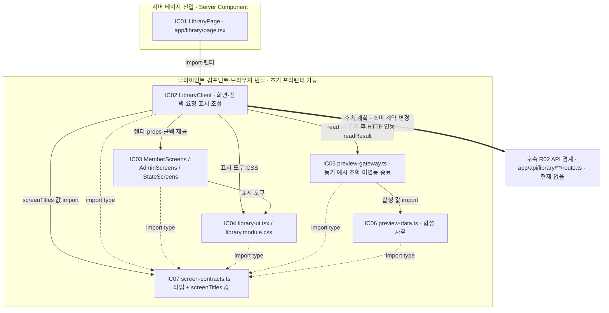

# 도서관리 시스템 — OOD 설계 초안

2026-10-04 작성 · 2026-10-05 SD 경계·기획 보충 · EDGE · `Namedo/Book-Management` · **구조 설계·OOD 초안 / 실제 업무 코드 미구현 / 운영 업무·실연동 검증 보류**

> **최신 기획 보충:** 전체 로컬 문서/실제 구현을 대조해 [§10](#increment-plan)에 증분의 착수·완료 증거, [§13](#implemented-components)에 실제 모듈 관계와 서버 연동 변경 범위, [§14](#planning-supplement)에 필요성 판정·채택/생략 근거를 보충했다. 프론트 검증 재개와 최신 실제 결과는 [케이스 §4](library-management-skeleton-cases.md#4-2026-10-05-실행-검증-재개)를 따른다. 과거 ‘실행 검증 보류’를 현재 프론트에 다시 적용하지 않는다. 이번 기획 작업에서는 실행 검사를 하지 않았다.

> **SD 상세화 범위:** 사용자의 2026-10-05 요청에 따라 §12에서 SD의 공통 처리·경계를 상세화했다. 여기서 SD는 SASD의 구조 설계/구조도이고, §2.1의 SD01~06은 설계 결정 ID다. 기존 §1~11의 ‘앱 코드/Figma 변경 없음’은 당시 OOD 작업의 기록이며, 후속 화면 계약·Figma 정비·예시 데이터 기반 프론트 껍데기 범위를 금지하는 뜻으로 확대하지 않는다. 실제 인증·QR·업무 판정·저장·사진 처리·발송과 CF48~55·TV01~07의 운영 업무/실연동 제한은 유지한다.

> **후속 구현 연결:** [UI 기록 §10~13](library-management-ui-draft.md#screen-implementation-trace), [뼈대 기록 §6](library-management-skeleton.md#frontend-shell), [UC 기반 케이스](library-management-skeleton-cases.md)를 작성했다. R01의 DTO·화면·로컬 입력/선택·예시 조회·미연동 명령/결과 조회 경계는 실제 파일에 있다. R02~12의 운영 책임·공통 U 후보·SC02 권한 강제·SC04 최종 처리·SC08 외부 효과는 미구현이다. 아래 §1~11의 예정 위치/당시 제외 범위는 역사와 후속 서버 설계이며 프론트 껍데기까지 미구현이라는 뜻으로 재사용하지 않는다.

## 1. 목적·기준선·이번 범위

사용자의 “이제 그러면 설계 해야겠구나. 공통기능 구현했을 때 처럼 하면 될듯” 요청에 따라, 기존 요구 분석과 교정된 Figma 초안을 구현 가능한 책임·계약으로 옮긴다. 공통 기능 작업의 [작은 검증 함수 계약](library-management-validation-utils.md)과 [뼈대의 책임·호출·영향 기록](library-management-skeleton.md) 형식을 재사용한다. 공통 유틸 U01~U14/O01~O04는 현재 **후보·미구현**이며, 구현된 라이브러리로 가정하지 않는다.

- 정본: [현행 분석 §5~10·12](library-management-analysis.md), [상세 UC](library-management-use-cases.md), [가정 대장](library-management-assumptions.md), [보류 목록](library-management-confirmation-required.md). 이 문서의 OP/SR/DD/INV/TC 번호는 각각 `*-LIBRARY-*`의 축약이다.
- UI 근거: [Figma 초안 기록 §9](library-management-ui-draft.md#9-사용자-지적에-따른-공통-목록-교정). Figma는 화면·상태 표본이며 입력/저장/권한의 구현 증거가 아니다.
- 구조적 열람 자료: [DFD·SASD 관점·프로세스 명세](library-management-process-model.md)·[CDFD 도면](library-management-dfd.html). 레벨0 전체 맥락 → 레벨1 주요 처리1~6 → 레벨2 각 주요 처리의 분해 → 레벨3 자료 정리4.4의 상세를 기존 OP·DD·책임에 연결하고 데이터/제어 흐름·제어 명세를 구분한다. 별도 구현·새 정책 확정이 아니다.
- 산출물: 책임·호출 방향, 논리 저장 모델, 입력/출력·오류, 권한, 경합·멱등성, 외부 실패·삭제 수명, UI 바인딩, 구현 순서·추적·설계 리뷰.
- 제외: 업무 구현, 의존성 설치, 계정·설정 발급, 실제 자료 변경, 배포, Figma 재편집. 앱/모델 실행·테스트·타입 검사·린트·빌드·실연동 검증을 하지 않는다.
- 범위 변경: 이전 인계의 **전체 OOD 보류만 최신 설계 요청으로 해제**한다. CF48~55의 해당 업무 구현 및 테스트 보류는 유지한다. 분석 후보를 제품 정책으로 승격하지 않는다.
- 시작점: HEAD `ade092b3e71b061da31cba24d912a7cd43c85369`. 기존 BentoNav 변경, 미추적 AGENTS/docs/library 뼈대를 보존한다. 아래 파일·심볼은 별도 명시가 없으면 **예정 위치**이며 생성하지 않았다.

현재 앱은 Next 14.2.3·React 18·TypeScript·App Router이다. `googleapis`·`next-auth`는 의존성에 선언돼 있지만 도서 인증/쓰기 구현은 없다. 공개 게임 CSV의 행 제외·1시간 캐시·오류를 빈 결과로 바꾸는 방식과 ReviewModal의 응답 확인 없는 성공 처리는 도서 업무에 복사하지 않는다.

### 방법 선택

P02의 **기능 명세에 위험 항목 추가**로 분류한다. 이번 실행은 설계 산출물까지이며 기존 Planning/OOA를 다시 수집하지 않는다.

| 방법 | 선택·대안과 이유 | 산출물·이번 판정 범위 |
| --- | --- | --- |
| P01/P02/P06·M03 | 사용자 목표별 증분, 기존 분석 대조. 새 요구 조사·전체 사이트 소급 문서화 생략 | §1/10/11; 상태·출처와 설계 대조 |
| D01~D03 | 기존 Next 앱 안의 함수/모듈 + 외부 저장 경계. 별도 마이크로서비스·기계적인 클래스 UML은 불필요 | §2; 책임표와 호출 방향 |
| D04/D05 | TypeScript 계약표·서버 권한. 새 OpenAPI/검증 프레임워크보다 기존 스택에 적합 | §4/5; 직접 호출·민감 필드 경계 |
| D06/D07 | 논리 레코드·독립 수명 + 단일 쓰기 조정 경로. Sheets의 PK/FK/CAS를 가정하지 않음 | §3/6; 실제 원자성은 TV01 의존 |
| D08/D09 | 외부 결과 재확인·제한 재시도·개인정보 no-store. 큐 제품/캐시 서비스 신규 도입은 보류 | §7/8; 실행 예산은 TV04/07 의존 |
| D10~D12 | 소비자가 있는 공통 후보만 사용, 기존 표시 패턴 재사용, 업무 구현은 별도 증분 | §2/9/10; 설치·코드 변경 없음 |
| T01~T03에 해당하는 계획 | 기존 TC의 경계·상태·실패/경합 입력군을 책임에 연결 | §10/11; 실행 결과를 작성하지 않음 |

## 2. 책임 배치와 기술 결정

### 2.1 기술 결정 기록

아래 SD는 개발자가 고른 **설계 선택**이며 사용자에게 확인받은 업무 규칙과 구별한다. 조건부 결정은 기술 검증 전 배포 가능한 확정 구조로 보고하지 않는다.

| ID·상태 | 결정·기각 대안 | 비용·근거·재검토 조건 |
| --- | --- | --- |
| SD01 · 설계 선택 | 기존 Next 앱의 Server Page/Client UI/Route Handler를 유지. 업무 규칙은 순수 함수, 외부 호출은 서버 모듈로 분리 | 화면마다 규칙 복제·전체 앱 재작성보다 영향 작음. 실제 호출부가 없으면 추상 계층을 더 만들지 않음 |
| SD02 · 조건부 채택안 | Sheets를 업무 자료, Drive를 처리 사진 저장 후보로 유지. 사이트의 모든 상태 변경은 **하나의 쓰기 조정자**를 통과 | 직접 Sheets 쓰기 + Next 메모리 mutex는 INV01/03/06을 충족하지 못함. 조정자의 영속 미결 상태·재시작 복구는 TV01/07 통과 전 미검증 |
| SD03 · SD02의 우선 기술 후보 | 한 Apps Script 프로젝트의 `getScriptLock()` 범위에서 원본 재읽기→업무 판정→Sheets batch 변경. 웹·예약·재처리 모두 같은 진입점 사용. 영속 진행 gate를 먼저 확인 저장하고 불명 쓰기는 해제하지 않음 | 작은 자료량에서는 전역 직렬화가 책/프로필별 분산 잠금보다 단순. 같은 프로젝트·동일 비공개 spreadsheet의 공동 확정 범위, 인증된 호출, gate의 재시작/응답 손실 복구·실행 제한을 TV01/07에서 검증해야 함. 불가능하면 저장 결정 재검토; 잠금 없는 쓰기로 대체하지 않음 |
| SD04 · 설계 선택 | 회원은 불투명 쿠키→독립 프로필, 관리자는 별도 인증 세션→현재 계정 역할 | 회원 로그인·학번 병합·쿠키 복구 추가 없음. 관리자 계정 발급/연결 CF52는 별도 보류 |
| SD05 · 인증 후보 | 마스터 인증은 설정 기반 계정 + 서버 비밀번호 검증 + 불투명 세션. 비밀번호 해시는 Node 비동기 scrypt 후보 | 새 OAuth 가입 요구를 만들지 않음. 인증 구현체·비밀 주입·해시 비용·rate limit 저장은 TV03/07에서 확인. `next-auth` 설치 사실만으로 기능 준비를 주장하지 않음 |
| SD06 · 설계 선택 | 현재 값/당시 snapshot/삭제 후 최소 작업 결과를 분리. 전체 이벤트 소싱·삭제 원본 아카이브를 만들지 않음 | 개인정보 삭제 의미와 프로필/제재의 독립 수명을 보존. 장기 정책 이력/프로필 만료 CF53/54 확정 전 자동 정리 없음 |

Apps Script 문서는 script lock이 해당 스크립트의 동시 실행을 막으며, 실제 취득 호출이 필요하다고 명시한다. Sheets 문서는 한 batch 요청의 변경이 함께 적용되지만 공동 편집 때문에 최종 값이 달라질 수 있다고 명시한다. **둘을 조합해 정상 사이트 명령을 직렬화하는 것은 이 설계의 추론·후보**이고, 사람의 직접 편집까지 잠가 주는 보장이 아니다. [LockService](https://developers.google.com/apps-script/reference/lock/lock-service), [Sheets batchUpdate](https://developers.google.com/workspace/sheets/api/reference/rest/v4/spreadsheets/batchUpdate).

### 2.2 모듈·함수의 책임

경로는 `game-dev-club-site/src/` 기준이다. 같은 책임의 연산은 함수로 함께 두고, 아래 표를 함수마다 파일 하나를 만드는 지시로 해석하지 않는다.

| 설계 ID·예정 위치/심볼 | 입력 → 출력·책임 | 의존·금지 책임 |
| --- | --- | --- |
| R01 `components/library/` · `LibraryClient`, `RecordTable`, `LoanDetail`, `CleanupPanel` | 명시적 DTO·선택 ID → 화면/사용자 명령. 요청 상태·필드 오류·현재 선택 표시 | 서버 권한/기한/점유 판정 안 함. Figma 표본 ID를 운영 ID로 사용하지 않음 |
| R02 `app/api/library/**/route.ts` · 요청 경계 | 원시 요청 → 검증된 입력·ActorContext → 서비스 결과·HTTP. multipart 제한, CSRF, 응답 필드 제한 | Sheet/Drive 주소·비밀 노출, `as Type`만으로 검증, 외부 결과를 무조건 성공 처리 금지 |
| R03 `lib/library/server/access.ts` · `resolveBorrower`, `requireAdmin`, `requireMaster`, `requireOwnedLoan` | 쿠키/세션 + 현재 서버 자료 → 검증된 안정 참조 또는 거부 | 학번/이메일 일치로 소유 설정 금지. 클라이언트 role 신뢰 금지 |
| R04 `lib/library/domain/rules.ts` · `canBorrow`, `canRenew`, `canReturn`, `calculatePenalty`, `resolveSelection` | 검증된 상태·정책·Clock/QR → 허용/이유 또는 미결 정책 | 네트워크·쿠키·React·저장 없음. 신규와 연장의 차단 조건을 합치지 않음 |
| R05 `lib/library/domain/time.ts` · `projectLoanTime`, `countFrozenMidnights`, `evaluateOverdue` | DateOnly/Instant·기준 기한·동결·발생 근거 → 시간 투영 | 날짜 진행과 정확한 제재 시간을 분리. CF49/51/55는 §8 계약으로 분리 |
| R06 `lib/library/server/commands.ts` · OP03~18/29/30 조정 | ActorContext·정규화 입력·attempt → 저장 계획/대상별 결과 | 현재 권한·시간·버전·사후조건 재검사. API 핸들러별 직접 외부 쓰기 금지 |
| R07 `lib/library/server/queries.ts` · OP01/02/19/25/26 | 검증 범위·조회 조건 → 공개/회원/관리 DTO | OP22 관측 처리와 순수 조회를 구분. 손상 행 탈락을 정상 빈 결과로 바꾸지 않음 |
| R08 `lib/library/server/store.ts` · `LibraryStore`, `MutationCoordinator` | 범위별 유효 snapshot·저장 계획 → 확인된 저장/충돌/불명 | IDs·관계·버전·자료 상태 검증. 특정 API가 transaction/CAS를 지원한다고 추정 금지 |
| R09 `lib/library/server/photos.ts` · `preparePhoto`, `readProtectedPhoto`, `readCatalogPhoto`, `replacePhoto`, `deleteArtifacts` | 파일·book/Loan의 별도 사진 세대·허용 주체 → 처리 사진/참고값/실제 파일 결과 | 등록 사진은 공개 서지, 대출 증빙은 관리자 보호 자료. EXIF는 증빙 참고, 사전 승인 아님. 원본 기본 보관·공개 Drive 링크 금지 |
| R10 `lib/library/server/operations.ts` · `beginAttempt`, `getOutcome`, `reconcileAttempt` | 주체·OP·멱등 키·payload 지문 → 최초 시도/기존 최소 결과/충돌 | OP24는 새 업무 실행 없음. 삭제한 Loan의 전체 응답 사본 보존 금지 |
| R11 `lib/library/server/notifications.ts` · `verifyEmail`, `planOccurrences`, `dispatchOccurrence` | 현재 프로필/Loan·발송 사건 → 후보/중단/제출/불명 | 주소 확인과 로그인 분리. CF50/51/55 해석 없는 발송 활성화 금지 |
| R12 `lib/library/server/runtime.ts` · `Clock`, `ExecutionContext`, `ProviderBudget` | 운영/격리 환경 → 현재 시각·저장/수신 대역·한정 실행 예산 | 브라우저가 운영 시각/fixture를 선택할 수 없음. OS 시각 변경 금지 |

공통 U02/03/04/05/06/07/08/09/10/12/13/14는 실제 소비자가 생기는 곳에서 선택한다. 학번의 9자리 문자열, 이름의 **모든 공백 제거**, 대출 허용, 정지 날짜, 제재, QR, 소유는 업무 함수의 책임이다. U13의 선언 MIME/크기는 사진 내용 검사 R09를 대신하지 않는다. 표준 `trim/filter/Set/Map` 한 줄을 호출마다 공통 래퍼로 만들지 않는다.

호출 방향은 UI → R02/R07 → R03/R06 → R04/R05 + R08~12이다. Apps Script 후보를 채택하면 **잠금 안에서 최신 상태를 읽고 규칙을 다시 평가하는 조정자**가 필요하다. Next에서 만든 변경안을 무조건 저장하는 gateway나 여러 HTTP 요청에 걸쳐 lock을 빌려 쓰는 구조는 사용하지 않는다. 순수 규칙의 공유 소스/스크립트 실행용 산출물은 후속 구현에서 정하며, 현재 번들·빌드를 만들지 않았다.

## 3. 데이터·키·독립 수명 설계

### 3.1 공통 표현과 논리 레코드

`Id`는 서버 발급 불투명 문자열, `DateOnly`는 엄격한 `YYYY-MM-DD`, `Instant`는 UTC ISO 시각 문자열이다. 서비스 달력 계산/표시는 `Asia/Seoul`로 고정한다. 카운트/버전/일수/정수 시간은 안전 정수다. 행 번호·제목·학번·이메일은 PK가 아니다. 생략/null/빈 문자열을 자동으로 같은 값으로 저장하지 않는다.

아래는 논리 레코드와 **Sheets 탭 후보**다. SQL 제약이 구현됐다는 뜻이 아니다. 함께 확정할 업무 자료와 Attempts/Occurrences/Barriers는 **동일한 비공개 spreadsheet의 논리 탭**에 둬야 한 batch 후보가 성립한다. 탭 숨김/보호를 읽기 권한 분리로 간주하지 않는다. spreadsheet는 공개 게시/CSV 없이 서버와 허가된 운영자만 접근하며, 운영자의 직접 편집은 Q28의 외부 수정 경계다. password verifier·서버 서명 비밀·암호화 비밀은 서버의 별도 비밀 영역에 두고 Sheet에는 비밀의 참조만 둔다. gate는 Script Properties 후보이며 업무 원자 batch 밖의 선행 제어다(§6.1). 여러 spreadsheet/저장소로 원자 집합을 나눌 필요가 생기면 SD03을 재설계한다. 실제 계정/권한·저장 배치는 TV01/03에서 확인한다.

| 데이터 ID·키/유일성 | 필수 핵심 값·nullable | 관계·저장/삭제 계약 |
| --- | --- | --- |
| E01 Books · `bookId` | 제목/저자/분야, hidden/newBorrowDisabled, revision; 등록 사진 ref/generation/status 선택 | Book 1 : Loan 0..N. 사이트 확정 active 0..1. 숨김/신규 불가와 점유/불확실을 분리. 제목 변경은 과거 snapshot 변경 없음. 선택 등록 사진은 별도 수명이며 LoanEvidence로 복사/대체하지 않음 |
| E02 BorrowerProfiles · `borrowerRef` | recentStudentNumber/name 선택, 현재 이메일/확인 상태·수신 설정, revision | Loan/Penalty/Access 0..N. 최근 값은 프로필에만 종속. 마지막 Loan/Access 삭제로 연쇄 삭제 없음. CF54 보관 종료 미정 |
| E03 AccessGrants · `accessId`, tokenDigest 유일 | borrowerRef, lastSeenAt/expiresAt/revokedAt?, revision | Access 1 : Profile 1. 평문 토큰은 쿠키에만. 서버 만료 검사·접속 갱신 AS092. 접근 유실이 profile/loan 참조 null화를 만들지 않음 |
| E04 Loans · `loanId` | bookId, borrowerRef(미연결 보충만 null), origin, borrowedAt/sourceTime, 당시 학번/이름·책 snapshot, dueDateBase, renewalCount, returnedAt?, revision | Loan 1 : Book 1; Profile 0..1. active/returned를 저장하고 removed는 원본 제거 후 최소 제어 결과에서만 표현. 단일 상태 문자열에 frozen/overdue/photo를 합치지 않음 |
| E05 LoanTime · `loanId` | 최초 연체 근거(없음/확인됨/불명), firstOverdueAt?, 누적 진행 근거/해석 버전 | Loan 1 : Time 1. 이미 발생한 근거 보존. CF49/55 수식은 값 없이 추정하지 않음. Loan 삭제 후 전체 날짜 이력 아카이브 없음 |
| E06 Freezes · `freezeId` | loanId, reason, startedAt, resumedAt?, revision | Loan 1 : Freeze 0..N. 사유별 독립. 종료 구간은 현재 기한 계산에 필요한 동안 유지, Loan 제거 때 부속 자료 제거 |
| E07 LoanEvidence · `loanId`, generation | 처리 파일 ref/직접 만든 이미지 사본 refs/파일별 상태, 촬영 참고값?, reviewStatus, note?, bookIdAtReview | Loan 1 : Evidence 0..1. 사진만 삭제는 참고값/검토/메모 유지. 성공 교체는 이전 조합 정리·새 generation/pending. DB 포함 삭제는 함께 제거. 원본은 artifact 목록에 보관하지 않음 |
| E08 Penalties · `penaltyId` | borrowerRef, sourceLoanId?, firstReturnAt, policyVersion/durationHours, expiresAt, clearedAt?, reason? | Profile 1 : Penalty 0..N. sourceLoan 제거 시 참조 null 또는 삭제된 ID의 최소 근거만 유지. 학번/이름/책/사진 사본 없음. 기존 expiry 불변 |
| E09 PolicyState/PolicyChanges · `policyVersion`, `changeId` | 유효 설정, 변경 전후 대응/시각·출처, 활성 버전 포인터 | 값+대응 기록+활성 전환을 함께 확인. 신규/연장 기간, 시간창·금지일·권수/N·제재/알림 규칙 의미를 보존. CF53 이후 전체 이력 조회/정리 미정 |
| E10 AdminAccounts · `accountRef`, loginId 유일 | 현재 master/admin/none, credentialVerifierRef, revision | master 1. 재시작 시 존재 확인/불일치 거부, 매번 새 계정 생성 금지. 비밀번호 해시/비밀은 업무 표/응답 밖. CF52 발급·회원 연결 없음 |
| E11 AdminSessions · `sessionId`, tokenDigest 유일 | accountRef, createdAt/expiresAt/revokedAt? | 계정 수명과 세션 수명 분리. role을 세션의 영구 권한으로 사용하지 않음. 종료는 해당 관리자 세션만 폐기 |
| E12 EmailProofs/PushSubscriptions · `proofId`/`subscriptionId` | 원 profileRef·주소/설정 revision, proofDigest/expiresAt/consumedAt?; 구독 endpoint·키·상태 | 오래된 주소 확인이 새 주소/해제를 덮어쓰지 못함. 비공개 저장. 구독 key/확인 토큰을 로그/목록에 반환하지 않음 |
| E13 Attempts · `(actorScope, OP, attemptRef)` 유일 | payloadFingerprint, target IDs/revisions, 최초 사건 시각/정책, 단계·효과 식별/최소 결과 | 진행 중 대상 barrier. 완료 결과는 개인정보 없는 참조/상태 중심. 삭제 후 재확인은 원본 재구성 없음. 확정 결과 tombstone 제거/키 재사용은 별도 설계 전 자동 실행 없음 |
| E14 Occurrences · `occurrenceId`, semanticDedupKey 유일 | Loan/규칙·채널/기한 세대, 예정 의미, queued/held/stopped/submitting/submitted/failed/unknown | 전송 payload를 영구 별도 보관하지 않음. DB 제거 후 중단·최소 결과. 미연결 Loan에 프로필 수신 자동 연결 없음 |
| E15 Observations/Barriers · 자원 ID·작업 ID | 이전 active 최소 근거(bookId/loanId/profileRef), 관측 시각·오류 위치·차단 범위 | 외부 삭제 관측과 미결 결과 확인용. 전체 Loan/사진 복사본 없음. 필요할 때 독립 제재/프로필만 직접 참조 |
| E16 WriteGates · `writeRef` 유일 | attemptRef·저장 단계·실행 세대, 판정/쓰기 의존 자원 ID·범위, pending/confirmedNotApplied/confirmedApplied | Script Properties의 선행 제어 후보. 원본 입력/사진/개인정보 없음. 이전 단계의 늦은 완료가 새 단계 gate를 해제하지 못함. TV01/07의 용량·신선도·재시작 확인 필요 |

논리 유일성·참조/필수/상태 규칙은 R08이 읽을 때 검사하고 R06/R08이 쓰기 확정 때 재검사한다. 중복 active는 하나를 `uniqueBy`로 버려 정상화하지 않는다. 정상 자료의 `bookId→현재 책 값`, `borrowerRef→최근 프로필 값`, `loanId→당시 입력/사건`을 분리한다. snapshot은 당시 사실 보존 목적이며 현재 값의 중복 캐시가 아니다. 물리 탭/열·셀 타입·권한·migration은 TV01 이후 확정하며 “3NF/DB 제약 완료”를 주장하지 않는다.

### 3.2 독립 상태와 투영

| 축 | 저장/출력 의미 | 금지되는 추론 |
| --- | --- | --- |
| 수명 | active / returned; 제거 이후 원본 없음 | terminated Loan을 지연 작업으로 active 복원 |
| 진행 | running / frozen + 종료 구간의 합집합 | frozen이면 점유·권수 0 |
| 연체 | 현재 경계 경과 / 과거 발생 / 확대 유예 / 누적 진행을 별도 값으로 반환 | 기한 비교 boolean 하나로 과거 연체 삭제, 유예 중 차단 규칙을 임의 확정 |
| 제재 | profile별 여러 건, `now < expiry && clearedAt=null`인 종료의 최댓값 | 여러 기간 합산, Loan 제거로 제재 해제 |
| 사진/검토 | present/permanentlyDeleted/trashed/missing/unknown + pending/match/mismatch/unverifiable | 사진 없음=DB 불확실, pending=대출 미승인 |
| 자료 신뢰 | valid / invalid / unavailable / writeUncertain, 영향 book/profile/policy 범위 | 읽기 실패=정상 0건, 전체 cookie 자동 차단 |
| 작업 결과 | confirmed / rejected / verifying / partial | partial/unknown을 전체 완료 또는 확정 실패로 표시 |

## 4. 함수·경계 계약

### 4.1 공통 성공/실패 형식

아래 TypeScript는 **설계 타입 초안**이다. 컴파일·코드 생성·테스트를 하지 않았다. 범용 `ValidationResult<T>`와 업무/외부 결과를 섞지 않는다.

```ts
type ActorContext =
  | { kind: 'public' }
  | { kind: 'borrower'; borrowerRef: string; accessId: string }
  | { kind: 'admin'; accountRef: string; sessionId: string }
  | { kind: 'worker'; executionRef: string; environment: 'production' | 'fixture' };

type Rejection = {
  code: string;
  fields?: readonly { path: string; code: string }[];
}; // 원문 값·token·사진·내부 stack을 포함하지 않음

type CommandResult<T> =
  | { status: 'confirmed'; attemptRef: string; value: T }
  | { status: 'rejected'; attemptRef?: string; error: Rejection }
  | { status: 'verifying'; attemptRef: string; effects: readonly EffectResult[] }
  | { status: 'partial'; attemptRef: string; items: readonly TargetResult[] };

type EffectResult = {
  resource:
    | 'book' | 'loan' | 'penalty' | 'photo' | 'policy' | 'notification'
    | 'profile' | 'access' | 'adminAccount' | 'adminSession'
    | 'qrConfirmation' | 'emailProof';
  ref: string;
  state: 'confirmed' | 'failed' | 'unknown' | 'notStarted';
  detail?: 'permanentlyDeleted' | 'trashed' | 'absentConfirmed';
  error?: Rejection;
};
type TargetResult = {
  targetRef: string;
  effects: readonly EffectResult[];
};
```

`ActorContext`는 R03 또는 신뢰된 실행 경계만 생성한다. admin의 role은 현재 자료에서 매번 확인한다. 결과 DTO는 대상 화면별로 제한하고, `value` 전체를 Attempts에 복사하지 않는다. `partial`은 확인된 효과와 실패/불명을 함께 표시하며, 남은 작업이 있는 대상을 전체 성공에 포함하지 않는다.

### 4.2 업무 함수의 입력·출력·실패

| 계약 ID·함수 | 정규화된 입력 → 정상 출력 | 거부/불명·저장 금지·관련 |
| --- | --- | --- |
| C01 `resolveBorrower` | tokenDigest·시각 → accessId/profileRef·만료 갱신 계획 | 없음/실효 시 타인 검색이나 학번 복구 없음. 최초 profile/access 생성은 둘 다 확인한 뒤에만 cookie 발급. DD03/29·INV02 |
| C02 `canBorrow` | book·profile별 active 집계/제재·현행 policy·시각·희망일 → 허용/최장일 | hidden/disabled/occupied·불확실·권수·연체/제재 차단·시간/금지일/범위 검사. 권수 -1/0과 기존 초과를 구분. OP03/INV01/03/05 |
| C03 `canRenew` | 소유한 Loan·대상 시간 투영·현재 N/일수·QR·시각 → 새 base/count | 대상 기한/연체·hidden·소유·시간·QR·N 검사. 신규 대출 불가(disabled)만 설정되었거나 다른 책 연체/제재/권수 초과만 있으면 거부하지 않음. CF49에 해당하는 상태의 결합 판단만 미정. OP13/INV06 |
| C04 `projectLoanTime` | dueDateBase·freeze intervals·관측 시각 → 투영 기한/배타적 경계/진행·과거 연체 | 같은 서비스 자정은 합집합으로 한 번 계산, `start < midnight <= observed/resumed`. 해제되지 않은 동결의 미래 기한을 확정하지 않음. AS003/DD08~12·INV07/08 |
| C05 `canReturn` / `calculatePenalty` | 소유한 active/관리 권한·시각·실물 확인 + 기존 연체 근거·반납 시점 정책의 제재 기간 → 최초 반납/필요 제재 | 회원은 시간/금지일 검사, 관리자는 면제. 연체 근거가 불명이고 필요 판정이 확인되지 않으면 원본을 파기하지 않음. expiry=최초 시각+비음수 정수 시간, 0은 새 제재 없음. OP04/10/12·INV09/10 |
| C06 `changePolicy` | 유효한 값·expectedVersion → 새 version+대응 change+active | 동시 변경은 conflict, 값만 저장/unknown이면 기존 유효 policy 유지. 신규 기간 변경으로 과거 due를 바꾸지 않고 기존 penalty expiry도 유지. OP07/DD27 |
| C07 `resolveSelection` / `previewCleanup` | 대상 종류·filter/include/exclude·scope → ID/revision snapshot·경고·건수 | include null=전체 후보, []=없음, exclude 우선. 제목/동명으로 선택하지 않음. 정리 대상은 미리보기 snapshot에 고정하고 실행 시 재검사하며, 예외 대상은 실행 시작 때 고정. OP11/12/15~18·INV11 |
| C08 `correctLoan` | 대상 revision·허용 field만·reason → 지정 값/관계만 변경 | unknown field 거부, 변경할 book의 점유 재검사, borrowerRef 유지, 사진/book 조합 변경 시 pending. 반납 완료→active 정정은 일반 수정과 별도 명시적 확인. OP09/INV01/04 |
| C09 `recordSupplementalLoan` | book·확인한 과거 시각/예정일·기록용 identity·reason·선택 photo → unlinked Loan | 현재 점유 검사, 기간/시간의 회원 제한은 적용하지 않음. profile 생성/이름 대조/자동 알림/회원 penalty 없음. OP14/AS090·INV17 |
| C10 `applyException` | target snapshot·각 revision·days 또는 freeze/penalty IDs·reason → 대상별 결과 | 나중에 생긴 새 Loan을 추가하지 않음. resume는 선택 freeze만, clear는 선택 penalty만, 관리자 연장은 회원 count 유지. CF49에 의존하는 판정만 보류. OP15~18 |
| C11 `preparePhoto` / `reviewPhoto` | 원본 이미지 내용·10MiB 상한/Loan evidence generation·book → 처리 이미지/참고값/검토 | 서버 내용/형식 검사, 변환 전 EXIF 추출, 가능한 압축/변환 뒤에만 보관. 원본/부적합 file 보관 없음. 검토 시 generation 불일치는 409. OP03/08/09·INV12/20 |
| C15 `saveCatalogPhoto` / `readCatalogPhoto` | bookId·book 사진 generation·선택 등록 파일/현재 공개 허용 상태 → 등록 사진/교체 결과/공개 이미지 | 등록 사진 없음은 정상. 내용 검사/처리만 C11과 공유하며 증빙 참고값·사후 검토·Loan 관계는 만들지 않음. 새 사진 확인 전 기존 등록 사진 유지, 교체 후 이전 파일 정리 실패는 partial. 관리자 입력/공개 서지 출력 분리. OP06/SR024/TC001·018 |
| C12 `updateProfile` / `confirmEmailOwnership` | profile revision·최근 값/현재 address revision에 연결한 proof → 최근 값/확인 상태 | 과거 Loan 변경 없음. 다른 browser의 확인은 원래 profile만 갱신하며 접근 권한을 부여하지 않음. 이전 proof가 주소 변경/해제를 되돌리지 않음. OP05/27~29·INV18 |
| C13 `revalidateExternalData` | raw rows + 최소 이전 관측 → valid 범위/문제 위치·관측 사건 | 원래 행 삭제/자동 중복 제거 없음. 이전 active가 확인된 직접 삭제는 최초 관측 반납으로 처리하며 새 제재 없음. 이전 상태가 불명이면 해당 책 보류. OP22/INV13 |
| C14 `getOutcome` | 검증된 시도 소유자/현재 admin·attemptRef → 최소 상태/다음 동작 | 타인 결과/존재 노출 없음. 결과 확인 조회는 새 Loan/penalty/발송/삭제를 만들지 않음. OP24/INV14/18 |

### 4.3 HTTP와 입력 경계

외부 HTTP는 Next Route Handler가 받고, 내부의 같은 서비스는 Server Page/허용된 worker에서 호출할 수 있다. 기본 prefix는 `/api/library`다. Path ID와 본문 모두 미검증 데이터로 취급한다. JSON의 미정의 field는 거부하고, PATCH에서 생략한 field는 유지하며, nullable로 허용된 field의 null만 값 제거를 뜻한다. `expectedRevision`은 사이트의 오래된 편집을 거부하는 조건이며 Sheets의 CAS가 아니다.

| OP | method/path 후보 | 주요 입력·출력/역할 |
| --- | --- | --- |
| C01 하위 경계(기존 진입 OP의 접근 준비) | POST `/access` | 최초 profile/access 생성 또는 기존 접근 확인·갱신. 둘 다 확인된 뒤에만 cookie 발급하며 새로운 제품 OP를 추가하지 않음 |
| 01/25 | GET `/books` · GET `/admin/books` | query/category/filter·공개 가용 DTO 또는 관리 전체 DTO |
| 02/26 | GET `/me/loans` · GET `/admin/records` · GET `/admin/loans/:id` · GET `/admin/penalties` | 본인/관리자로 제한한 목록·상세, 정상 0건과 읽기 실패 구분 |
| 03 | POST `/loans` (multipart) | bookId/학번/이름/dueDate/사진/attemptRef. confirmed일 때만 201과 새 Loan 참조 |
| 04/10/13 | POST `/loans/:id/return` · `/admin/loans/:id/return` · `/loans/:id/renew` | 확인/관리 reason·physicalConfirmation/QR proof·attemptRef |
| 13의 QR 확인 하위 경계 | POST `/qr-confirmations` | 유효한 access + 현재 QR 값 → 해당 access/profile에 연결한 서버 확인 자료·확인/만료 시각. OP13의 서버 연장 검사에서 재확인 |
| 06/08/09/14 | POST `/admin/books` · PATCH `/admin/books/:id` · POST `/admin/loans/:id/review` · PATCH `/admin/loans/:id` · POST `/admin/loans` | 허용 fields/revision/reason/attempt. 선택 등록 사진 추가/교체는 OP06, 대출 증빙 교체는 OP09의 multipart 하위 경계 |
| 07/19 | POST `/admin/policy` · GET `/admin/policy/changes` | 값/expectedVersion/attempt. OP19의 과거 종료 history 범위는 CF53 보류 |
| 11/12 | POST `/admin/cleanup/preview` · POST `/admin/cleanup` | scope/selection → previewRef + ID/revisions/경고. 실행은 같은 snapshot/force 확인/reason/attempt |
| 15~18 | POST `/admin/exceptions/{extend,freeze,resume,clear-penalties}` | snapshot/revisions/일수 또는 선택한 사유 ID/필수 reason/attempt |
| 05/27/29 | PATCH `/me/notifications` · POST `/me/email-verifications` · PATCH `/me/profile` | 검증된 소유 profile/현재 설정 revision |
| 28 | POST `/email-verifications/confirm` | 유효 확인 수단 보유자. 현재 회원 cookie 없이도 proof의 원 profile/address revision만 갱신, 조회/접근/복구 권한을 발급하지 않음 |
| 23/30/32 | POST `/admin/session` · DELETE `/admin/session` · POST `/admin/accounts/:id/role` · POST `/admin/accounts` | 인증, 현재 master만 role 관리. 발급/연결 OP32는 CF52 보류 |
| 24 | GET `/operations/:attemptRef` | 해당 시도 소유자/현재 admin·최소 결과, 전체 이력 payload 없음 |
| 08/26 photo | GET `/admin/loans/:id/photo` | 현재 admin + evidence generation 검사·private stream |
| 01/06/25 catalog photo | GET `/books/:id/photo` · GET `/admin/books/:id/photo` | 현재 공개 도서 DTO에 허용된 등록 사진/관리자의 전체 등록 사진. Loan 증빙 ref를 받지 않음 |
| 20/21/22/31 | 격리 시험 제어/내부 예약/관측/장기 정리 실행 경계 | 공개 worker URL 없음. OP20은 fixture 전용, OP21/31은 CF 경계를 따름 |

confirmed 갱신/빈 목록은 200, verifying/partial은 202와 대상별 상태, 입력 구문은 400·크기는 413/형식은 415·의미는 422, 권한은 403, 대상 없음은 404, 오래된 revision/상태/같은 key의 다른 내용은 409, 미정 정책 `POLICY_UNRESOLVED`는 409, 확인된 일시적 이용 불가는 503이다. HTTP 정상 응답이어도 본문의 status가 전체 성공을 뜻하지는 않는다. 기존 session이 없으면 403 `ACCESS_REQUIRED`와 접근 화면 안내로 통일하며, 이 cookie 방식에 임의의 401 challenge를 추가하지 않는다. 외부 쓰기 timeout은 **실패로 확정하지 않고** 202 verifying과 참조를 반환한다. 시도 등록 전 외부에 도달할 수 없다면 503이며 부작용이 없다.

## 5. 접근·표시·보안 계약

- 공개: 가용 도서의 공개 서지/등록 사진만 제공. 대출자·profileRef·Loan 사진/메모·제재·관리 이력·내부 오류를 반환하지 않음.
- 회원: R03의 access→profile만 소유 근거로 삼아 본인 Loan/이력/제재/설정을 제공. 보관 증빙 사진과 내부 memo는 반환하지 않음. Cookie 값/QR 값의 클라이언트 검사를 권한 근거로 삼지 않음.
- 관리: 모든 관리 read/write/사진에서 현재 session + account role 검사. master/admin은 일반 관리, master만 role 변경. 마스터는 일반 승격/박탈 대상에서 제외. 박탈 뒤 이전 session은 다음 요청에서 거부.
- worker: 허용된 실행 ID·환경과 필요한 최소 OP만 사용. 일반 admin session으로 운영 시계/실제 수신/fixture를 전환하지 않음. Apps Script 후보에는 서버 간 서명한 본문·OP/attempt·시각/nonce와 현재 access/session 참조를 전달하며, 브라우저의 role을 신뢰하지 않음. 조정자도 저장 직전 현재 권한 검사.

회원 cookie 후보는 `__Host-edge-library-access`, 관리 cookie는 별도 `__Host-edge-library-admin`이다. 암호학적 난수 token, Secure/HttpOnly/SameSite=Lax/Path=/, Domain 없음으로 설계한다. 일반 cookie 문맥은 하나로 고정한다. 서버는 token digest를 조회해 실효/만료를 검사하고, 회원 접근 시 **달력 2개월·같은 일자가 없으면 말일**(AS092)로 만료를 갱신한다. cookie Max-Age는 새 절대 만료까지의 초 수로 계산한다. 2개월을 60일이나 영구 접근으로 바꾸지 않는다.

연장용 QR 확인은 R03의 서버 경계가 현재 QR 값의 유효성을 검사한 뒤 accessId/borrowerRef·확인 시각·만료 시각에 연결해 발급한다. C03/OP13은 유효한 현재 access와 확인 자료의 서버 발급 근거·대상 일치·`now < expiresAt`을 검사한다. 확인 뒤 **10분간 같은 접근에서 재사용**할 수 있으며, QR 교체/폐기는 이미 받은 확인을 원래 만료 전에 무효화하지 않는다(AS016/Q13). 이후 새 확인은 변경된 QR 기준으로 발급한다. 일반 직접 링크 방문을 QR 확인으로 취급하지 않으며, 확인 자료는 현장 존재나 관리 권한의 보장이 아니다. 확인 자료를 서버에서 검증할 구체 형식은 R03 구현 때 정하고, 형식 선언만으로 검증 완료를 주장하지 않는다.

관리 session의 절대 만료 8시간은 개발자의 초기 후보이며, 로그인 시 발급/재발급하고 종료 시 해당 session을 실효시킨다. 환경 확인 전 TV03 후보이며 사용자의 운영 규칙으로 확정하지 않는다. 설정에서 영속 accountRef와 credential verifier의 위치를 지정하고, 서버 시작 시 기존 ID/role을 초기화하지 않는다. scrypt는 OWASP의 후보 설정을 참고하며 salt/매개변수/hash만 비공개 credential 영역에 보관한다. 실제 Node 버전·메모리 예산·시도 횟수 제한의 영속화가 미확인이라 매개변수 수치를 구현 완료로 고정하지 않는다. [OWASP Password Storage](https://cheatsheetseries.owasp.org/cheatsheets/Password_Storage_Cheat_Sheet.html), [Node crypto.scrypt](https://nodejs.org/api/crypto.html#cryptoscryptpassword-salt-keylen-options-callback).

cookie를 사용하는 변경은 동일 origin 검사 + session/access에 연결한 CSRF token으로 보호하며, GET에서 변경 명령을 실행하지 않는다. 아직 session/access가 없는 최초 접근/로그인은 동일 origin과 서버 발급 초기 요청 확인 자료를 검사하며, 로그인에는 제한된 시도 횟수도 적용한다. 요청 본문을 진단 로그에 복사하지 않고, URL/진단 로그에 password·cookie·이메일 proof·사진·학번/이름 전체를 남기지 않는다. OP22가 GET 전에 관측 사건을 처리한다면 독립 내부 처리로 기록한다.

사진 보호 stream은 role 박탈/대상 삭제/세대 변경을 매번 검사하고 Drive의 비밀 URL을 전달하지 않는다. 모든 본인/관리/사진/operation HTTP와 서버 자료 조회는 private/no-store를 기본값으로 둔다. Next14의 GET 캐시를 명시적으로 비활성화하는 설계이며, 정적 도서 snapshot을 서버 저장 판정에 사용하지 않는다. [Next 14 Route Handlers](https://nextjs.org/docs/14/app/building-your-application/routing/route-handlers).

공개 등록 사진 경계는 현재 공개 서지에 허용된 bookId/generation만 받아 서버에서 이미지를 전달한다. 숨김/권한 변경을 오래된 URL로 우회하지 않도록 기본 no-store를 유지한다. 대출 증빙의 사진 ID/EXIF/메모는 이 경계에 연결하지 않는다. 등록 사진 변경/제거가 과거 Loan 증빙의 수명을 바꾸지 않는다.

## 6. 쓰기·경합·재확인

### 6.1 저장 경계와 최소 능력

R08/MutationCoordinator의 최소 계약은 다음과 같다. **미확인 능력은 TV01에서 판정한다.** interface 선언만으로 보장이 성립했다고 하지 않는다.

1. 사이트에서 시작한 모든 변경(대출·반납·정정·보충·정책·profile·roles·관측·예약의 상태 변경)이 같은 직렬화 영역에 참여한다.
2. lock 안에서 현재 access/role·raw 자료/참조·active 집합·policy·expectedRevision·같은 attempt를 재검사한다. 최종 업무 확정 단계의 서버 시각/정책을 고정한다. 사진 준비·attempt 등록 시각은 최초 대출/반납 확정 시각과 다르며, 업로드 시작 시각/클라이언트 시각으로 허용을 결정하지 않는다. 이미 확정한 사건의 재확인은 원 시각/정책을 재사용한다.
3. 한 업무의 확정은 대응 Loan/제재/점유 근거/알림 중단/attempt 최소 결과를 하나의 원자 확정 단위인 batch로 묶는다. 원자성 지원은 TV01의 확인 대상이며, 별개의 저장 호출 둘을 transaction이라고 하지 않는다.
4. Drive/알림 등 외부 효과 전에 attempt와 관련 자원의 진행 barrier가 **영속 저장되었음을 확인**한다. 저장이 불명이면 외부 효과를 시작하지 않는다. lock 안에서 사진 업로드/메일 완료를 기다리지 않는다.
5. 저장 결과가 불명이면 그 자원과 판정 의존 범위의 정상 변경 재개를 거부하고 pending/불명 자원을 이어받아 대조한다. 기간 만료만으로 barrier를 해제하지 않는다. 프로세스 재시작/lock 자동 해제도 미적용의 증거가 아니다. 독립적으로 정상 확인 가능한 범위는 계속 제공한다.
6. 최초 barrier 저장 자체가 불명인 경우까지 포함하여, **뒤늦게 적용되는 쓰기와 다음 명령이 충돌하지 않는 영속 중단/복구 장치**가 필요하다. 아래 writeRef gate가 후보이며 Apps Script lock만으로 이를 입증할 수 없다. gate의 실제 저장/조회 의미·용량·복구를 확인하지 못하면 SD03을 기각하고 저장 방식을 바꾼다.

**SD03의 영속 gate 후보:** 각 Sheets 저장 단계에 고유 `writeRef`를 부여한다(시도+단계+새 실행 세대). 단일 전역 pending 값을 지웠다 다시 쓰는 방식은 사용하지 않는다. 이전 gate 완료 호출이 늦게 적용돼 다음 단계의 gate를 지울 수 있기 때문이다.

- script lock 안에서 기존 pending gate와 현재 명령의 **판정/쓰기 의존 전체**를 대조한다. 대출은 book+profile 권수, 도서 이동은 이전/새 book+원 profile, 정책·권한·수신은 해당 policy/account/profile까지 포함한다. 의존 범위를 모르면 정상 판정을 추정하지 않는다.
- 고유 gate에 writeRef/자원 범위/pending을 저장하고 다시 읽어 확인한 뒤에만 해당 Sheets 요청을 제출한다. gate 저장/확인 실패는 Sheet 부작용 시작 전 중단이다. 초기 gate 저장이 늦게 도착해 불필요한 보류가 생겨도 업무 쓰기를 무조건 이어서 실행하지 않는다.
- Sheets batch는 업무 변경과 해당 writeRef의 최소 적용 marker를 함께 저장한다. 같은 writeRef의 batch를 SDK·gateway·재시도 계층이 자동 중복 제출하지 않아야 한다. 중복 제출이 아직 진행 중일 수 있으면 marker 하나만으로 gate를 닫지 못한다.
- 응답 손실/실행 종료 후에도 pending은 남는다. 확정 적용 marker와 사후조건, 또는 **확정 미적용** 근거를 확인한 뒤 그 writeRef만 완료로 바꾼다. 한 번의 marker 부재 조회·TTL·서버 재시작을 미적용 근거로 삼지 않는다. 완료 상태 저장 불명도 새 쓰기의 안전 근거로 사용하지 않는다.
- 사이트의 행 이동/정렬/행 삭제·삽입으로 늦은 요청의 주소가 바뀌지 않게 한다. 생성은 AppendCells 후보, 갱신은 현재 ID와 대조한 범위, DB 항목 제거는 업무/부속 필드를 비우는 후보다. 비어 있는 이전 슬롯 재사용을 막는 무작위 rowAnchor만 남길 수 있으며 삭제한 학번/이름/사진/참고값/메모는 남기지 않는다. 목록은 빈 업무 슬롯을 제외하되 손상된 업무 행을 빈 것으로 숨기지 않는다. 원본의 사람 편집/행 이동은 Q28의 보장 밖이며 이후 검증한다.
- pending gate가 걸린 자원·공유 판정 범위는 보류하되 다른 정상 조회/업무는 계속한다. gate 저장소를 읽을 수 없어 범위를 판단할 수 없는 경우에는 그 판단에 의존하는 쓰기뿐 아니라 **가용성·권수·현재 역할 등 조회/권한 판정도 불확실 또는 거부**로 반환한다. active 행이 아직 보이지 않는다는 이유로 책을 가용으로 표시하지 않는다. 독립 확인 가능한 서지 등 조회는 계속하며 원본 조회를 정상 빈 값으로 바꾸지 않는다.
- 완료 gate/marker의 안전한 정리와 용량 한계는 TV01/07에서 정한다. 불명 gate를 용량 확보용으로 지우지 않으며, 안전한 gate를 먼저 만들 수 없으면 새 쓰기를 시작하지 않는다. 공개 복구 버튼으로 운영자가 결과를 추정해 잠금을 풀게 하지 않는다.

Properties Service의 script 범위 key/value 저장과 Sheets의 AppendCells/UpdateCells는 공식 API 기능이다. 위 순서·gate 수명·행 주소 제약의 조합은 **설계 후보의 추론**이며 영속 일관성/장애 복구의 실행 증거가 아니다. TV01은 최초 gate 저장/완료 저장 불명, 서버 종료, 중복 호출, 미결 중 다른 자원 작업, 행 삭제/주소 안정성까지 확인해야 한다. [Apps Script Properties Service](https://developers.google.com/apps-script/guides/properties), [Sheets 요청 종류](https://developers.google.com/workspace/sheets/api/reference/rest/v4/spreadsheets/request#appendcellsrequest).

따라서 이번 산출물은 **논리 OOD 초안**이며, Sheets 구현의 전체 실현 가능성 통과가 아니다. 물리 저장 후보를 실행할 수 없는 테스트 보류 상태에서 메모리 lock이나 읽기 직후 쓰기를 대체 보장으로 삼지 않는다.

### 6.2 동시 사건·허용 결과

| 경합 | 같은 저장 판정에서 보호하는 대상 | 기대 결과·재조작 |
| --- | --- | --- |
| 같은 책의 대출×대출/보충/책 이동 | book의 active 집합·barrier | 한쪽만 확정, 나중 요청은 occupied/conflict. 처리 중 자료를 가용으로 표시하지 않음 |
| 같은 profile의 잔여 권수 1에서 서로 다른 책 대출 | profile의 전체 active + 새 Loan | 한쪽만 확정, 나중 요청은 quota 거부. book별 lock만으로는 부족 |
| renew×return/cleanup/correction | 대상 Loan revision·lifecycle·attempt | 먼저 확정된 상태로 재판정. 종료 뒤 renew/freeze 없음, 성공 count는 한 번 증가 |
| return×policy 변경/같은 return 재전송 | 최초 사건 시각·현재 policy version·penalty/outcome | 최초 확정 시각/당시 policy 유지. 나중에 다른 policy로 제재를 중복 부과하지 않음 |
| preview×대상 변경·새 Loan 발생 | preview snapshot ID/revision·scope | 상태/집합 변화를 표시하고 다시 preview. 실행 시작 뒤 최초 snapshot 밖으로 확대하지 않음 |
| policy×policy | active version/change 대응 | 오래된 expectedVersion은 conflict. 값만 저장된 새 policy를 활성화하지 않음 |
| role 박탈×관리 요청 | 현재 session/account role·저장 판정 | 박탈이 먼저 확정되면 거부. 이전 인증 사실과 현재 권한을 구분 |
| return/수신 해제×알림 제출 | Loan/profile revisions·occurrence 상태 | 중단이 발송 결정보다 먼저면 새 제출 없음. 이미 제출을 시작한 외부 효과의 회수는 보장하지 않음 |

알림 발송 결정은 같은 조정 영역에서 현재 Loan/설정을 확인하고 `submitting`을 저장하는 시점이다. 중단이 이보다 먼저면 submit하지 않는다. 이후 중단은 다음 제출을 막고, 이미 시작한 외부 처리는 결과 확인으로 넘긴다. 실제 발송 직전에도 재검사하지만, 분리된 API 사이의 원자적 철회는 보장하지 않는다(INV15).

### 6.3 같은 attempt·결과 불명

멱등 key는 `(actorScope, OP, attemptRef)`다. 정규화 payload의 키 기반 지문과 대상 snapshot을 저장한다. key만으로 소유권을 판단하지 않는다. 원본 사진/학번/이름 전체를 지문 확인용 로그에 남기지 않는다.

- 같은 key·같은 내용: 현재 접근 권한을 검사하고 확정된 최소 결과를 재사용. verifying/partial은 원래 절차를 대조하며 연장/반납/제재/파일 생성을 새 작업으로 중복 실행하지 않음.
- 같은 key·다른 내용: 409 `ATTEMPT_PAYLOAD_CONFLICT`. 화면 편집 뒤 새 실행에는 별도 key 사용.
- 최초 거부: 부작용 없음을 확인한 거부만 rejected. 원래 거부는 같은 key로 바꾸지 않으며 새 작업으로 재제출 가능.
- 응답 유실: OP24는 저장된 원래 결과만 조회. 결과를 찾지 못한 한 번의 조회는 미적용의 증거가 아님.
- 최종 저장 불명: 대상/단계/알려진 ref로 다시 읽어 원래 사건의 효과 확인. 모순/미확정이면 verifying을 유지하고 관련 book/profile의 안전에 필요한 변경만 중단.
- 삭제 뒤: 원래 Loan의 전체 DTO·사진/EXIF/메모·대출자 snapshot을 Attempt에 복원하지 않음. 자원 ID·건수/효과·최초 시각/제재 ref·남은 처리만 유지. 완료 뒤 key 재사용을 허용하는 자동 TTL은 두지 않음.

## 7. 사진·자료 정리·외부 실패

### 7.1 일반 대출·사진 교체

일반 대출은 입력/사진 내용을 검사하고, 현재 대출 조건 확인 → attempt/barrier 저장 확인 → 처리 사진을 비공개 Drive에 저장 → 파일 ID/내용 결과 확인 → 잠금 안에서 현재 시각/조건 재확인 → Loan/사진 관계/점유/attempt 결과를 같은 일괄 저장으로 확정하는 순서로 진행한다. 도중에 허용 조건을 충족하지 못하게 되면 Loan을 만들지 않고, 연결되지 않았다고 확인된 새 파일만 정리한다. 저장/연결 결과가 불명확하면 기존 상태를 대출 가능으로 취급하지 않고 대조한다. 원본 이미지는 처리 목적으로만 유지하고 처리 종료 시 폐기한다. 처리 중 임시 파일도 관리자 조회 외에는 공개하지 않는다.

사진 교체는 기존 generation을 유지한 채 새 사진을 검사/저장하고, 새 사진의 조회 가능 여부/관계를 확인한 뒤 새 generation·참고값·pending을 확정한다. 이후 기존 파일/썸네일 등의 사본/기존 참고값을 정리한다. 새 사진 수락 전에 기존 사진을 지우지 않는다. 전환 후 기존 자료 정리가 실패하면 partial로 남은 작업을 표시하고 교체 전체가 완료됐다고 하지 않는다. 이전 참고값을 복원 가능한 이력으로 옮겨 보관하지 않는다. 사진만 삭제할 때는 별도 계약에 따라 현재 참고값/검토/메모를 남긴다.

10MiB는 `10 * 1024 * 1024` 바이트의 입력 경계다. 선언된 크기/확장자/MIME만으로 파일을 수락하지 않는다. JPEG/PNG/WebP/HEIC 계열의 실제 디코딩/변환 가능 여부는 TV06에서 확인하며, 미지원이면 형식 안내를 반환한다. 클라이언트 변환은 편의 기능이며 서버 검사를 대체하지 않는다. EXIF 누락을 거부/위조의 근거로 삼지 않고, lastModified를 촬영 시각으로 대체하지 않는다.

### 7.2 선택 정리 절차

1. OP11은 대상 ID/revision·scope, 건수, active 건수, 자료별 예상 결과만 반환한다. scope는 `photoOnly` / `loanAndPhotos`다. 화면의 2건 표본을 고정 조건으로 삼지 않는다.
2. OP12는 현재 관리자 권한·snapshot·사유·active 항목 강제 정리 확인을 다시 검사한다. 각 대상의 처리 시작 시 대상 상태를 고정한다. 사전 처리에서 모순이 발견된 대상은 미리보기를 다시 요청한다.
3. `photoOnly`: Loan/시각/점유/제재/참고값/검토/메모를 유지한다. 파일과 그 사본을 정리하고 실제 파일 상태만 변경한다.
4. active `loanAndPhotos`: 필요한 최초 반납/연체/당시 제재의 판정·저장 결과를 확인한 뒤 원본을 제거한다. 반납 확정 후 DB 삭제가 실패하면 해당 book의 신규 대출 barrier를 유지한다. 기존 penalty/profile을 삭제하지 않는다. 강제 삭제를 실물이 돌아온 증거로 표시하지 않는다.
5. DB 제거에는 Loan의 참고값/검토/메모/현재 시간·freeze 부속 자료도 포함한다. 반납/제거된 Loan의 알림은 중단한다. DB 삭제와 사진 정리는 별도 효과 결과로 표시한다.
6. 사진 정리는 영구 삭제를 시도하고, 실제 권한/서비스 사양에 따라 **영구 삭제가 불가능하다고 확인된 경우에만** 휴지통으로 이동한다. timeout/unknown은 불가능 확인이 아니므로 결과를 대조한다. DB 제거 후 사진 정리가 실패하면 남은 파일 ID와 처리 상태만 남기고 다시 정리한다.
7. 복수 대상은 대상 × DB/photo/penalty의 결과를 반환한다. 일부 성공을 취소하거나 전체 성공으로 표시하지 않고, 미완료 부분만 재확인/재처리한다.

Drive의 휴지통 이동과 영구 삭제는 별도 연산이며, 지원 능력과 권한은 실제 환경에서 확인한다. 404만으로 모든 파일이 영구 삭제됐다고 단정하지 않는다. 알려진 ref, 처리 전 존재 여부/권한, API 결과를 함께 대조해 ‘부재 확인’·‘접근 불가’·‘불명’을 구별한다. [Google Drive 삭제 안내](https://developers.google.com/workspace/drive/api/guides/delete).

### 7.3 외부 호출 방침

| 결과 | 처리·재시도 | UI/유지 상태 |
| --- | --- | --- |
| 내용/권한/대상의 확정 오류 | 자동 재시도 없이 부작용 여부 구별 | 필드 오류/접근 거부/대상 충돌. 공급자의 비밀 상세 정보 제외 |
| 읽기의 일시 장애 | 어댑터 한 계층에서만 전체 제한 시간 내 유한 재시도. SDK 재시도와 중복하지 않음 | unavailable, 정상 빈 결과와 구별, 독립적인 정상 업무 계속 |
| 응답 유실/쓰기 timeout | 조회/대조, 무조건 재전송하지 않음 | verifying·확인된 효과·barrier 유지 |
| Drive/이메일의 일부 효과만 확인 | 원래 attempt의 남은 작업, 공급자가 식별할 수 있는 정보로 대조 | partial/unknown. 전체 payload를 숨은 아카이브로 보관하지 않음 |
| 원본의 잘못된 값/직접 삭제 | R08 검증 + OP22 관측. 원본 자동 복구 없음 | 오류 위치/영향 자원. 이전 active 근거가 있는 삭제는 관측 사건으로 처리하고 새 제재 없음 |

`ProviderBudget`은 전체 제한 시간/시도별 timeout/최대 시도 횟수/Retry-After 허용 조건을 한 곳에 둔다. 값은 QR06과 실제 서버/API 제약 TV01/04/07을 근거로 정하므로 현재 미정이다. 무기한 대기, 모든 오류의 자동 재전송, 여러 계층의 중복 재시도, 도입 근거가 없는 Circuit Breaker는 채택하지 않는다. 지원 능력이 불명확한 채 제한 시간까지 계속 시도하지 않으며, 필요한 능력 설정이 없으면 호출을 거부한다.

## 8. 시간·알림·고영향 보류의 분리

정상적인 `DateOnly`/KST 자정·제재 시간의 계약은 설계하되, 보류된 의미를 기본값으로 채우지 않는다. 업무 순수 함수의 판정은 `allowed` / `denied` / `unresolved(policyId)`를 구별한다. unresolved 사유는 해당 경로에서 표시하며, 관계없는 정상 반납/회원 연장/관리 권한을 일괄 중단하지 않는다.

| CF·책임 | 설계할 부분 | 구현 보류 경계 |
| --- | --- | --- |
| CF48 · R05/R12 OP31 | 자동 정리 실행과 후보 판정의 별도 경계 | 시작점/기간/대상/동결/제재/점유. 180일을 운영값으로 삼지 않으며 스케줄러 등록 없음 |
| CF49 · R05/C03/C05/C10 | 이미 발생한 연체 근거 보존, 관리자 확대의 base 추가·회원 count 불변 | 확대 유예 중 회원 차단과 진행 누적/재개. `hasOverdueHistory`만으로 모든 의미를 결정하지 않으며 필요한 해당 판정을 unresolved로 분리 |
| CF50 · R11 OP21 | D와 H의 별도 rule 타입, channel/occurrence/결과 대조 | D 구간 경계·첫 발송/구간 안 시작/재활성화/마지막 지연. AS095 수식을 활성 기본값으로 삼지 않음 |
| CF51 · R05/R11 | 날짜 freeze 투영과 H 알림 시각의 책임 분리 | 같은 날 정지 시간의 H 이월/재개. AS096 자동 실행 없음 |
| CF52 · R03/R06 OP30/32 | 현재 role 검사·영구 master 보존·기존 대상의 role 변경 계약 | 다른 account 발급/생성 대상/회원 연결 의미 보류·공개 가입 추가 없음. 해당 의미 직접 확인 전 의존하는 account 흐름을 활성화하지 않음 |
| CF53 · R07/R08 OP19 | 현재 유효값과 대응 저장 검증에 필요한 change | 종료 history의 조회/아카이브/정리. 영구 이력 보관 또는 전체 삭제로 결정하지 않음 |
| CF54 · R08 E02 | Loan/Access와 독립된 profile 참조 | profile의 이메일/설정/이름 보관 종료. 자동 TTL/영구 보관을 확정하지 않음 |
| CF55 · R05/R11 | 첫 연체와 후속 D+n의 별도 occurrence | 달력/진행 기준, freeze 중 후속 발송. AS097 수식/worker 활성화 없음 |

이메일 소유 확인 proof는 profile+address+설정 revision에 연결하고 성공 처리는 한 번만 적용한다. 현재 주소의 소유 확인과 수신 선택을 함께 확인한 경우에만 이메일 알림 사용을 허용하며, 확인 성공만으로 수신 해제 선택을 덮어쓰지 않는다. 요청/확인 이메일과 Loan 반납 알림은 별도 event로 구별한다. 브라우저 push 거부나 이메일 미선택으로 Loan을 취소하지 않는다. worker는 발송 결정 시 현재 active/owner 설정/주소 확인/시간 의미/동결/후속 안내/중복을 검사하고, unknown 제출을 자동 재전송하지 않는다. 실제 이메일/Push 공급자·무료 제공 범위·주기/최대 지연은 TV04/07 미확정이다.

Clock은 서버에서 주입한다. fixture 실행에는 환경별 저장/Drive 대역/수신 대역을 필수로 두며, 같은 함수의 입력 시계만 바꾼다. 시각을 뒤로 돌려도 기존 확정 사건을 되돌리지 않으며, 재현은 새 fixture/명시적 reset으로 수행한다. OP20은 테스트 보류 해제 전에는 구현/실행하지 않는다.

## 9. Figma와 UI의 구현 책임

화면마다 별도 API/업무 규칙을 늘리지 않고 목록 DTO와 상세 DTO를 구별한다. 공통 `RecordTable`은 열 제목/실제 데이터 행/선택 요소를 분리하고 업무 차이는 명시적 props로 전달한다. 표의 열 제목 행을 선택 가능한 Loan으로 취급하지 않는다.

| UI·책임 | 데이터/선택 상태 → 연산 | 오류/접근성·설계 기준 |
| --- | --- | --- |
| M01~03 · 검색/신규 대출 | 공개 book DTO → bookId → 입력/사진/희망일 → OP03 | book snapshot 표시, confirmed 외에는 완료로 이동하지 않음. 입력/사진의 필드 오류 유지. 데이터 읽기 실패를 책 0건으로 표시하지 않음 |
| M04~07 · 자기 기록/반납/연장 | 자기 Loan DTO·대상 loanId → 확인/QR → OP04/13 | 날짜/동결/발생 연체/제재를 별도 표시. 적용 불가 사유, 미결/확인 중/결과 재조회 |
| M08 · profile/알림 | 현재 설정 revision → OP05/27~29 | address 확인 상태, 브라우저 거부, 알림 없이 이용. 최근값 편집으로 과거 Loan 입력을 변경하지 않음 |
| A01/A02 · 기록 선택/상세 | **단일 선택** `selectedLoanId: string|null`. 모든 행에 동등한 book/loan ID·저자/분야·이름/학번/회원 연결·날짜·상태·사진 DTO → OP26 상세 | 라디오 버튼+행 강조+선택 요약의 ID 일치. 미선택은 버튼 비활성. 선택 후 재조회 실패 시 다른 행의 상세를 표시하지 않음. 반납 예정일/동결 전 예정일 명시 |
| A06 · 선택 정리 | **복수 선택** `selectedLoanIds: Set<string>`·scope·previewRef. 선택 건수/active 건수 → OP11 재확인 → OP12 | 체크박스 상태와 요약 일치, scope 변경/대상 revision 변화 시 preview 무효화. 필터 변경으로 선택 집합을 알리지 않고 재정의하지 않음. 이전 결과는 별도 영역 |
| A03/A05 · book 관리/예외 | bookId 선택과 loan/penalty/freeze snapshot 선택을 별도 타입으로 구별 | Figma 선택 흐름 미완성으로 구현 전 대상 요약/빈 선택/건수의 UI 보완 필요. 현재 Figma 전체의 이해 가능성이 통과했다고 선언하지 않음 |
| A04/A07/A08 · policy/권한/보충·정정 | 값과 revision/현재 role/대상 ID → 해당 OP | CF 제안을 제품 기본값으로 placeholder에 고정하지 않음. 이전 값과 저장 확인 중 구별, 권한 박탈/권한 오류 |
| S 상태 · 결과 | CommandResult/자료 신뢰 → 거부/확인 중/partial/재확인 | partial은 대상×효과 표시. DB 부재+사진 잔존, 휴지통 이동, 영구 삭제, unknown 구별 |

목록은 선택을 위해 같은 정보 항목을 제공하고 상세 사진/메모/정정은 상세 화면에 둔다. 사진 누락은 파일 상태이며 회원 소유 여부/권수/DB 불확실 상태와 혼합하지 않는다. 구현 시 적절한 표 제목, 라벨이 있는 라디오 버튼/체크박스, 키보드 포커스, 결과/건수 변경의 상태 알림을 제공한다. 320px에서는 책·대상 ID·선택/상태를 생략하지 않고 줄바꿈/상세 펼침으로 표시하며, PC의 6열을 그대로 가로로 넘치게 배치하지 않는다. 이는 설계 기준이며 실제 사용/기기 확인 TC025는 미실행이다.

저장이 확정되면 현재 표시 중인 목록/상세/자기 제재/선택 preview를 다시 조회한다. 갱신 실패는 ‘저장 결과 확정·표시 갱신 실패’로 구별하며, 이전 화면으로 돌아갔다는 이유로 저장 취소로 취급하지 않는다. 미확정이면 원래 attempt를 다시 조회한다. 브라우저 표시 캐시가 서버의 권한/점유/시각 재판정을 생략하게 해서는 안 된다.

<a id="increment-plan"></a>

## 10. 추적과 후속 구현 단위

전체 요구사항 표는 분석 §10.3을 정본으로 삼고, 아래 표에서 책임·예정 위치·TC를 연결한다. 전체 32개 OP를 한 번에 구현하는 계획은 아니다. 아래 TC는 모두 **실행 0건**이다.

| 요구사항/OP·UC 범위 | 설계 책임/계약·예정 코드 | 검증 계획·의존/보류 |
| --- | --- | --- |
| SR001/002/024/025/059, OP01/06/25, UC05/21/23 | R01/02/07/08/09·E01·C02/15 | TC001/017/018/026·TV01/02/06. 정상 빈 결과/오류·전체 관리 범위·선택 등록 사진과 공개 읽기 |
| SR003~013/017/018/050/056/060, OP02/03/14/29, UC01/03/10 | R03~10·E02~04/13·C01/02/09/12 | TC002/004/015/016/019/021/024/027·TV01/05/06. 점유/권수/사진/식별 |
| SR019~021/027~032/036~038, OP04/10/13/16/17, UC02/09/14/17 | R04~06/08/10·E05/06/08·C03~05/10 | TC003~008/011/016·CF49가 필요한 경로만 분리 |
| SR026/034/046/054/069, OP07/09/15/19, UC06/12/13/16 | R05~08·E04/05/09·C06/08/10 | TC012/017/031·CF49/53. 현재 변경/이력에 필요한 부분과 미결 부분 구별 |
| SR033/035/039~044/057/058/066~068, OP08/11/12/18/26, UC07/15/18/23 | R01/06~10·E07/08/13/15·C07/10/11/14 | TC013/014/018/020/026·TV02/06. 삭제 의미/부분 결과/모든 사진 보호 |
| SR047~049/053/055, OP22/24, UC08/22 | R08/10·E13/15·C13/14·§6/7 | TC014~017·QR01/04/05. unknown을 성공/빈 결과로 표시하지 않음 |
| SR014~017/022/023/061/065, OP05/21/27/28, UC04/24 | R03/11/12·E12/14·C12·§8 | TC009/010/019/028/031·TV04·CF50/51/55 |
| SR051/062/063/070, OP23/30/32, UC20/25 | R02/03/06/08·E10/11·§5/8 | TC022/029·TV03·CF52. 현재 권한과 발급 경계 |
| SR052/064, OP20/31, UC19/08 후속 | R05/12·§8 | TC023/030·QR02/09·TV07·CF48 전체 기능 보류 |
| QR01~09 | §2~9의 오류/격리/권한/경합/부분 결과/표시/식별/비용 책임 | TC014~019/022~026·TV01~07. 성능/무료 운영/기기 실증 없음 |

### 10.1 현행 상태와 선행 기술 확인

2026-10-05 기획 보충. I01~07의 목표와 기존 TC를 유지하고 **착수 조건·종료 증거·구현/검증 상태**를 보충했다. 실제/예정 파일은 [§13](#implemented-components), 필요성 판정은 [§14](#planning-supplement)를 따른다. 여기서 TC001은 `TC-LIBRARY-001`, RISK01은 `RISK-LIBRARY-01`이다. 요구·예상 결과의 정본은 [분석 §9~10](library-management-analysis.md), CF별 제한 경로는 §8이다.

프론트의 실행 재개 범위와 최신 결과는 [케이스 §4](library-management-skeleton-cases.md#4-2026-10-05-실행-검증-재개)를 따른다. 이 보완 시점에는 환경 준비 기록과 gateway 테스트 파일이 있었고 통과 기록은 없었다. 아래 표에 운영 기능의 구현/검증 완료를 추정하지 않는다. 이번 요청은 기획 보충이므로 제품·기술 실험을 실행하지 않았다.

| 준비 단위 | 산출물·책임 | 착수 조건과 종료 증거 | 현재 상태 |
| --- | --- | --- | --- |
| I00 · 현재 프론트 껍데기 인수 | R01의 M/A/S 화면·SC07, TC-SHELL-01~30; `tests/library/preview-gateway.test.cjs`는 예시 투영/미연동 경계 자산 | 합성 예시와 허용된 프론트 검사 환경. 적용 케이스의 환경·관찰·타입/린트/빌드·관련 회귀 결과를 케이스 §4에 연결하고 필수 미실행/실패가 없어야 **프론트 검증 완료**. gateway 테스트만으로 UI/접근성·업무 성공을 통과시키지 않음 | 구현 있음. 실행 재개/결과는 케이스 §4 정본. 이 작업에서는 결과 추가 없음 |
| T0 · 기술 확인용 최소 격리 기반 | TV07 중 fixture·주입 Clock·저장/사진/수신 대역·환경 구별. R12의 시험 지원 책임; **관리자 UI/OP20 제품 기능과 별개** | 해당 기술 확인의 범위·격리 대상·허용 호출과 초기화 방법을 먼저 기록. 운영 자료/OS 시각/실제 수신에 영향이 없다는 관찰 근거와 독립 reset이 종료 증거(QR02/RISK08). 실제 API 확인이 필요하면 운영과 분리한 자원·권한으로 범위를 한정 | 미구현·기술 확인 미실행. 프론트 검증 재개로 허용됐다고 간주하지 않음 |
| 관련 TV 부분 확인 · T0 이후 | 각 I 단위가 소비하는 TV01~07의 질문/종료 조건, SD02/03/05와 물리 저장·공급자 결정 갱신 | [분석 §9.3](library-management-analysis.md)의 종료 조건 중 해당 연산에 필요한 읽기/쓰기/권한/복구/파일/기기 능력을 특정. 지원/미지원/판정 불가·환경/증거/잔여 제약을 기록. 대역 통과와 실제 공급자 지원을 구분 | TV01~07 미검증. 관련 없는 능력까지 일괄 선행으로 묶지 않음 |

T0는 실제 외부·시각 효과를 시험하기 위한 최소 기반이며, 순수 계약 검토·문서 작업의 선행 조건이 아니다. `T0 → 관련 TV 부분 확인 → 해당 운영 증분의 구현·검증`으로 기술 의존을 정한다. 기술 확인용 대역/시계 준비가 I07의 관리자 시험 화면 완료를 기다리지 않게 하고, I07의 OP20은 T0와 같은 격리 원칙을 재사용한다. 실제 기능 시제품이 있어야 확인 가능한 TV는 해당 증분 내부에 제한된 구현·기술 확인 작업을 두며, 운영 기능 완료 전 종료 증거를 요구한다.

### 10.2 기존 목표 단위별 착수·종료 증거

순서는 기본 우선순위다. 선행 조건을 충족하는 독립 경로는 병행할 수 있으며, I07의 OP20을 모든 I01~06 뒤에만 배치하는 고정 일정이 아니다. 운영 구현·실연동·시험은 당시 사용자 작업 범위와 실행 제한을 함께 확인한다. 계획표 작성이 그 제한을 해제하지 않는다.

| 단위·기존 목표/연산 | 필수 선행·독립 경로 | 산출물·완료에 필요한 증거 | 현재 구현/검증·잔여 조건 |
| --- | --- | --- | --- |
| I01 · 공개/관리 조회·관리자 진입 · OP01/25/23 | 공개 조회: TV01의 정상/0건/손상 읽기. 관리 경로: 추가로 TV03 현재 역할·세션·재시작 근거. 선택 등록 사진 조회는 해당 TV02/06 근거가 필요. §13의 비동기/DTO 소비 계약 | R02/03/07/08의 선택 경로와 제한 DTO. TC001/017/022/026/029 중 해당 조회·진입의 허용/거부·정상 0건/손상 구별, 사진 보호, RISK02/05. TC-SHELL-03/13/30의 영향 회귀 | 화면/예시 조회만 있음, 운영 미구현·검증 없음. CF52의 계정 **발급**은 별도이며 현재 역할 검사와 혼합하지 않음 |
| I02 · 사진 신규 대출→본인 기록→결과 재확인 · OP03/02/24 | I01의 필요한 읽기·현재 주체 경계, TV01 쓰기 직렬화/gate·불명 응답/재시작, TV02 사진 연결, TV05 접근/프로필, TV06 실제 파일 처리; §13 명령 소비 계약 | R03~10·E02~04/13의 선택 흐름. TC002/014~017/019/024/027 중 점유·권수·사진·쿠키·동일 시도·결과 재확인/금지 부작용. RISK01/03/04/05와 관련 shell 입력/이동 회귀 | 입력/파일 선택/미연동 화면만 있음. 운영 미구현·검증 없음. 자동 반납 CF48과 프로필 자동 정리 CF54를 신규 대출의 기본 처리로 추가하지 않음 |
| I03 · 회원/관리 반납·제재·회원 연장 · OP04/10/13 | I02의 대상/소유·저장/결과 확인 계약, TV01 경합/복구와 현재 시각·QR 검증 책임. CF49 의존 경로를 §8 기준으로 제한 | R04~06/08/10·C03~05/10. TC003~008/011/015/016 중 시간/종료 경합·중복·연체/제재·동결의 적용 경로와 저장 상태, RISK01/03. 정상 반납/확정된 비연체 연장과 CF49 경로를 별도 판정 | 확인/연장 입력과 결과 표본만 있음. 운영 미구현·검증 없음. 연체 관리자 확대 후의 유예/차단 의미는 미확정 유지 |
| I04 · 도서 관리·증빙 검토·보충/정정 · OP06/08/09/14/26 | 필요한 I01 관리 접근·I02 쓰기/사진 경계. TV01 현재 자료/점유 검사, TV02/06 교체 사진의 필요한 능력 | R06~09·C02/08/09/11/15. TC012/013/017/018/021/026의 사유·원본 보존/교체·점유 이동·unlinked·보충 사진/시각, RISK02/03/05. A01/A02/A03/A08 선택/상세 회귀 | 관리 입력/선택 표본만 있음. 운영 미구현·검증 없음. 실제 사진 처리와 보호 읽기 확인 필요 |
| I05 · 선택 정리/재처리·예외/제재 해제·현재 정책 변경 · OP07/11/12/15~19 | I02/03/04 중 해당 변경의 현재 권한/쓰기·반납/사진 책임, TV01/02 부분 결과/복구. 정리는 preview→명시 확인→apply, 재처리는 원래 미완료 효과만 | R05~10·C06/07/10/11/14, TC012~018/020 중 snapshot·건수·독립 profile/penalty·부분 결과/잔여 파일·유효 policy 보존, RISK03/07. TC-SHELL-19~21의 적용 회귀 | 선택/확인/현재 정책 초안과 결과 표본만 있음. 운영 미구현·검증 없음. CF49/53/54의 확대·이력/보관 종료 경로만 제한하며 현재 유효값 검증/사진만 정리와 혼합하지 않음 |
| I06 · 프로필 설정·주소 소유 확인·지원 기기 알림 · OP05/27~29/21 | I02의 현재 회원 접근/프로필·TV05 문맥, TV04 주소 확인/발송·구독/불명/중복, TV07 주기/재시작·격리 수신. 채널 설정·주소 확인은 미결 시간 규칙과 독립 | R03/11/12·C12, TC009/010/019/028/031 중 선택한 경로의 proof/revision·이전 주소 거부·수신 해제·Loan 취소 없음·발송 결과, RISK04/06/09. 지원/미지원 기기와 비용 근거 기록 | 설정/채널 상태 표본만 있음. 운영 미구현·검증 없음. CF50/51/55 확인 전 의존 D/H/후속 안내를 활성화하지 않음 |
| I07 · 권한 관리·미결 업무・관리자 격리 시간 시험 · OP30/31/32/20 | OP30의 현재 master/역할 검사·박탈 적용 책임은 독립 추적(TV03·필요한 계정 저장 근거); **대상 발급/연결 의미에 의존하는 구현은 CF52 확인 전 보류**. OP31은 CF48, OP32는 CF52 확인 후 해당 계약 갱신. OP20은 T0·현재 관리자 권한과 격리 실행 범위로 독립 계획 | OP30: UC25/TC022/029의 현재 역할·영구 master 보존·박탈 후 거부, 대상 의미/쓰기 실패 검증. OP20: UC19/TC023·QR02/TC022, 운영 무변경/초기화·권한·시각 후퇴 시 이력 불변(RISK08). OP31/32: TC030/029와 관련 불변조건. 확인된 의미를 SR/UC/OP/TC에 추적한 뒤 구현 | 업무/관리자 시험 기능 미구현·검증 없음. OP31과 OP30/32의 CF52 의존 구현 보류. OP20은 프론트 검증 재개로 업무 모델 실행이 허용됐다고 간주하지 않음 |

OP22의 외부 수정 관측은 I01의 자료 오류/손상 경로와 I02~05의 현재 자료 재검사에 연결한다. R08/R10·C13과 TC017/QR01/RISK02가 담당하며, 쓰기가 필요한 관측 경로에는 TV01의 해당 쓰기/복구 근거를 추가한다. 관측은 별도 사건이고 조회 함수의 숨은 쓰기로 구현하지 않는다(분석 §8/설계 SC03). 이를 모든 공개 읽기의 공통 쓰기 선행으로 확대하지 않는다.

### 10.3 판정과 갱신 규칙

각 단위는 범위/SR·UC·OP → 필요한 TV/CF 부분 → 책임·실제 파일 → 적용 TC/QR·위험 → 실제 결과 순으로 추적한다. 관련 근거가 없으면 그 경로는 판정 불가로 두고 다른 확정 경로의 진행 조건을 보존한다. 필수 동작을 제외한 증분은 제외 범위를 명시하며 전체 목표 완료로 보고하지 않는다.

기술 실패는 SD02/03/05·저장/공급자 계약을, CF 답변은 AS·분석·UC·OP/TC의 해당 의미를 갱신한 뒤 영향을 받는 I행과 §13의 소비부를 재대조한다. API 단독·대역·프론트 표본 결과는 각각 해당 경계의 증거다. 운영 목표 완료는 선택한 UC의 성공/최소 보장·적용 실패/회귀·QR 증거가 있고 필수 실패/미실행이 없어야 한다. 일정·인력·추정 실적이 없으므로 날짜/점수/완료율을 만들지 않았다.

## 11. 설계 리뷰·판정·남은 제약

이번 리뷰는 요구사항/UC/데이터/화면과 **문서 계약의 정적 대조**다. 실행 테스트, 서비스 권한 확인, 사용자 승인이 아니다.

| 판정 항목 | 대상·확인 근거 | 결과·필요 조치 |
| --- | --- | --- |
| 목적/추적 | 전체 32개 OP를 §4/10에서 책임과 연결, 기존 분석/UC 재사용 | 초안 대조 완료. 요구 재수집·별도 제품 범위 추가 없음 |
| 책임 일관성 | R01~12 호출 방향, U 후보와 업무 판정, 현재 코드 읽기 | 초안 대조 완료. 예정 코드의 존재/구현을 주장하지 않음 |
| 독립 리뷰 보완 | 공통 EffectResult·OP28·SR024/OP06·SD03 저장 배치 | 결과 타입에 book/profile/access/관리자 효과 추가, 다른 브라우저 이메일 확인과 소유 조회 분리, 등록 사진 C15/공개 읽기·독립 수명 추가. 공동 batch와 별도 비밀 영역 구분 |
| 독립 상태/수명 | INV02~12/17~20, E02/04/05/07/08, §7/8 | 초안 대조 완료. Loan/사진/제재/프로필의 잘못된 연쇄 삭제 금지 |
| 권한/입력/오류 | OP 소유/현재 role/사진·sourceTime, §4/5/9 | 초안 대조 완료. 실제 경계의 거부/정보 비노출은 TC022 등 미실행 |
| 경합/불명/부분 결과 | INV01/03/06/09/13~15, §6.1/6.2/7 | 고유 단계/세대 writeRef gate·공동 적용 marker·중복 제출 금지·행 주소/의존 범위 계약으로 보완. gate 조회 불가의 가용성/권수/권한도 불확실로 분리. 실현 가능성 미통과이며 최초/완료 gate 저장 불명·재시작·용량은 TV01/07 확인 필요 |
| CF 오확정 | CF48~55, 분석 §12/AS094~097, §8 | 초안 대조 완료. 유예 중 차단/알림 수식/180일/보관 TTL을 활성 기본값으로 삼지 않음 |
| UI 선택/상세 | A01/A06 최신 교정, §9 | 계약 대조 완료. A03/A05 보완·실제 입력/키보드/기기/클릭 사용성 미확인 |
| 비용/성능/외부 | QR06/09, TV01~07, 공식 사양 | 사양상 후보만 확인. 무료 운영/실제 권한/응답/현재 Node 버전 미검증 |

**현재 단계의 완료 범위:** OOD 초안의 책임·데이터·주요 계약·실패/보류·구현 순서를 기록했다. 전체 OOD/구현 준비를 무조건 통과로 판정하지 않는다. 저장의 불명 응답에 걸친 안전한 중단/복구, 실제 인증/이미지/알림 공급자, 실행 예산·물리 저장 정의는 기술 판정 의존 사항으로 남는다. CF48~55는 요구 의미의 보류이며 기술 판정과 별개다.

당시 OOD 변경은 설계와 기존 기록의 참조/최신 단계 갱신뿐이었다. 앱 코드/Figma/실제 자료/실제 설정 변경은 없었다. 테스트·타입 검사·린트·빌드·앱/모델 실행·실제 Google 연동·이메일/push 발송은 **미실행, 보류 유지**다.

<a id="structural-boundaries"></a>

## 12. SD — 공통 처리·모듈 경계 상세화

2026-10-05 후속 요청의 1단계다. 기존 R01~12, C01~15와 [프로세스 모델 §8](library-management-process-model.md#8-sasd-관점의-모듈-분해)를 상세화한다. 새 OP·업무 규칙·서버 계층을 추가하지 않는다. `SC01~08`은 이 절의 **구조 계약 ID**이며 SD01~06의 결정 ID, DFD 처리 번호 P0~P6, 분석의 CF 보류 ID와 별개다. 책임 이름은 함수/파일 개수를 강제하지 않는다.

### 12.1 구조 분해와 진입 책임

구조 설계의 부모/하위는 **호출·책임 분배**를 뜻한다. 기존 CDFD의 P0 → P1~P6 → 레벨2 → P4.4 레벨3과 여섯 기호·프로세스 표·CSPEC은 그대로 유지하며, 아래 호출 표를 DFD 데이터/제어 흐름으로 덮어쓰지 않는다. 모듈 사이 데이터 couple과 제어 couple은 §12.3에서 따로 적는다.

| 상위 책임 → 하위 책임 | 기존 담당·프로세스 연결 | 공통화 범위·경계 |
| --- | --- | --- |
| 요청 수용 → 형식/허용 필드 검사 | R02 · P1.1 · SC01 | HTTP path/query/body/multipart의 원시 입력을 OP별 정규화 입력으로 제한. Server Page의 값도 같은 필드 계약을 따르며 HTTP 포장만 생략 |
| 요청 수용 → 접근·현재 권한 확인 | R03 · P1.2/1.3 · SC02 | 공개/본인/관리/마스터/확인 수단 보유자/허가 실행 주체의 근거를 구분. 접근 발급/갱신은 별도 쓰기 계약을 따름 |
| 검증된 요청 분배 → 읽기 구성 | R07 + R08/R09 · P2.1~2.4 · SC03 | 원본 검증·시간 투영·검색/필터·공개/본인/관리 DTO. 정리 미리보기 OP11과 결과 조회 OP24도 읽기 경계를 따름 |
| 검증된 요청 분배 → 상태 변경 조정 | R06/R11 + R03~05/R08~12 · P3/P4/P5/P6 · SC04 | 같은 시도 확인, 최신 권한/자료/시간/정책 검사, 저장·외부 효과와 확인 결과 조정. R02나 UI가 외부 쓰기를 직접 수행하지 않음 |
| 처리 결과 → 응답 제한 → 화면 표시 | R02/R07 → R01 · P1.4 · SC05 | 업무 결과를 안전한 DTO/오류와 HTTP로 포장하고, 화면은 대상·필드·효과에 맞게 표시. 성공 의미의 소유자는 업무 조정자 |
| 화면의 입력·선택 → 검토 가능한 요청 | R01 · SC06/07 | 선택 ID·revision·scope·사유·입력 초안을 보관. 선택과 실제 권한/업무 상태를 구별하고 서버 연동 지점을 한정 |
| 허가 실행 진입 → 제한된 외부·시간 처리 | R12/R08~11 · K0/K5/K4.4의 기존 제어 조건 · SC08 | 신뢰된 시계/실행 문맥·예산·보류를 전달. 브라우저 예시 상태가 운영 실행 제어를 만들지 않음 |

### 12.2 공통 계약과 조회/명령 구분

| 구조 계약 | 제공자 → 소비자 · 데이터 입력/출력 | 제어·실패 책임 / 금지 효과 |
| --- | --- | --- |
| **SC01 입력 검사** | R02 → R03/R06/R07/R11/R10: OP별 허용 필드·대상 ID·revision·정규화 입력 또는 `Rejection.fields` | 구문/크기/추가 필드/누락/null/허용 enum과 업무 의미를 분리. 학번은 선행 0을 보존하는 9자리 문자열, 이름의 모든 공백 제거는 기존 업무 계약을 참조. 날짜/정수 파서의 성공으로 대출 허용을 판정하지 않음. multipart의 선언 크기/MIME 검사는 R09 실제 내용 검사를 대체하지 않음. U01~14/O01~04는 후보이며 호출 가능한 구현으로 간주하지 않음 |
| **SC02 권한 진입점** | R03 → 해당 서비스: 서버 근거의 `ActorContext`·허용된 조회/대상 범위 또는 거부. OP28은 proof에 연결된 원 profile/address revision만 전달 | R02에서 기본 접근을 확인하고 R07의 DTO 구성/사진 읽기와 R06/R08의 쓰기 확정에서 현재 소유·역할·대상 관계를 재검사. 내부 서비스 직접 호출도 경계를 생략하지 않음. role/borrowerRef/QR 성공을 클라이언트 입력에서 승격하지 않음. OP23 접근 요청, C01 준비, QR 하위 경계, OP28은 각 기존 제한 범위만 허용 |
| **SC03 조회** | R07/R08/R09/R10 → R02/R01: 검증된 공개/본인/관리 DTO, 정상 0건, 읽기 실패/자료 불확실/접근 거부를 구분 | OP01/02/19/25/26·OP11·OP24는 조회 자체로 Loan/점유/제재/파일/발송을 바꾸지 않음. OP11은 POST여도 삭제 없는 검토 계산이다. C01 접근 갱신·OP22 관측 사건·OP20 시험 제어는 조회 함수의 숨은 쓰기가 아니라 별도 상태 변경. 손상 행 누락을 0건으로 만들지 않음 |
| **SC04 명령** | R06/R11/R10 → R08/R09/R11: 현재 주체·검증 입력·attempt와 기존 C 계약. → R02: §4.1 `CommandResult` | 권한과 payload 비교에 필요한 최소 검사를 통과한 같은 시도는 기존 결과를 확인한다. 새 요청만 자료 검증→대상/현재 상태→정책 검사로 진행(AS039). 같은 시도의 불확실 효과는 무조건 다시 실행하지 않음. 저장 직전 권한/상태/시각/정책 재검사와 §6/7의 gate·부분 결과·독립 수명은 유지 |
| **SC05 결과·오류** | R08~11 → R06/R07 → R02 → R01: 대상 ID·최소 DTO·필드 오류·효과 결과·해당 확인 참조 | 서비스는 confirmed/rejected/verifying/partial 의미와 확인된 효과를 결정. R02는 §4.3의 HTTP/민감 필드 제한을 담당하며 R01은 문구·포커스·상태 표시만 담당. timeout을 확정 실패, 202를 완료, 자료 오류를 빈 목록으로 바꾸지 않음. 비밀·사진 원본·내부 stack·원문 개인정보를 오류에 넣지 않음 |
| **SC06 선택·상세·확인** | R01 → R07/OP11 또는 명령: 단일 `selectedBookId`/`selectedLoanId`, 복수 Loan/freeze/penalty ID, 대상 revision·scope·preview snapshot | 헤더는 대상이 아님. 책/대출/제재/동결의 식별 타입과 건수를 구분. 목록의 현재 선택→해당 상세→확인 대상의 ID가 같아야 함. scope/대상 revision 변화는 정리 preview를 무효화하고, 이전 결과는 현재 선택과 별도 표시. 필터 변경으로 선택 집합을 몰래 재정의하지 않음. 새로 생긴 대상은 기존 일괄 snapshot에 편입하지 않음(C07/C10) |
| **SC07 프론트 껍데기** | R01의 예시 DTO/입력·선택 상태 → 화면 이벤트 → 명시적 미연동 지점. 실제 데이터/권한용 서버 입력과 예시 화면 상태는 분리 | 이번 구현은 목록·상세·입력·선택·화면 이동만 실행 가능한 코드로 작성하는 범위. 명령 버튼은 ‘요청 내용 확인/서버 미연동’을 반환하며 업무 confirmed/운영 attempt/세션/QR 확인을 만들지 않음. 예시 결과 표본은 예시임을 별도 표시. 사진은 파일 입력·파일명/선택 상태까지만 다루며 읽기/EXIF/변환/업로드/삭제 없음 |
| **SC08 외부·시간·보류** | R12 → R06/R11/R08/R09: 신뢰 실행 문맥/Clock/ProviderBudget. R08~11 → 조정자: 확정/실패/불명 효과, 영향 범위 | CF48~55의 해당 판정은 unresolved/구현 보류로 분리하고 분석 표본값을 기본 정책으로 채우지 않음. TV01~07은 미검증. 브라우저의 상태 표본 전환이 운영 시계·권한·외부 자료/수신자를 제어하지 않음. 미연동 껍데기에서는 공급자 호출·worker 등록 자체가 없음 |

권한별 DTO의 정본은 §5이며 화면 계약에서 이를 좁힌다. 공개 DTO에는 서지·공개 등록 사진만, 본인 DTO에는 본인 대출/이력/제재/설정만 제공한다. 관리 DTO는 현재 관리 권한이 있는 요청에서만 상세 증빙·검토·메모/전체 자료를 제공한다. 서로의 DTO 전체를 전달한 뒤 CSS로 숨기는 방법은 데이터 제한을 만족하지 않는다. 예시 모드의 관리자 화면 탐색을 실제 관리자 접근으로 표시하지 않는다.

### 12.3 모듈 사이 데이터/제어 couple

아래 `SC-D`는 인수/반환의 **데이터 couple**, `SC-C`는 호출 선택·진행/중단의 **제어 couple**이다. 이 표의 식별자는 기존 업무 계약 C01~15·DFD 저장소 D1~5·제어 흐름 CF-/C5-/C44-와 별개다. F05 `runAt/executionContext`, 정리 scope·사유·강제 확인값, 외부 응답은 데이터다. 그 값을 판정하여 호출을 허가/중단하는 결과만 제어다.

| 연결 | 전달 데이터 D | 전달 제어 C·책임 |
| --- | --- | --- |
| R01 → R02 또는 후속 미연동 경계 | SC-D01: 검색/입력·선택 ID/revision·scope·사유·확인·attempt(실연동 이후만) | SC-C01: 사용자 조회/검토/명령 요청. 이번 껍데기는 미연동 표시에서 종료(SC07) |
| R02 → R03 | SC-D02: OP·원시 접근 수단·정규화 대상 참조. 비밀 접근 수단은 다음 DTO로 전달하지 않음 | SC-C02: OP별 공개/본인/관리/마스터/확인/내부 실행 경계 선택. 실패면 서비스 분배 중단 |
| R03 → R02/R06/R07/R10/R11 | SC-D03: 검증 주체·현재 허용 범위/관계 또는 안전한 거부 코드 | SC-C03: 요청 허용/거부. 클라이언트 role·오래된 세션은 제어 근거가 아님 |
| R02 → R07/R06/R10/R11 | SC-D04: 허용된 OP 입력·주체·대상 snapshot·확인 자료 | SC-C04: 조회/미리보기/기존 결과 조회/상태 변경 중 한 경로 선택. preview 완료가 정리 실행을 자동 호출하지 않음 |
| R07/R06/R11 → R08/R09 | SC-D05: 제한된 조회 범위 또는 저장 계획·자원 ID/세대·현재 revision | SC-C05: 검증된 읽기 요청 또는 같은 조정자의 변경 단계 요청. raw 값/미확인 gate는 성공 판정의 입력으로 채택하지 않음 |
| R06/R07/R11 → R04/R05 | SC-D06: 현재 검증 snapshot·정책·Clock 값·QR 근거/동결·기존 연체 근거 | SC-C06: 대상 OP의 순수 판정/투영 호출. `allowed/denied/unresolved`가 다음 단계의 허가/중단을 결정하며 함수는 외부 효과를 만들지 않음 |
| R06/R11 → R10/R08 | SC-D07: actorScope·OP·attempt·payload 지문·효과/자원 ref | SC-C07: 최초/기존 결과/다른 내용 충돌 선택, 미결 유지·재확인. OP24 조회는 명령 재실행 제어가 아님 |
| R08/R09/R11 → R06/R07/R10 | SC-D08: 유효 자료/문제 위치·확인된 효과·실패/불명·남은 ref | SC-C08: 해당 자원/단계만 완료·중단·대조·미결 유지. 대상별 부분 결과를 전체 완료로 승격하지 않음 |
| R06/R07/R10/R11 → R02 → R01 | SC-D09: 역할별 DTO 또는 Rejection/CommandResult·대상별 상태 | SC-C09: 표시 상태·재조회 가능 여부·focus 안내. 표시 전환으로 실제 저장 결과를 변경하지 않음 |
| R12 → R06/R11/R08/R09 | SC-D10: 서버 시각·허가 실행 ID/환경·한정 예산 | SC-C10: 허가된 내부 OP 시작/중단·한정 재시도. 브라우저에 fixture 실행 권한을 추가하지 않음 |

### 12.4 요청 경로별 책임·실패 종료

| 경로 | 계약 순서·확인 결과 | 실패 종료와 보존 |
| --- | --- | --- |
| 공개/본인/관리 조회 | SC01→SC02→SC03→SC05. R08 자료 검증, 필요 시 R04/R05 투영, R07 필드 제한 | 접근/읽기/손상/불확실을 구분. 요청 선택과 이전 유효 표시가 있으면 이전 자료임을 표시하되 다른 대상의 상세로 교체하지 않음. 정상 0건만 빈 결과 |
| 단일/복수 상태 변경 | SC01→SC02→SC04(기존 시도 확인/새 요청 검사)→SC05. 최신 재검사와 저장·외부 단계는 §6/7 | 시도 전 거부는 부작용 없음. 시도 이후에는 확인된 효과/불명/남은 작업을 보존. 필드 오류는 입력을 유지하고, 권한/대상 충돌은 재조회가 필요한 대상만 안내 |
| 정리 검토 → 명시적 실행 | SC06→SC01/02→SC03(OP11)→SC05, 사용자 확인 뒤 SC04(OP12) | preview는 삭제하지 않음. current 선택/scope/revision과 불일치하면 실행용 preview를 다시 준비. 현재 건수·활성 경고와 이전 결과의 대상/효과를 혼합하지 않음 |
| 결과 재확인 | SC01/02→SC03(C14/OP24)→SC05 | 원래 소유자/현재 관리자만 최소 결과 조회. 새 Loan·반납·제재·삭제·발송을 만들거나 삭제 원본을 복원하지 않음 |
| 현재 프론트 껍데기 | SC06→SC07의 로컬 표시/입력 검사/화면 이동→미연동 상태 | 실제 SC02 권한 강제, SC03 서버 조회, SC04 저장 판정, SC08 외부 처리는 미구현. 사용자 예시 입력을 실제 성공·세션·QR·저장된 사진으로 표시하지 않음 |

### 12.5 변경 이유·정적 대조와 남은 제약

P02 통합 기능 명세에 기존 위험 계약을 참조하는 상세화로 분류했다. D02/D03의 책임·호출/데이터 표, D04/D05의 입력·권한·결과 경계, D11/D12의 기존 모듈 재사용·최소 변경, T12의 정적 추적 대조를 선택했다. 기존 분석 재수집·새 UC/DFD 분해·새 검증 프레임워크는 계약의 의미와 업무 흐름을 바꾸지 않아 생략했다. 후속 화면 계약은 SC01~08과 화면 ID/기존 OP/C를 함께 연결한다.

| 검토 항목 / 대상 | 대조 근거 | 결과·조치 |
| --- | --- | --- |
| 책임·경계 / SC01~05 | R02/03/06/07/10/11, C01~15, P1.1~1.4/P2.1~2.4, AS039/074 | **통과(문서 정적 대조):** 형식·현재 권한·읽기·명령·응답의 담당을 분리. 직접 서비스 호출과 최종 쓰기의 현재 권한 재검사 유지 |
| 데이터/제어 / §12.3 | 프로세스 모델 §1/3/7/8, F05/F08/F11 및 K0/K5/K4.4 | **통과(문서 정적 대조):** 입력값/확인값/실행문맥/응답은 데이터, 판정 후 진행/중단은 제어. 기존 레벨/기호/흐름/CSPEC 변경 없음 |
| 선택·오류·노출 / SC03/05/06 | C07/C10/C14, §5/9, A01/A06 현행 기록 | **통과(문서 정적 대조):** 대상 ID/revision·현재 선택/이전 결과·정상 0건/실패·공개/본인/관리 필드 구분. A03/A05의 화면 보완은 후속 2단계 |
| 예정 서버/실제 껍데기 / SC07 | 최신 사용자 범위, R01~12의 예정 위치, 공통 U 후보 상태 | **통과(범위 대조):** 프론트 예시 구현의 상태/명령 표시 계약만 정의. 서버·권한·공통 유틸이 구현됐다고 보고하지 않음 |
| 업무/기술 확정 / SC08·§8 | CF48~55·TV01~07·AS093~097/100~104 | **판정 불가(보류 유지):** 업무 의미·실서비스·경합·기기 지원 미검증. 기본값/자동 실행으로 보완하지 않음 |
| 실제 동작·접근성·품질 | 기존 TC와 후속 화면별 계약/예시 케이스 | **미실행:** 테스트·타입 검사·린트·빌드·앱/업무 모델 실행·브라우저 제품 시험·실서비스 호출은 사용자 제한으로 보류. 정적 대조를 실행 통과로 집계하지 않음 |

이 절은 SD의 공통 처리와 화면/서버 연결 경계까지 상세화한 설계 기록이다. 프론트 껍데기의 실제 파일·화면 계약·Figma 정비 결과는 후속 산출물에서 연결하며, 실제 인증·세션 발급·운영 QR·최종 판정·Sheets/Drive 저장·사진 처리·외부 발송·실자료/실설정 변경·배포의 제외를 유지한다.

<a id="implemented-components"></a>

## 13. 실제 컴포넌트 관계와 서버 연동 변경 범위

2026-10-05 기획 보완. 질문은 **현재 존재하는 모듈이 어떤 계약에 의존하며, 운영 연동 시 어느 소비부를 함께 변경해야 하는가**이다. §2의 R01~12·§12의 SC01~08을 정본으로 참조하고 새 업무 책임·API·파일 분할을 확정하지 않는다. 현재 구현의 관계를 설명하는 비공식 모듈도이며 UML 컴포넌트 표기를 주장하지 않는다.

### 13.1 선택 이유와 실제 관계

D02/D03/D12를 적용했다. [프로세스 모델 §8](library-management-process-model.md#8-sasd-관점의-모듈-분해)은 예정 업무 모듈의 호출 분배, CDFD는 업무 데이터/제어 흐름, §12는 전달 계약을 설명한다. 아래 그림은 실제 import·렌더 의존과 후속 연동의 교체 경계를 보여주므로 기존 모델을 대체하지 않는다. 경로·props의 정본은 [UI 기록 §11~13](library-management-ui-draft.md#screen-implementation-trace)이며 표와 그림은 같은 IC ID를 사용한다.



- 실선은 현재 runtime import·렌더/함수 사용의 의존 방향, 점선은 현재 `import type` 의존, 굵은 선은 후속 계획 관계다. 화살표는 DFD 데이터 이동이나 시간 순서를 뜻하지 않는다. 화면의 역방향 콜백은 IC02가 제공한 계약을 호출하며 별도 모듈 import가 아니다.
- IC01은 서버 페이지에서 IC02를 렌더한다. 동적 요청마다 SSR된다는 판정은 하지 않으며 정적 사전 렌더도 가능하다. IC02~04의 `use client`와 그 의존 모듈은 브라우저 번들 경계에 포함되고 초기 HTML은 서버에서 프리렌더될 수 있다.
- IC07의 DTO/상태/콜백/interface는 타입 의존이며 `screenTitles`만 IC02의 runtime 값 의존이다. IC04의 CSS는 IC02와 `library-ui.tsx`가 각각 import한다. 외부 패키지와 세부 함수는 이번 질문에 필요하지 않아 생략했다.
- 후속 R02와 R03~12의 업무 구현·공통 U 후보는 현재 없다. `googleSheet.ts`는 아카이브가 소비하며 도서관리의 현재 의존 경로에 연결하지 않는다. 예시 role·자료·시각은 서버 주체/권한/원본 상태가 아니다.

### 13.2 제공·필요 계약과 실제 파일 추적

경로는 `game-dev-club-site/src/` 기준이다. 검증 연결은 [껍데기 케이스](library-management-skeleton-cases.md)의 TC-SHELL 번호이며 이 표 자체는 실행 결과가 아니다.

| 모듈·실제 파일 | 제공 계약·소유 책임 | 필요한 계약·소비자 / 검증 연결 |
| --- | --- | --- |
| IC01 `app/library/page.tsx` | `LibraryPage`·준비 안내·홈 복귀·프론트 진입 | IC02 렌더. 기존 `components/BentoNav.tsx`는 `/library` 링크 진입 / TC-SHELL-30 |
| IC02 `components/library/LibraryClient.tsx` | mode/scenario/screen·선택 ID·RequestState; `onNavigate/onCommand/onResultQuery` | IC05 동기 조회·명령/결과 조회, IC07 제목/타입, IC03/04 표시 / TC-SHELL-03/07/22/24/25/28 |
| IC03 `components/library/{MemberScreens,AdminScreens,StateScreens}.tsx` | 화면별 로컬 입력·파일 선택·대상/확인; 콜백 호출 | IC02의 제한 DTO/선택·콜백, IC04의 필드/행/상태 표시, IC07 타입 / TC-SHELL-01~26 |
| IC04 `components/library/library-ui.tsx`, `library.module.css` | Field/FilePicker/RecordTable/LoanIdentity/Notice 등과 표시·포커스 CSS | 소비 화면이 대상·선택·표시 값을 소유. 파일 선택은 로컬 File, 업무 승인 없음 / TC-SHELL-05/06/13/27/28 |
| IC05 `lib/library/preview-gateway.ts` | `previewGateway`: `readPublicBooks/readOwnLoans/readAdminData`, `request/readResult` | IC06 합성 자료·IC07 PreviewGateway/QueryState 타입. 조회와 명령·결과 조회 분리 / TC-SHELL-03/07/25/29 |
| IC06 `lib/library/preview-data.ts` | `exampleBooks/exampleOwnLoans/exampleAdminData` 합성 값 | IC07 DTO 타입; 앱 runtime 소비는 IC05, 테스트의 별도 소비는 검증 자산. 실제 개인정보/서비스 데이터 없음 / TC-SHELL-01/08/29 |
| IC07 `lib/library/screen-contracts.ts` | 표시 DTO·QueryState/RequestState·PreviewCommand/ScreenNavigation/PreviewGateway, `screenTitles` | IC02~06의 필요한 타입·IC02의 제목 값. 서버 인증/저장 계약을 제공하지 않음 / TC-SHELL-07/22/25/29 |

### 13.3 후속 서버 연동의 변경 범위와 착수·종료 증거

IC05는 현재 **동기 반환**이고 IC02는 렌더 중 `read*`를 직접 호출한다. `source`는 `example`, 요청 상태는 `idle/invalid/not-connected`, `PreviewCommand`는 일반 입력 draft다. 따라서 네트워크 연동은 gateway 함수 몸체만 교체하는 작업으로 계획하지 않는다. 아래는 기존 I01~07·SC 계약에 연결하는 후속 작업 기준이며 이번에 구현하거나 실행하지 않는다.

| 변경 경계·대상 | 필요한 변경·기존 정본 | 착수에 필요한 증거 | 종료에 필요한 증거 |
| --- | --- | --- | --- |
| 조회 소비 · IC02/05/07 | 실제 비동기 조회의 시작·응답 순서·취소/이전 표시·권한별 DTO 소비를 결정. 호출을 렌더 중 부작용에서 분리; SC02/03/05·§5/9·I01 | 해당 OP의 입력/DTO·권한·빈/오류 계약, TV01/03의 필요한 읽기·인증 근거와 허용된 실행 범위 | 실제 읽기에서 정상 0건/오류·권한 박탈·대상 변경 뒤 이전 응답 구별. TC001/017/022와 TC-SHELL-03/13의 적용 회귀 결과 |
| 명령·결과 조회 · IC02/03/05/07 | OP별 타입·revision/attempt와 `CommandResult` 소비. confirmed/rejected/verifying/partial 표시와 결과 재조회 분리; SC01/04/05·§4/6·I02 이후 | 선택 OP/C의 계약·권한·불변조건·기술 의존 근거, 현재 화면 이벤트와 payload 대응표 | 업무 TC의 사후조건·금지 부작용·응답 유실/중복·최소 결과 증거. TC014~017/022 및 TC-SHELL-07/25의 적용 회귀를 구별 |
| 사진·선택 확인 · IC03/04/05와 후속 R02/09 | 로컬 File 선택을 실제 multipart/내용 검사 경계로 연결. A06의 합성 dataSignature를 서버 previewRef/revision·현재 권한 계약으로 보완; SC01/06·§7 | 대상 OP의 파일/사진 세대·정리 범위 계약, 필요한 TV01/02/06 근거와 격리 자료 | 새 사진 확인 전 이전 사진 유지·독립 수명·부분 결과, 대상/scope/revision 변경 후 정리 확인 무효화. TC013/014/018/026 및 TC-SHELL-06/20/21 적용 결과 |
| 표본·실제 경계 · IC01~07 | 연동된 기능에서 예시 mode/scenario·합성 fixture/독립 결과 메뉴의 제공 범위를 명시. 서버 주체·현재 권한이 실제 진입을 결정; SC02/07/08 | 해당 I 단위의 실제 제공 범위와 예시 제공 여부, CF/TV별 선행 조건을 기록 | 예시 역할이 운영 접근을 만들지 않고 예시 결과가 실제 완료로 표시되지 않는 근거. TC022/023·해당 shell 회귀와 미구현 범위를 별도 기록 |

서버 계약은 §2/4~8/12를 재사용한다. 실제 연동 소비 계약은 선택 OP에 필요한 만큼 정의하며 PreviewGateway 전체의 범용 비동기 추상화·새 라이브러리·예상 서버 파일을 선행 생성하지 않는다. 착수/종료 증거는 해당 증분에 적용되는 항목만 요구하고 관련 없는 TV 전체를 통과 조건으로 묶지 않는다. TC-SHELL은 예시 회귀 증거이며 운영 업무·실서비스 실현성의 증거를 대신하지 않는다.

### 13.4 문서 대조 결과와 현재 한계

| 대상 | 확인 근거 | 이번 판정 |
| --- | --- | --- |
| IC01~07의 존재·의존·경계 | 실제 import/export·`use client`·IC02의 read/콜백 소비·IC05 반환과 §12/UI 계약 대조 | **통과(소스·문서 정적 대조):** 실제/예정, runtime/type-only, 조회/명령/결과 조회를 구분 |
| 후속 연동 범위 | 현재 동기/예시 전용 계약과 SC02~08·I01~07 대조 | **계획 보완 완료:** 함께 변경할 소비부와 필요한 증거 정의. 운영 연동·기술 판정 완료 아님 |
| 실행 검증 상태 | [껍데기 케이스 §4](library-management-skeleton-cases.md#4-2026-10-05-실행-검증-재개)의 최신 재개 기록 | 프론트 실행 재개 범위·기존 결과는 그 기록을 따른다. **이번 기획 보완에서는** 테스트·타입·린트·빌드·앱/모델 실행·실연동을 수행하지 않음 |

이번 변경은 관계도·계약 추적·후속 영향 계획의 추가다. 앱 코드·테스트 코드·설정·외부 자료는 변경하지 않았으며 CF48~55·TV01~07의 의미/검증 상태를 임의로 해제하지 않는다.

<a id="planning-supplement"></a>

## 14. 전체 산출물 기준의 기획 보충·필요성 판정

2026-10-05. 사용자 요청: 요구사항 분석→기획→구현→테스트 과정의 기획 측면을 보충하고, 컴포넌트 다이어그램을 포함한 작업의 필요성 기준을 직접 세워 필요한 작업을 진행한다. 추가 지시: **진행내역은 인계만이 아니라 전체 문서와 구현 파일**이다. 아래 기준은 이번 개발 판단이며 새 운영 요구사항/정책 또는 표준 전체 준수 선언이 아니다.

### 14.1 검토 범위와 기준선

저장소 전체 문서/소스 목록을 확인하고 각 산출물의 역할·현행 구간과 변경 관련 구현/소비자를 대조했다. 작업 폴더에서 `.docx/.doc/.pdf`는 발견되지 않아 로컬 `docs/` 문서를 사용했다. 저장소 밖의 문서·Figma 현행 파일을 이번 작업에서 읽었다고 주장하지 않는다. 인계는 읽기 지도이며 실제 문서/소스 상태를 대신하지 않는다.

| 근거 묶음 | 확인 위치·현재 의미 | 이번 처리 |
| --- | --- | --- |
| 공통 공학 기준·양식·감사 | `AGENTS.md`, `DEVELOPMENT_GUIDELINES.md`, `DEVELOPMENT_CRITERIA.md`, `METHOD_CATALOG.md`, `methods/`·`templates/`·`GUIDELINE_AUDIT/COVERAGE.md` | 전체 지침 재감사 대신 관련 P/D/T/M 선택·판정 적용. PDF의 과제/예시를 새 작업 명령으로 채택하지 않음 |
| 요구·결정·가정·보류 | [분석](library-management-analysis.md) §9/10/12, [수집/결정](library-management.md), [AS](library-management-assumptions.md), [CF](library-management-confirmation-required.md), [질문/답변](library-management-confirmation-questions.md), [UC](library-management-use-cases.md) | 현행 SR/UC/OP·QR·TV·RISK·CF를 재사용. 역사적 ‘미작성/보류’와 최신 상태 구별 |
| 분석/구조/표시 모델 | 이 설계 §2/8~12, [프로세스 모델](library-management-process-model.md), [DFD 산출물](library-management-dfd.html)·`docs/tools/` 생성기, [UI 계약/추적](library-management-ui-draft.md) | DFD·SC·UI의 목적/정본을 보존. 실제 import 관계와 계획의 공백만 보충 |
| 실제 구현·검증 자산 | [뼈대 기록](library-management-skeleton.md) §6, [케이스](library-management-skeleton-cases.md) §2/4, `src/app/library`·`components/library`·`lib/library`, `tests/library/preview-gateway.test.cjs`, `package.json` | 화면/DTO/소비·gateway·합성 자료·테스트 파일의 존재를 확인. 실행 결과는 별도 정본 연결 |
| 후보와 인접 사이트 | [검증 유틸 후보](library-management-validation-utils.md), [인계](library-management-handoff.md), 기존 홈/About/Archive·공유 layout/스타일·googleSheet/ReviewModal | 후보 구현/실연동을 추정하지 않고 실제 재사용·회귀 경계를 아래에 기록 |

브랜치 `Namedo/Book-Management`, HEAD `ade092b3e71b061da31cba24d912a7cd43c85369`에서 기존 미커밋 변경을 보존했다. 이 작업의 수정은 설계/인계 두 문서다. 이미 있던 About/BentoNav/설정·프론트/테스트의 변경을 이번 기획 구현으로 집계하지 않는다.

### 14.2 필요한 작업의 기준

후보를 **필요/조건부/생략**으로 나눈다. 아래 질문에 근거로 답하고, 기존 산출물을 참조·짧게 보완하는 방법으로 해결 가능한지 먼저 판정한다.

| 기준 | 필요 판정에 요구하는 근거 |
| --- | --- |
| 목적·관련성 | 사용자 목표/현행 SR·UC·OP 또는 실제 소비자와 연결되는 구체적인 개발 질문이 있음 |
| 확인된 공백 | 책임·경계·선행·종료/실패·추적·검증 상태가 누락/모호/불일치하거나, 여러 기록을 연결하지 않으면 다음 선택을 잘못할 가능성이 있음 |
| 추가 효용 | 산출물을 읽고 **무엇을 먼저 할지, 어느 파일/계약을 함께 바꿀지, 무엇으로 끝났다고 판정할지** 중 적어도 하나가 더 명확해짐. 다이어그램/문서의 존재 자체는 효용이 아님 |
| 일관성과 범위 | 기존 사용자 결정·업무 규칙·CF/TV/실행 제한을 보존. 해결되지 않은 결정은 조건부로 남기고 독립 작업을 불필요하게 막지 않음 |
| 최소 비용·유지 | 충분한 기존 표/모델/ID를 재사용하며 독립 정책 정본·도구/계층·상세 모델을 중복 만들지 않음. 새 표현은 갱신할 원본 위치를 명시 |
| 확인 가능한 종료 | 산출물·근거·대조 방법·통과/판정 불가 조건을 작업 전에 정의할 수 있음. 구현/계획/문서 리뷰/실행 검증을 서로 구분 |

공백·효용이 있고 나머지 조건을 만족하면 필요, 핵심 정보/실행 근거가 없으면 해당 부분만 조건부, 기존 자료로 이미 답할 수 있거나 목적 연결이 없으면 생략한다. 점수 합으로 권한/정책 미정을 확정하거나 필수 기능을 제외하지 않는다. 신규 기능이 없어도 다음 구현의 누락·재작업·잘못된 완료 판단을 줄이는 보충은 공학적으로 필요하다.

### 14.3 후보별 선택·실제 산출물

| 후보·판정 | 공백/효용 또는 생략 근거 | 방법·산출물·종료 기준 |
| --- | --- | --- |
| 실제 컴포넌트 관계도 · **필요/작성** | SC/DFD는 계약/처리 흐름이며 현재 프론트 import·실제/예정·클라이언트 경계를 한눈에 보여주지 않음 | D02/D03/D12, §13.1~2. 실제 파일/의존 방향·runtime/type·후속 계획을 소스와 대조 |
| 예시→운영 연동 영향표 · **필요/작성** | 동기 read와 예시 전용 상태/초안 계약을 네트워크 호출로 단순 교체하면 소비부·결과 의미가 누락됨 | D04/D05/D12/T12, §13.3. 소비부·기존 OP/SC·착수/종료 증거 연결 |
| 기존 증분 계획의 착수·완료 보충 · **필요/작성** | I01~07만으로 현재 프론트 인수/격리 준비·부분 TV 선행·실제 완료 증거를 고르기 어려움 | P01/P02/P07·M01~03/M10, §10. I00/T0와 기존 I행 연결, 격리 준비↔OP20 완료 선행 순환 방지 |
| 검증 상태/자산과 인계 교정 · **필요/반영** | 케이스 §4는 프론트 검증 재개, 인계는 전면 보류. 테스트 파일 존재와 실제 통과도 구별 필요 | M03/M10/T12, §10/13 및 인계 최신 요약/§0.4/재개 문구. 케이스 §4 정본 연결 |
| 새 위험 대장·CF표·UC/전체 SA·DFD/FSM/논리 ERD 재작성 · **생략** | 분석 §5~10/12, UC25, RISK01~09, 설계 §3/6~8·SC와 프로세스 모델이 해당 의미를 이미 설명. 새 규칙/데이터 의미 변경 없음 | P02/D02/M07, 기존 ID를 I행에서 참조. 실제 위험 사건이나 의미 변화가 생길 때만 해당 원본 갱신 |
| 전체 사이트 상세 다이어그램·배포도/물리 스키마 확정 · **조건부/현재 생략** | 인접 경계는 아래 표로 충분. 실제 실행 주체·물리 저장·TV 근거가 미확정 | D02/D06·M05/M06. 해당 배포/저장 변경 시 필요한 환경/호환/복구 설계 보충 |
| 새 테스트 목록/도구·공통 U 후보 일괄 구현 · **생략** | 운영 TC/TV·TC-SHELL30·기존 gateway 테스트가 존재하며 실제 소비 필요 이상의 구현 효용 없음 | D11/T01/T08. 실제 소비자/실행 공백이 확인될 때 필요한 계약만 구현 |
| 일정표/점수 우선순위·새 프로세스/표준 평가 · **생략** | 고정 일정/추정 실적/조직 평가 요청 없음. 조건·의존 목록으로 다음 선택 가능 | M01~03/M09. 근거 없는 기간·점수·인증/완료율을 만들지 않음 |

### 14.4 인접 사이트의 실제 경계와 재사용 판단

| 현재 위치·역할 | 실제 구현 사실 | 도서관리 계획/회귀에 적용 |
| --- | --- | --- |
| `app/page.tsx`·`BentoNav.tsx`·`Footer.tsx` | 홈/공유 표시와 About/Archive/Library 경로 이동 | Library 진입/홈 복귀는 TC-SHELL-30. 공유 layout/전역 스타일 변경 때만 인접 화면 회귀를 확장 |
| `app/about/page.tsx` | 정적 소개·외부 카페 링크 | 별도 사용자 목표/연동 구현으로 확대하지 않고 기존 로컬 변경 보존 |
| `app/archive/page.tsx`·`ArchiveClient/GameCard/ReviewModal`·`lib/googleSheet.ts` | 실제 공개 CSV·후기 전송. 게임 읽기에는 3600초 재검증, 후기 조회 실패도 `[]`, 후기 no-cors 전송은 응답 저장 성공을 확인하지 않음 | 분석 §9.2의 기존 재사용 제한을 확인. 도서 빈/오류·현재성·confirmed 계약의 구현으로 복사하지 않음. 이번에 Archive 수정/후기 전송 시험 없음 |
| `app/library/page.tsx`·IC02~07 | 합성 데이터/표시 역할·미연동 명령/결과 조회, 실제 저장/권한 없음 | §13의 실제 모듈 관계를 정본 소스에 연결. gateway 시험은 예시 계약 범위이며 운영 보안/저장 검증이 아님 |

### 14.5 이번 보충의 리뷰와 완료 범위

| 검토 항목·대상 | 확인 근거 | 결과·남은 조치 |
| --- | --- | --- |
| 타당성·§10/13/14 | 사용자 기획 보충/전체 산출물 지시와 각 후보의 개발 질문/효용 | **통과(문서 대조):** 실제 공백을 해소하는 표현/계획만 보충. 새 기능 요구 없음 |
| 일관성·I/IC·CF/TV | 기존 R/SC/OP, 실제 import/동기 상태, CF 제한, 케이스 §4와 인계 | **통과(정적 대조):** 실제/예정·검증 재개/운영 제한·조건부 경로 구분. 정본 상태를 전체 보류로 되돌리지 않음 |
| 누락·I00/T0/I01~07 | 현재 구현/자산, 기존 I목표·위험/TV·TC 및 연동 소비부 | **통과(계획 범위):** 프론트 인수·기술 준비·운영 목표에 착수/종료 증거 연결. 운영 기능 완전성/실현성은 별도 판정 |
| 검증 가능성·추적성 | 실제 경로/심볼·SC·OP/TC·TV/RISK·산출물 링크 | **통과(문서/소스 대조):** 다음 작업의 대상·결과·확인 방법을 식별. 실행 통과를 뜻하지 않음 |
| 실현 가능성·사용 목적 인수 | TV01~07·CF48~55·실제 사용자/환경 결과 부재 | **판정 불가/보류 유지:** 제품/실서비스/기기·업무 정책을 이번 문서로 확정하지 않음 |

이번 완료는 **필요성 선별과 채택한 기획·구조 표현의 보충**이다. 제품 테스트·타입/린트/빌드·앱/업무 모델 실행·실연동·배포·Figma 수정은 수행하지 않았다. 이후 문서 대조에서 발견한 수정 사항과 실제 경로/링크 확인 결과는 이 절의 판정에 반영하며, 프론트의 별도 실행 결과는 케이스 §4에서 관리한다.

최종 문서 확인: 두 문서의 로컬 링크 74곳과 새 절 링크 14곳에서 없는 대상 0개, 코드 fence 쌍과 변경분 공백 검사 통과. 별도 읽기 리뷰에서 I06의 불필요한 관리자 TV03 선행을 제거하고 OP30/22 추적, 설계 상단의 프론트 검증 상태, 테스트의 합성 자료 소비 범위를 교정한 뒤 재대조했다. 이 수치는 문서 연결 검사이며 TC/제품 검사 실행 수가 아니다.
