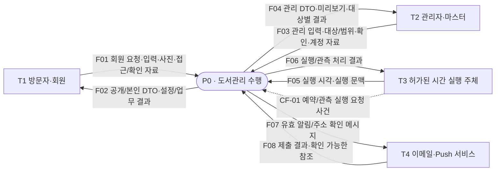
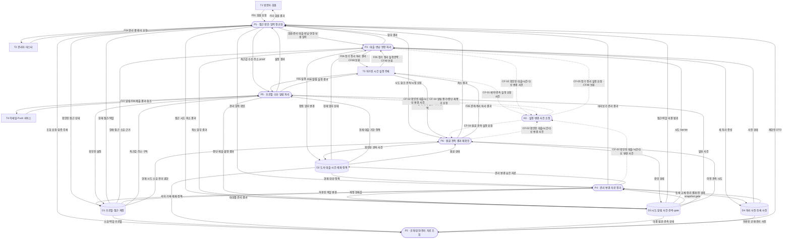
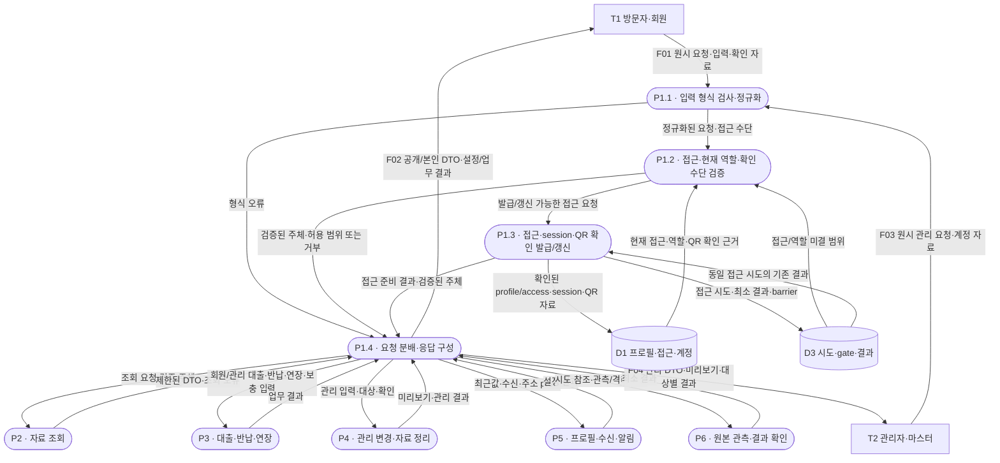
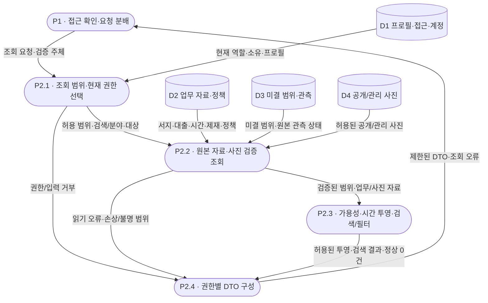
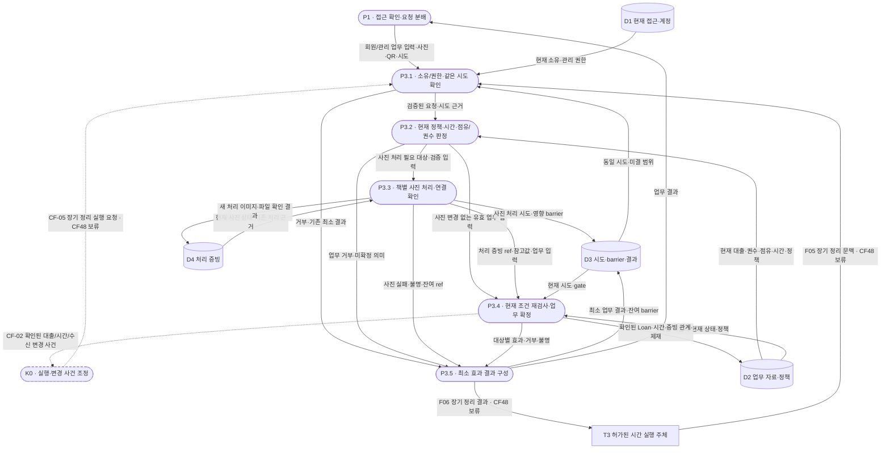
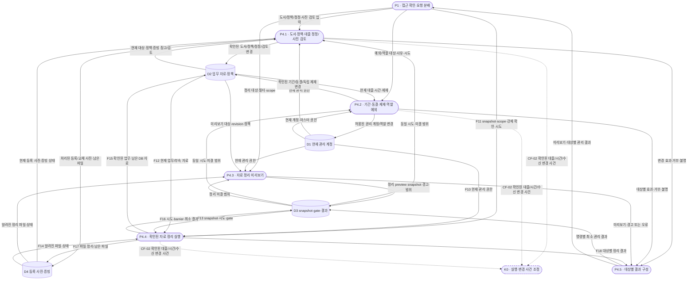
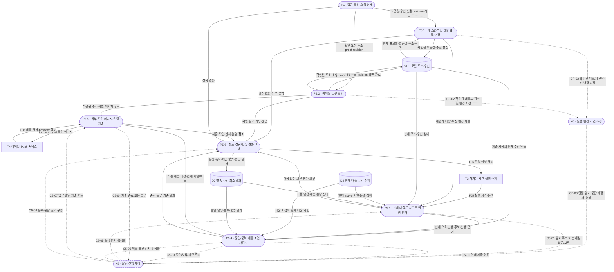
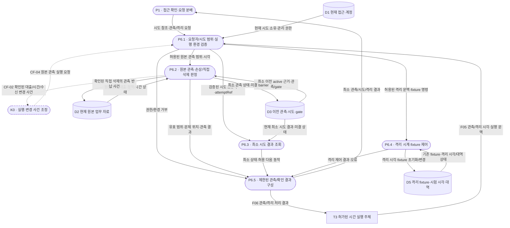
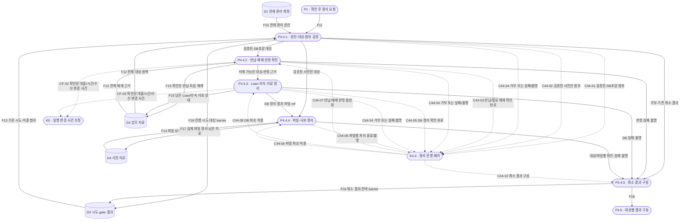
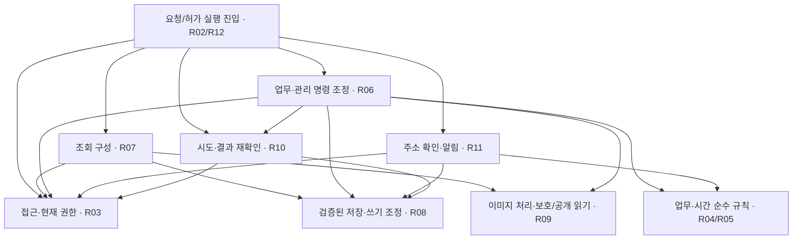

# 도서관리 — DFD·SASD 관점·프로세스 명세

2026-10-05 · **설계 열람용 모델 / 업무 구현·테스트 미실행**

## 1. 읽는 기준

사용자의 “DFD나 SASD, 프로세스 테이블을 볼 수 있을까” 요청에 따라 [현행 분석](library-management-analysis.md)과 [OOD 초안](library-management-design.md)을 구조적 관점으로 펼쳤다. 요구사항을 새로 수집하거나 기존 설계를 교체한 문서가 아니다.

- **DFD**: 어떤 데이터가 어디서 들어와 어떤 처리·저장소를 거쳐 결과가 되는지 보여준다. 여기서는 프로젝트 P13이 선택한 **CDFD 확장**을 사용해 처리의 활성화·중단을 결정하는 제어 사건도 구분한다. 화살표는 시간 순서나 함수 호출이 아니다.
- **SASD 관점**: 처리 분해 → 데이터 사전 → 말단 처리 명세 → 모듈 책임 연결을 함께 보는 방식이다. SASD 자체가 한 종류의 그림 이름은 아니다.
- **프로세스 명세**: 각 처리의 입력·전제·변환·출력·실패·근거를 표로 보여준다.
- 적용: 프로젝트 P13/P14/P15·D02/D03. 기존 OOAD의 UC/OP·데이터 사전은 유지하고 데이터 이동/삭제와 처리 활성화·중단 책임을 확인하는 모델만 추가했다. 전체 UML·새 클래스·새 운영 저장소는 추가하지 않는다. 레벨2의 D5는 기존 R12 격리 시험 자료를 표현하는 내부 저장소다.
- 레벨: **레벨0는 전체 시스템 하나, 레벨1은 주요 처리1~6, 레벨2는 각 주요 처리의 하위 처리, 레벨3은 처리4.4의 상세**다. `4.4`는 처리 번호이며 레벨4라는 뜻이 아니다. 이 문서의 OP/DD/INV/TC는 기존 `*-LIBRARY-*` ID의 축약이다.
- 표기 정본: [CDFD 도면 보기](library-management-dfd.html). 터미네이터=직사각형, 데이터 처리=실선 타원, 제어 처리=점선 타원, 저장소=평행선, 데이터 흐름=실선 화살표, 제어 흐름=점선 화살표로 표시한다. 아래 Mermaid는 편집 가능한 같은 모델의 원문이며 저장소만 원통으로 대체한다. 도면과 원문의 처리/저장소/제어 사건 ID 및 각 데이터 흐름의 이름·방향·구성은 같고, 도면의 d 번호는 별도 표시용 ID다.
- 경계: **논리적인 도서관리 기능 + 관리 대상 영속 자료**를 시스템으로 본다. 실제 Sheets/Drive의 클라우드/API 경계는 OOD R08/R09에서 다룬다. 사람이 Sheets/Drive를 직접 수정하는 행위는 사이트 명령 밖이며, 처리 6이 변경된 원본을 관측한다. 외부 주체→저장소 직접 연결로 사이트 처리를 생략하지 않는다.
- CF48~55는 계속 미확정이다. 아래에 흐름/책임이 있다는 것이 해당 기능의 실행 활성화나 승인·실현성 확인을 뜻하지 않는다. 테스트 보류 유지.

### 처리 이름의 계층 표기

도면과 원문 처리 이름은 **`P번호 · 처리 이름`**으로 통일한다. `P0`는 전체 시스템이며, 첫 분해는 `P1`~`P6`이다. 이후에는 **부모 번호 + `.자식 순번`**을 쓴다. 예: `P4 · 관리 변경·자료 정리` → `P4.4 · 확인된 자료 정리 실행` → `P4.4.1 · 권한·대상·범위 검증`. `P2.1`은 P2의 첫 번째 자식이며, 점으로 이어진 번호는 실행 순서가 아니라 분해 계층이다. 추가 분해가 없는 처리에 `P2.1.1` 같은 가상의 하위를 만들지 않는다.

도형은 첫 줄에 번호를 강조하고 다음 줄에 이름을 표시한다. 도면 제목/선택 메뉴는 **`부모 → 자식 번호 범위`**, 그 아래 계층 경로는 전체 조상 번호를 표시한다. 상위 도면 버튼은 부모 처리가 표시된 도면으로 돌아간다. 선택한 처리에 분해 도면이 있으면 하위 도면 버튼으로 이동한다. 경계 대조용으로 재표시하는 다른 처리도 원래 번호를 유지한다.

제어 처리는 데이터 처리와 구분해 `K부모 번호`로 표시한다. `K0`는 P0 내부, `K5`는 P5 내부, `K4.4`는 P4.4 내부의 제어 처리다. `K4.4`의 기존 원문 노드/CSPEC 참조 ID는 `K44`로 유지하며 두 표기는 동일 대상을 뜻한다. 흐름 CF-/C5-/C44-와 D/T 저장소·종단 ID는 유지한다. Markdown 편집용 노드 키 `P21`, `P44`, `A` 등과 표시 번호 `P2.1`, `P4.4`, `P4.4.1`은 구분한다.

### 레벨별 읽기 순서

| 레벨 | 부모 → 자식 | 해당 절 |
| --- | --- | --- |
| 0 | 전체 기능을 P0 하나로 표현 | §2 |
| 1 | P0 → P1~P6 | §3·4 |
| 2 | P1 → P1.1~P1.4, P2 → P2.1~P2.4, P3 → P3.1~P3.5 | §5.1~5.3 |
| 2 | P4 → P4.1~P4.5, P5 → P5.1~P5.6, P6 → P6.1~P6.5 | §5.4~5.6 |
| 3 | P4.4 → P4.4.1~P4.4.5 | §6 |

레벨2의 각 처리에는 입출력·변환·실패를 정의한 기존 C/UC 계약을 연결한다. 내부 처리 의미가 설명된 말단은 그 명세에서 끝내고, 삭제처럼 추가 분해가 필요한 처리4.4만 레벨3으로 내려간다. 이전 문서는 레벨2를 생략한 채 4.4 상세로 내려갔으며 이번 교정에서 그 중간을 채웠다.

### 표기·생략 범위

| 요소 | 표기·이름 | 이 모델에서의 의미 |
| --- | --- | --- |
| 터미네이터 / 외부 종단 | 직사각형·T1~T4 | T1 방문자·회원, T2 관리자·마스터, T3 허가된 시간 실행 주체, T4 이메일·Push 서비스. 경계 밖 데이터/사건의 출처·소비자이며 순서도의 시작/종료 기호가 아님 |
| 데이터 처리 / data process | 실선 타원·P0, P1~P6, P1.1 등 | 입력 자료를 검증·변환·조회/저장 결과로 바꿈. 부모 밖 처리를 하위 그림에 다시 표시해도 터미네이터로 바뀌지 않음 |
| 저장소 / data store | 두 평행선·D1~D5 | 유지되는 자료. 화살표가 처리로 향하면 읽기, 저장소로 향하면 쓰기. 한 그림의 반복 표시는 같은 저장소이며 별도 복제본이 아님 |
| 데이터 흐름 / data flow | 이름 있는 실선 단방향 화살표 | 요청/DTO/사진/시각/확인값/상태 등 의미 있는 자료를 전달. 원문 F01~18과 세부 흐름 이름을 참조하며 도면의 d 번호는 연결을 찾는 표시용 ID |
| 제어 처리 / control process | 점선 타원·K0/K5/K4.4(기존 ID K44) | 실행·중단 조건을 조정. 기존 R11/12·R06/08/10의 논리 책임이며 새 중앙 서비스나 저장소를 만들지 않음 |
| 제어 흐름 / control flow | 이름 있는 점선 단방향 화살표·CF-/C5-/C44- | 실행 요청 사건·현재 조건 판정·완료/불명 사건을 전달하여 처리 활성화·중단을 결정. 전체 업무 자료나 함수 호출 순서가 아님 |
| 제어 명세 / CSPEC | §7의 사건·조건·활성화/중단 표 | 점선 처리의 의미·입출력·거부/불명 결과를 정의. 기존 상태 축·전이·Guard는 분석 §7과 OOD §6/8이 정본 |

`runAt/executionContext`는 **F05 데이터**, 예약 실행 요청은 **CF-01 제어 사건**이다. 강제 삭제 확인값·scope·reason은 F11 데이터이며 점선으로 바꾸지 않는다. 공급자 응답은 F08 데이터이고, 그 결과를 판정한 제출 종료/불명 사건만 제어 처리로 전달한다. 기본 데이터 DFD에 제어 흐름이 항상 필수인 것은 아니지만, 이번 시간 실행·발송 중단·삭제 허용에는 CDFD 제어 표현이 필요하다.

선택은 P13의 CDFD 범례다. Gane–Sarson/Yourdon의 다른 기호, 순서도 결정 마름모·UML fork/join·structure chart의 제어 couple을 혼합하지 않는다. 제어 저장소·별도 중단 API는 요구 근거가 없어 추가하지 않는다. 순서/경합은 OOD 단계 표, 상태 전이는 기존 분석 §7을 참조한다.

## 2. 레벨0 — 맥락 DFD / 처리0

F01에는 공개 조회와 자기 대출/반납/연장/설정, 이메일 확인 proof가 포함된다. 이메일 확인 proof를 가진 다른 브라우저는 해당 확인만 수행하며 본인 조회 권한을 받지 않는다. F03의 마스터 역할 관리는 일반 관리자 요청과 별도로 권한을 검사한다.

## 3. 레벨1 — 처리0을 주요 처리1~6으로 분해

실선은 실제 입출력 자료이고 점선은 제어 사건이다. 요청/응답과 읽기/쓰기를 각각의 단방향 선으로 나눈다. K0는 실행/변경 사건을 기존 책임으로 전달하는 논리 제어 처리이며 새 통합 스케줄러를 확정하지 않는다.

접근 초기화·설정 저장처럼 표시를 축약한 쓰기도 R08/R10의 같은 시도·gate 계약을 사용한다. 각 처리의 원본 읽기는 R08 검증을 통과해야 하며, 처리 6을 거치지 않았다고 raw 자료를 신뢰하는 구조가 아니다. 프로세스는 논리적인 업무 변환 단위이고 함수/파일 하나와 일대일 대응하지 않는다.

### 저장소·흐름 사전

| 이름 | 포함 데이터·의미 | 정본 연결·수명 |
| --- | --- | --- |
| D1 | 독립 프로필·접근 grant·관리 계정/session·QR 확인 자료·주소 확인/구독 | OOD E02/03/10~12·QR 계약, DD03/22/29~31. Loan 제거로 프로필 제거 없음. 비밀번호 verifier/서버 비밀은 별도 비밀 영역 |
| D2 | Book·Loan snapshot·시간 진행/동결·증빙 참고값/검토/메모·독립 Penalty·현재 정책/대응 변경 | E01/04~09, DD01~20/23의 참고값·24/27/32. 신규 기간으로 과거 기한 변경 없음, Loan 삭제로 제재 해제 없음 |
| D3 | Attempts·Occurrences·이전 관측/영향 barrier·고유 writeRef gate | E13~16, DD25/28. 삭제한 원본의 숨은 복사본 아님. writeRef marker와 실제 gate 저장은 다른 저장 책임 |
| D4 | 처리된 증빙 파일·직접 만든 이미지 사본·선택 등록 사진 | E01 사진/E07의 파일 부분, DD23의 파일 부분. 참고값/검토/메모 원본은 D2. 이미지 원본은 처리 후 폐기. 등록 사진과 보호 증빙의 조회/수명 분리 |
| D5 | 격리 fixture·시험 시각·시험용 외부 서비스 대역 | R12의 Clock/ExecutionContext·OP20·TC023. 처리6 내부의 기존 시험 자료만 표현하며 운영 D1~4·OS 시각·실제 수신처와 분리. 테스트 실행 보류 |
| F01/F03 | 원시 조회/명령, 대상 ID/revision, 입력값/사진·확인·proof·attemptRef | OP의 입력 계약, DD01~08/14~26/28~31. role·owner·서버 시각은 브라우저 값으로 확정하지 않음 |
| F02/F04 | 권한별 DTO, 필드 오류·거부·confirmed/verifying/partial, 최소 다음 동작 | OOD §4/5/9. 회원에게 저장 증빙/내부 메모 없음, 삭제 후 전체 개인정보 재구성 없음 |
| F05/F06 | 신뢰된 실행 ID·환경·server/fixture 시각, 실행별 상태·참조 | R12·OP20/21/22/31. 운영/fixture 저장·수신 분리, CF48 및 알림 의미 보류 |
| F07/F08 | 현재 확인 주소/구독에 대한 허용 메시지·제출 결과/참조 | OP21/27/28, DD21/22. unknown 자동 재전송 없음, 주소 확인이 로그인/복구 권한을 만들지 않음 |
| CF-01 | 예약/관측 실행 요청 사건 | T3→처리0, 레벨1에서K0로 전달. F05 실행 자료와 다른 제어 사건이며 주기/실행 환경의 실제 지원은 TV04/07 미확인 |
| CF-02 | 확인된 대출/시간/수신 변경 사건 | 처리3/4/5/6→K0. Loan 확정/반납/DB 제거·동결/기한·정책/수신 변경 중 알림 영향 사건만 해당. 쓰기 불명은 확정 변경 사건으로 내보내지 않음 |
| CF-03/04/05 | 알림 평가/중단 재평가, 원본 관측, 장기 정리 실행 요청 | K0→처리5/6/3. 현재 권한/실행 자료 재검사는 대상 처리에서 유지. CF-05는 CF48 전기능 보류 |
| C5-01~08 | 유효 후보, 제출 허용/중단, 제출 종료/불명과 평가/검사/제출/결과 구성 활성화 | 처리5 내부의 K5 제어 사건. 발생 근거/후보 자료/F08 자체는 실선. §7의 K5 명세와 DD21/22·INV14~16 연결 |
| C44-01~10 | 범위 검증·반납/제재 확인·DB 정리/파일 결과와 후속 파괴/결과 구성 허용 | 처리4.4 내부의 K44 제어 사건. 강제 확인 입력은 F11 데이터. §7의 K44 명세·INV10/14/18/20 연결 |

## 4. 레벨1 프로세스 테이블

`부모 0`의 처리 1~6은 상위 조정 처리다. 세부 OP/C 계약을 참조하며 표 안에 모든 알고리즘을 복제하지 않는다. 아래 ‘전제/변환/실패’는 계획 명세이고 실행 확인 결과가 아니다.

| 처리·부모/하위 | 입력·전제 | 변환 → 출력 | 실패·보존 조건 | OP·책임·검증 연결 |
| --- | --- | --- | --- | --- |
| 1 접근 확인·정규화 / 부모0 / 1.1~1.4 | F01/F03·D1/3. cookie/session/proof 원천과 입력 형식 확인 | 안정 주체·정규화 입력 → 해당 처리, 제한된 결과 → 요청자 | 학번/이메일 소유 병합 없음. 현재 role 박탈 즉시 반영. 이메일 proof 보유자에게 회원 접근을 부여하지 않음 | OP23·C01/QR 하위 경계, R02/03. TC002/019/022/024/029 |
| 2 자료 조회 / 부모0 / 2.1~2.4 | 검증 주체·검색/분야/대상, D1~4. 자료/gate 영향 범위 확인 | 공개 가용/본인/전체관리 DTO·정상 0건 → 처리1 | 오류를 0건으로 바꾸지 않음. 미결/gate 조회 실패를 가용으로 해석하지 않음. 회원에게 증빙 사진/메모 제외 | OP01/02/19/25/26, R07/08/09. TC001/017/026; CF53 |
| 3 대출·반납·연장 / 부모0 / 3.1~3.5 | 검증 주체·대상·사진/기한/확인·attempt, D1~4 또는 신뢰된 F05. 현재 소유/권수/점유/시각/정책 | 정규화 입력·처리 증빙·업무 변경 → D2/4, 최소 결과 → D3/처리1 또는 F06 | 같은 책/프로필 여유 경합·한 시도 한 효과. 사진 불명은 Loan 전체 완료 아님. 미연결 보충 자동 귀속 없음 | OP03/04/10/13/14/31, R04~10. TC002~008/011/015/016/021/030; CF48/49 |
| 4 관리 변경·정리 / 부모0 / 4.1~4.5 | 현재 관리자/마스터·대상/revision·값·scope·reason/확인, D1~4 | 지정 변경·고정 대상·삭제 효과 → 저장, 대상별 결과 → 처리1 | role·대상 재검사, 새 Loan을 기존 일괄대상에 넣지 않음. 사진만과 DB포함·제재해제 구분 | OP06/07/08/09/11/12/15~18/30/32, R03/06/08~10. TC001/012~014/018/020/029/031; CF49/52/53 |
| 5 프로필·수신·알림 / 부모0 / 5.1~5.6 | 설정/revision·주소 proof 또는 F05, 현재 D1/2/3·F08 | 최근값/확인/구독 변경, 유효 발송 후보 → F07; 결과 → D3/처리1 또는F06 | Loan snapshot 불변. 이전 proof가 새 주소/해제를 되돌리지 않음. 반납/수신해제 선행이면 제출 없음 | OP05/21/27/28/29, R03/11/12. TC009/010/019/027/028/031; CF50/51/54/55 |
| 6 원본 관측·결과 확인 / 부모0 / 6.1~6.5 | 권한·범위/attempt 또는 F05, D1~3의 현재 원본·이전 active 근거·gate | 유효 범위/오류 위치·관측 사건·최소 시도 결과 → D2/3/처리1 또는F06 | OP24는 새 업무 실행 없음. 직접 삭제의 이전 상태 확인 때만 관측반납, 새 제재 없음. 운영 자료/시각/수신 변경 없음 | OP20/22/24, R08/10/12. TC014/016/017/023 |

각 행의 하위 처리 전체를 다음 레벨2에 펼친다. 같은 OP/C 계약을 쓰며 새로운 업무나 외부 응답을 추가하지 않는다.

## 5. 레벨2 — 주요 처리1~6을 각각 분해

각 그림에서 자기 부모 밖의 처리·주체·저장소는 **경계를 대조하기 위한 재표시**다. 다른 주요 처리의 내부를 함께 분해하지 않는다. 입력과 출력을 단방향으로 풀고, 합성 데이터의 구성은 §3의 사전과 아래 처리 표에서 정의한다. 처리 표의 C/INV가 적용 규칙이며 TC는 실행할 때의 검증 연결이다.

### 5.1 처리1 → 1.1~1.4 / 접근 확인·입력 정규화

| 말단·부모1 | 입력·전제 → 변환·출력 | 실패·금지 효과 / 계약·검증 연결 |
| --- | --- | --- |
| 1.1 | F01/F03·DD01~08/14~26/28~31 → OP별 허용 필드·형식·상한을 검사하고 정규화 요청/필드 오류 생성 | 임의 role/owner/시각을 서버 근거로 채택하지 않음. 파일 내용 검사는 처리3/4의 C11에서 수행. R02, TC002/018/022 |
| 1.2 | 정규화 요청·D1/3 → 공개/본인/관리/주소 확인의 접근 범위와 현재 권한을 구분해 주체/거부 생성 | 학번·이메일 일치로 소유 병합 없음. 박탈된 옛 session 거부. 주소 proof 보유자는 해당 확인만 허용. C01·R03, INV02/18/19, TC019/022/024/028/029 |
| 1.3 | 접근 초기화/갱신·OP23·QR 요청·같은 시도 → 확인된 접근 상태와 최소 시도 결과 저장 후 접근 준비 결과 생성 | 최초 profile/access 모두 확인 전 cookie 없음. QR는 관리 권한을 만들지 않음. 미결이면 완료 발급으로 표현하지 않음. C01·QR 계약·R08/10, TC002/019/022/029 |
| 1.4 | 검증된 주체·정규화 요청 또는 오류·처리2~6 결과 → 해당 처리 요청과 권한별 F02/F04 구성 | 오류를 정상 빈 결과/완료로 바꾸지 않음. DTO에 내부 증빙/메모·타인 결과 없음. R02/03·CommandResult, INV14/18, TC016/026 |

### 5.2 처리2 → 2.1~2.4 / 공개·본인·관리 자료 조회

| 말단·부모2 | 입력·전제 → 변환·출력 | 실패·금지 효과 / 계약·검증 연결 |
| --- | --- | --- |
| 2.1 | OP01/02/19/25/26·D1·DD01~03/22/31 → 공개/본인/전체관리 범위·대상 선택 | 타인 자료/존재 노출 없음. 현재 역할로 관리 조회 검사. R03/07, INV02/19, TC001/022/026 |
| 2.2 | 허용 범위·D2~4·DD04~24/25/27/28/32 → 원본/gate 검증 후 유효 자료·사진 또는 오류/불명 반환 | 실패를 0건으로 바꾸거나 손상 원본을 자동 정정하지 않음. 증빙은 보호 조회만 허용. R08/09·C13의 원본 검증 규칙, INV12/13/18, TC017/018/026 |
| 2.3 | 유효 자료·정규화 검색/필터·현재 투영 시각 → 가용성/기한/제재 안내와 허용 결과 집합 계산 | 미결 책을 가용으로 취급하지 않음. 투영이 과거 snapshot/기한을 저장 변경하지 않음. C04·R04/07, INV01/07/08/10, TC001/004/026 |
| 2.4 | 조회 결과·권한 범위 또는 오류 → 공개/본인/관리 DTO·정상 0건/오류 구분 | 회원 DTO에 저장 증빙/내부 메모 없음. CF53의 장기 이력 범위를 확정하지 않음. R07·OOD §4/5, TC001/017/026 |

처리2는 D1~4에 쓰지 않는다. 직접 삭제의 관측 사건은 처리6이며, 조회 자체의 저장 부작용으로 합치지 않는다.

### 5.3 처리3 → 3.1~3.5 / 대출·반납·연장·보충

| 말단·부모3 | 입력·전제 → 변환·출력 | 실패·금지 효과 / 계약·검증 연결 |
| --- | --- | --- |
| 3.1 | OP03/04/10/13/14/31·D1/3·DD03/28~31 → 소유 회원/관리자/허가 실행 문맥·같은 시도 대조 | 타인 Loan 처리 없음. 같은 key의 다른 입력은409. OP31은 CF48로 전기능 보류. C01/14·R03/10, INV02/14/18/19, TC016/022/030 |
| 3.2 | 유효 요청·D2·DD04~20/27/32 → 신규/회원 반납/연장/관리 반납/미연결 보충별 현재 조건과 변경안 계산 | 관리자 보충은 회원 기간/시간 제한 없이 현재 점유 검사. 자동 회원 귀속 없음. CF49 결합 판정은 unresolved. C02~05/09, INV01/03/05~10/17, TC002~008/011/021 |
| 3.3 | 필요한 책별 입력 사진·D4·DD23 → 내용/상한 검사·EXIF 추출·처리 후 파일 확인·증빙 ref/참고값 생성 | 원본/부적합 파일 보관 없음. 신규 회원 대출 필수 사진과 관리자 보충 선택 사진을 구분. 파일 불명은 전체 완료 아님. C11·R09, INV12/20, TC002/015/018/021 |
| 3.4 | 변경안·확인된 증빙 또는 사진 불필요 경로·현재 D2/3 → R08 gate 안에서 최종 조건 재검사 후 업무 효과 확인 | 같은 책/프로필 여유 경합·중복 효과 차단. 사진 시작 시각을 업무 확정 시각으로 쓰지 않음. 제재 불명 상태를 전체 완료로 내보내지 않음. C02~05/09·R08/10, INV01/03/09/10/14, TC011/015/016 |
| 3.5 | 확인된 효과/기존 결과 또는 거부·불명/잔여 ref → 최소 D3 상태와 요청 출처에 맞는 결과 구성 | 원본 개인정보 숨은 복사본 없음. 재확인은 새 업무가 아님. C14·CommandResult, INV14/18, TC014~016/030 |

실제 저장 단계·현재 권한 재검사·외부 파일 처리 전 gate 확정은 OOD §6/7을 따른다. 데이터 화살표만으로 동시성/원자성/실행 순서를 보장하지 않는다. CF48의 기준일/기간을 이 그림에서 임의로 정하지 않는다.

### 5.4 처리4 → 4.1~4.5 / 관리 변경·자료 정리

| 처리·부모4 | 입력·전제 → 변환·출력 | 실패·금지 효과 / 계약·검증 연결 |
| --- | --- | --- |
| 4.1 말단 | OP06/07/08/09·D1~4·DD01/04~08/23/24/27/28/31 → 허용 필드·revision·현재 정책/사진 generation을 검사하고 지정 값/관계·등록 사진/검토 결과만 변경 | Loan 소유/snapshot·기존 기한/제재를 임의 재작성하지 않음. 새 파일 확인 전 기존 파일 유지. C06/08/11/15·R03/08~10, INV01/04/12/20, TC001/012/018 |
| 4.2 말단 | OP15~18/30/32·D1~3·DD14~20/25/28/31/32 → 실행 시작의 ID/revision 대상 고정 후 예외/허용 계정 변경·대상별 결과 생성 | 새 Loan을 대상에 추가하지 않음. freeze/제재 전체 무조건 해제 없음. 마스터 보존. CF49/52 영향 판정/계정 후보 연결 보류. C07/10·R03/08/10, INV10/11/19, TC020/029/031 |
| 4.3 말단 | OP11·현재 권한·filter/include/exclude·scope·D2~4·DD25/26 → 정리 후보 ID/revision·사진/DB 범위·경고/건수 snapshot 및 미리보기 생성 | 조회 실패를 0건으로 바꾸지 않음. 업무/사진 삭제 없음. 현재 권한과 대상 변경은 실행 시 재검사. C07, INV11/14, TC014/020/026 |
| 4.4 상위 | OP12·F10~14·DD08~13/19/20/23~28/31 → §6의 4.4.1~5로 분해하여 F15~18 생성 | 사진만/DB포함·강제 확인·독립 제재 수명 구분. 부분/불명은 잔여 작업/barrier로 표현. C05/07/14, INV10/11/13/14/18/20, TC013/014/018/020 |
| 4.5 말단 | 앞 처리의 미리보기 또는 대상×효과 결과 → 최소 관리 결과 및 처리1 응답 구성 | 정상 미리보기를 업무 완료라고 표시하지 않음. 정리 원본 개인정보 복원 없음. C14·CommandResult, INV14/18, TC014/016/026 |

4.3의 미리보기는 4.5→처리1→관리자에게 반환된다. 관리자가 확인한 뒤 보내는 **별도 요청**이 4.4의 입력이며, 미리보기 생성만으로 삭제에 진입하지 않는다. 각 변경의 준비 gate/같은 시도 확인은 R08/R10의 공통 계약을 사용한다. CF53의 보관 범위를 미리보기에서 확정하지 않는다.

### 5.5 처리5 → 5.1~5.6 / 프로필·수신·주소 확인·알림

| 말단·부모5 | 입력·전제 → 변환·출력 | 실패·금지 효과 / 계약·검증 연결 |
| --- | --- | --- |
| 5.1 | OP05/29·D1·DD03/22/29/30 → 본인 최근값·현재 채널/주소/구독 검증 후 설정 변경·결과/재평가 대상 생성 | 과거 Loan snapshot 변경 없음. 마지막 Loan 삭제로 프로필/수신 자동 제거 없음(CF54). C12·R03/08/11, INV02/18, TC019/027 |
| 5.2 | OP27/28·D1·DD22·현재 address revision과 proof → 확인 메시지 후보 또는 현재 주소 소유 확인 결과 생성 | 다른 브라우저에는 확인만 허용. 오래된 proof가 새 주소/수신해제를 되돌리지 않음. 미확인 주소의 확인 메시지와 확인된 주소의 업무 알림을 구분. C12·R03/11, INV18, TC028 |
| 5.3 | OP21·F05 또는 설정 재평가·D1~3·DD08~12/21/22/32 → 현재 Loan/수신/시간 규칙에 맞는 발생 후보·근거 또는 대상 없음/보류 생성 | 미래 발생 후보 생성과 실제 제출 구분. CF50/51/55의 발송 의미를 가정으로 활성화하지 않음. R05/11/12, INV15/16, TC009/010/025/031 |
| 5.4 | 발생 후보·현재 D1~3 → 반납/DB 삭제/수신해제·동결·동일 발생을 재검사하여 허용 제출 또는 중단/보류/기존 결과 생성 | 선행 반납/해제 뒤 제출 없음. 외부 unknown을 미발송으로 보고 자동 재전송하지 않음. R11·Occurrences 계약, INV14~16, TC010/025 |
| 5.5 | 허용된 업무 알림 또는 주소 확인 메시지 후보 → F07 제출·F08 확인 가능한 응답/참조와 실패/불명 생성 | 후보 출처별 주소 확인 조건 유지. 제출 확인을 사람의 수신/열람 확인으로 표시하지 않음. R11·DD21/22, INV15/16/18, TC009/025/028 |
| 5.6 | 설정/소유 확인·발생 평가/제출 효과 또는 거부/보류/불명 → D3 최소 결과·설정 응답 또는 실행 결과 생성 | 업무 알림/확인 proof 결과로 로그인 권한을 만들지 않음. 실제 발송/수신 성공 주장 없음. C12/14·R10/11, INV14/18, TC019/025/028 |

발생 예약과 외부 제출 전 준비 기록·현재 revision 재검사는 OOD §8을 따른다. D3 저장 화살표는 공통 상태 저장 책임을 모은 표현이며, 외부 제출 뒤에만 시도를 기록한다는 의미가 아니다.

### 5.6 처리6 → 6.1~6.5 / 원본 관측·결과 확인·격리 제어

| 말단·부모6 | 입력·전제 → 변환·출력 | 실패·금지 효과 / 계약·검증 연결 |
| --- | --- | --- |
| 6.1 | OP20/22/24·D1·범위/attemptRef·신뢰된 F05·DD28~31·R12 환경 계약 → 현재 권한·소유/허용 관측 범위와 서버 결정 환경 검사 후 해당 요청/거부 생성 | 브라우저 입력으로 운영을 fixture로 전환하지 않음. 타인 시도 존재 노출 없음. R03/10/12, INV18/19, TC022/023 |
| 6.2 | OP22·현재 D2·D3 최소 이전 관측·DD04~20/25/27/28 → 유효 범위/손상 위치와 근거 있는 직접 삭제 관측 사건 생성 | 이전 active가 확인된 경우만 관측 반납, 새 제재 없음. 불명 책 신규 보류. 손상 원본 자동 제거/삭제 원본 복원 없음. C13·R08/10, INV13/18, TC017 |
| 6.3 | OP24·검증된 시도 소유자/현재 admin·D3·DD28 → 원래 시도의 현재 최소 결과와 허용 다음 동작 조회 | **읽기 전용**. 새 Loan/사진/제재/알림/삭제/재실행 없음. 백그라운드 재확인 효과는 R10의 별도 조정 책임. C14, INV14/18, TC014/016 |
| 6.4 | OP20·허용된 격리 요청·D5·R12의 Clock/ExecutionContext → 격리 시계 이동/fixture 초기화·시험용 자료/대역 상태와 제어 결과 생성 | 운영 D1~4·OS 시각·실제 수신처 무변경. 시각 후퇴로 저장 이력 자동 되감기 없음. **설계만, 테스트 실행 보류**. R12, TC023 |
| 6.5 | 관측/최소 시도/격리 제어 결과 또는 권한/환경 오류 → 범위 제한한 결과를 요청 출처에 반환 | OP24 응답 구성은 저장 쓰기 없음. 삭제한 원본 개인정보를 결과에서 재구성하지 않음. C14·R02/10/12, INV14/18, TC014/016/017/023 |

D5는 처리6 내부에서만 새로 드러난 중간 저장소이므로 부모의 운영 입출력은 바뀌지 않는다(P13). 모든 레벨의 F05/F06에는 격리 시각/fixture 제어 요청과 결과가 포함된다. D5와6.4는 격리 시험 기능의 설계이며 이번 작업에서는 실행하지 않는다.

## 6. 레벨3 — 레벨2의 자료 정리 처리4.4 분해

### 6.1 부모4.4의 경계 계약

| 경계 | 데이터·구성 |
| --- | --- |
| 출력 CF-02 | 알림에 영향을 주는 확인된 관측 반납/DB 제거 사건 → 부모 밖 K0. 불명/사진만 정리에서는 생성하지 않음 |
| 입력 F10 | D1의 현재 관리 계정/session·관리 권한 |
| 입력 F11 | 검증된 관리자 문맥 + preview snapshot(ID/revision) + `photoOnly/loanAndPhotos` + 강제 확인 + reason + attemptRef |
| 입력 F12 | D2의 현재 Loan/제재·정책·시간/부속 자료 상태 |
| 입력 F13 | D3의 기존 attempt/진행 gate/최소 확정 결과 |
| 입력 F14 | D4의 알려진 파일 ref/파일별 존재·권한·처리 상태 |
| 출력 F15 | D2의 확인된 반납/제재·남은 DB 자료/부속 자료 상태 |
| 출력 F16 | D3의 시도·barrier·대상별 최소 결과 |
| 출력 F17 | D4의 실제 파일 정리 결과/남은 자료 |
| 출력 F18 | 레벨2의 처리4.5로 전달할 대상별 confirmed/rejected/verifying/partial·남은 작업. 처리4.5→처리1을 통해 관리자에게 반환 |

### 6.2 데이터 분해도

파일 정리 대상은 검증된 사진만 대상 또는 DB 정리 후 남은 파일이다. DB/제재가 불명인 경로는 파일 파괴를 무조건 이어가지 않는다. 상자 사이의 중간 데이터는 업무 상태를 담으며 화살표 자체가 transaction·lock·호출 순서를 보장하지 않는다. 실제 저장 단계/재확인은 OOD §6/7을 따른다.

### 6.3 말단 프로세스 명세

| 처리·부모 | 입력/사전·전제 | 변환·출력 | 거부/불명·금지 부작용 | 규칙·TC |
| --- | --- | --- | --- | --- |
| 4.4.1 / 부모4.4 | F10~13; DD25/26/28/31. 현재 admin·snapshot/범위·확인·입력 검증 | 같은 시도 대조, 대상 재검사·고정 → DB포함/사진만 대상 또는 거부/기존 결과. 진행 제어 저장은 확인 뒤 후속 효과 허용 | 대상 변화는 다시 preview. 같은 key의 다른 내용409. 타인 결과/삭제 원본 복사 없음 | C07/14·R03, INV11/14/18/19, TC014/016/020/022 |
| 4.4.2 / 부모4.4 | 검증된 DB포함 대상·F12; DD12/13/19/20/27 | active면 최초 반납 사건·당시 정책 제재 확인. returned는 기존 사건 유지 → 삭제 가능 대상/F15 | 미연결 보충에 회원 제재 연결 없음. 제재 필요 판정 불명 시 원본 파괴 금지. 기존 사건 시각·제재 중복 없음 | C05, INV09/10/17, TC003/011/013/014 |
| 4.4.3 / 부모4.4 | 삭제 가능 대상·현재 원본; DD08~13/23/24 | Loan·참고값·검토/메모·시간/freeze 부속 업무 자료 제거 → F15·남은 파일 ref/DB 결과 | 반납확정/DB실패는 해당 책 신규 보류. 프로필/유효 제재 유지. 원본을 Attempts/로그에 복사하지 않음 | E04~08/13, INV10/13/18/20, TC013/014/027 |
| 4.4.4 / 부모4.4 | 검증된 사진만 대상 또는 DB 정리 후 파일 ref·F14; DD23 | 파일/직접 만든 사본 영구 삭제 확인 → F17·파일별 결과. 영구 삭제 불가능이 확인된 때만 trash | timeout은 불가능 확인 아님. 사진만이면 Loan/기한/점유/제재/참고값/검토/메모 유지. partial에 남은 ref만 보존 | INV14/20, TC013/014/018 |
| 4.4.5 / 부모4.4 | 앞 처리의 확인 효과·오류/불명·원 attempt | 대상×DB/photo/penalty를 구성 → F16/18. 남은 작업/barrier 명시 | 일부 성공을 전체 완료로 표시하지 않음. 재확인은 원래 시도이며 새 Loan/제재/사진/알림을 생성하지 않음 | C14/CommandResult, INV14/18, TC014/016/026 |

## 7. 제어 처리 명세 — CSPEC

제어 처리는 전달 자료를 다시 보관하는 모듈이 아니라 **어떤 사건과 현재 조건에서 어떤 처리를 활성화/중단하는지** 정의한다. 아래 판정 단계는 논리 제어 상태이며 새 영속 enum/테이블을 추가하지 않는다. CF는 제어 흐름 ID이고 CF48~55는 기존 미확정 요구사항 ID다.

| 제어 처리·현재 판정 단계 | 입력 사건·조건 | 활성화/중단 출력·다음 단계 | 거부/불명·보류 / 근거 |
| --- | --- | --- | --- |
| K0 / 사건 대기 | CF-01·유효한 허가 실행 문맥, 관측 요청 해당 | CF-04로6 활성화 → 다음 사건 대기 | 요청 자료/현재 권한은6.1에서 재검사. 실제 주기/스케줄러 지원은 TV04/07 미확인. R12·OP22 |
| K0 / 사건 대기 | CF-01의 알림 실행 또는 CF-02의 확인된 알림 영향 변경 | CF-03으로5의 현재 발생/중단 재평가 요청 → 다음 사건 대기 | 변경 사실이 불명인 경우 확정 사건 생성 금지. 단순 조회/사진만 정리로 Loan 종료 사건 생성 없음. R11/12·OP21·INV15 |
| K0 / 사건 대기 | 장기 정리 실행 요구 | CF-05의 경계만 표시, **현재 비활성** | CF48 전기능 보류. 주기/180일 값 채택·스케줄러 등록 없음. R05/12·OP31 |
| K5 / 평가 전 | CF-03·현재 실행 자료 사용 가능 | C5-05로5.3 평가 활성화 → 후보 판정 대기 | CF50/51/55에 의존하는 후보는 보류. R05/11/12·DD21 |
| K5 / 후보 판정 대기 | C5-01의 유효 후보 | C5-06으로5.4 현재 제출 조건 검사 → 제출 판정 대기 | 후보 자료는 실선으로5.4 전달. 후보 생성만으로 외부 제출 없음. R11·INV15 |
| K5 / 후보/제출 판정 대기 | C5-01 대상 없음/보류 또는 C5-03 중단/기존 결과 | C5-08로5.6 결과 구성 → 사건 대기 | 반납/DB 제거/해제 선행은 제출 금지. 동결·불명은 현행 계약에 맞는 held/unknown. INV14~16 |
| K5 / 제출 판정 대기 | C5-02·현재 주소/구독/Loan/동일 발생 검사 통과 | C5-07로5.5 **업무 알림** 제출 허용 → 제출 결과 대기 | 제출 결정 저장 확인·직전 재검사는 OOD §6/8. 원자적 회수 보장 없음. R08/11·INV15 |
| K5 / 제출 결과 대기 | C5-04 제출 종료/실패/불명 | C5-08로5.6 최소 결과 구성 → 사건 대기 | unknown을 미제출로 보고 자동 재전송하지 않음. R10/11·INV14/15 |
| K44 / 범위 판정 대기 | C44-01·현재 admin/snapshot/강제 확인/DB포함 범위 유효 | C44-07로4.4.2 판정 활성화 → 반납/제재 판정 대기 | 확인값은 F11 데이터. 현재 권한/gate 확인은 R03/08/10. C05/07·INV19 |
| K44 / 범위 판정 대기 | C44-02·현재 권한/snapshot·사진만 범위 유효 | C44-09로4.4.4 파일 정리 허용 → 파일 결과 대기 | Loan/기한/점유/제재/참고값/검토/메모 그대로. INV10/20 |
| K44 / 반납/제재 판정 대기 | C44-03·필요한 최초 반납/독립 제재 효과 확인 | C44-08로4.4.3 DB 파괴 허용 → DB 결과 대기 | 판정 불명은 원본 파괴 금지. 이미 returned인 대상은 기존 사건 유지. C05·INV09/10 |
| K44 / DB 결과 대기 | C44-05·DB 정리 확인·알려진 남은 파일 ref | C44-09로4.4.4 파일 정리 허용 → 파일 결과 대기 | DB 실패/불명은 파일 파괴로 무조건 진행하지 않음. R08/10·INV14/18 |
| K44 / 범위/반납/DB 판정 대기 | C44-04·거부/실패/불명 | 후속 파괴 활성화 없음. C44-10로4.4.5 결과 구성 → 결과 반환 | verifying/partial·남은 작업/barrier 유지. 전체 원본 복원/새 효과 생성 없음. C14·INV14/18 |
| K44 / 파일 결과 대기 | C44-06·파일별 종료/실패/불명 | C44-10로4.4.5 결과 구성 → 결과 반환 | 영구 삭제 불가능 확인 때만 trash. timeout은 불가능 확인 아님. INV14/20 |

K5는 **업무 알림** 제어다. 5.2의 주소 확인 메시지는 현재 소유/주소 revision 검증에 따라5.5로 전달되는 별도 확인 요청이며 Loan 후보 발생을 요구하지 않는다. 주소 확인 완료 중 수신에 영향을 주는 사실만 CF-02로 재평가한다. 제공자 F08 전체 응답과 현재 D1~3 자료는 실선이며 K5에 전달하는 것은 그 자료를 판정한 사건이다.

K44의 실패 사건과 완료 사건은 같은 단계에 동시에 생성하지 않는다. 반환할 판정은 `confirmed/rejected/verifying/partial`, 대상×DB/photo/penalty 효과는 기존 계약을 유지한다. 실제 gate·저장 확인/복구 순서는 OOD §6/7, 업무 상태 전이·Guard는 분석 §7을 참조하며 그림의 화살표 위치로 우선순위를 정하지 않는다.

## 8. SASD 관점의 모듈 분해

다음은 OOD의 **기능 분배·호출 의존 요약**이다. 정통 structure chart의 데이터/제어 couple 기호는 축약했고, DFD의 데이터 화살표와 구별한다. 새 프레임워크·별도 프로세스 서버를 확정하는 그림이 아니다.

프로세스2의 자료 조회는 R07, 프로세스3/4의 업무 변경은 R06, 프로세스5는 R11, 프로세스6은 R08/R10/R12가 주로 담당한다. R04/R05·저장·사진·접근 검사는 여러 프로세스가 공유한다. 화면1개=프로세스1개=파일1개로 분해하지 않는다.

## 9. 균형·검토 기록

| 대상 | 대조 근거 | 문서 대조 결과·한계 |
| --- | --- | --- |
| 레벨0 처리0 ↔ 레벨1 처리1~6 | F01~08 | 회원/관리 요청·결과는 처리1, 실행문맥/결과는3/5/6, 외부 메시지/제출 결과는5에 보존. 새로운 외부 업무 계약 추가 없음 |
| 레벨1 처리1 ↔ 레벨2 1.1~1.4 | U/A·처리2~6·D1/3 | 회원/관리 원시 입력·결과, 검증 주체/각 요청·하위 결과, 현재 접근/미결 범위·확인된 접근/최소 결과 보존. 내부 정규화 요청·접근 준비 결과는1 내부 |
| 레벨1 처리2 ↔ 레벨2 2.1~2.4 | 처리1·D1~4 | 조회 요청·제한된 DTO/오류, 역할/소유·업무/사진·미결 자료 입력 보존. 모든 저장소 읽기 전용. 내부 투영/검색 결과는2 내부 |
| 레벨1 처리3 ↔ 레벨2 3.1~3.5 | 처리1/W·D1~4 | 회원/관리 업무 입력·F05/06·현재 권한/업무/시도/사진 입력과 D2/3/4 효과·최소 응답 보존. 사진 없는 경로와 사진 처리 경로 구분. CF48 활성화 없음 |
| 레벨1 처리4 ↔ 레벨2 4.1~4.5 | 처리1·D1~4 | 관리 입력/미리보기/대상별 결과, 계정/업무/snapshot·파일 입력과 역할/업무/시도/파일 변경 보존. 4.3에서4.4로 자동 실행 연결 없음 |
| 레벨1 처리5 ↔ 레벨2 5.1~5.6 | 처리1/W/N·D1~3 | 설정/proof·F05~08, 프로필/대출/발송 사건 입력과 확인된 설정/최소 상태 출력 보존. 설정 응답과 실행 응답은 원 요청 출처로 구분 |
| 레벨1 처리6 ↔ 레벨2 6.1~6.5 | 처리1/W·D1~3, 내부D5 | 관측/시도/격리 요청·F05/06, 권한/원본/이전 관측 입력과 제한된 관측 사건/최소 결과 출력 보존. OP24는 읽기 전용. 내부D5는 R12 시험 경계의 상세이며 운영 저장소 추가 없음 |
| 레벨2 처리4.4 ↔ 레벨3 4.4.1~5 | F10~18·D1~4·처리4.5 | 현재 권한/확인 입력·업무/시도/파일 입력, 업무/최소 결과/파일 상태·대상별 결과 출력 보존. F18은 부모 그림의4.5로 반환. 검증 대상/파일 ref는4.4 내부 |
| 연결 규칙 | 레벨0~3의 DFD 처리·저장소/외부 주체 | 외부 주체↔저장소·저장소↔저장소 직접 연결 없음. 조회/생성/삭제가 모두 이름 있는 처리에 연결됨 |
| 사전·수명 | D1~5, 기존 DD/E·R12와 OOD §3/7/8 | 프로필·제재와 Loan/파일 수명 분리, 원본 처리 후 폐기, 사진만/DB포함 차이 및 격리 자료 분리 연결 |
| 처리 추적 | 전체 OP01~32·레벨1/2 표·4.4 말단 명세 | 각 주요 처리의 레벨2와 필요한4.4 레벨3을 채우고 OP/C·DD·INV·TC에 연결. 모든 처리를 동일 깊이로 강제 분해하지 않으며 구현/실제 검증 완료로 세지 않음 |
| 보류·검증 | CF48~55·TV01~07 | 시각/알림/계정/보관 의미 보류 유지. DFD/분해도는 저장 경합·원자성·실서비스 지원·사용성의 실행 증거가 아님 |
| 제어 경계 균형 | 레벨0 CF-01 ↔ 레벨1 K0; 레벨1 각 처리 ↔ 레벨2; 처리4.4 ↔ 레벨3 | CF-01만 외부 실행 사건. CF-02는3/4/5/6의 확인된 변경→K0, CF-03/04/05는K0→5/6/3로 각 하위 그림에 보존. 처리4.4의CF-02도 레벨3 B/C→K0로 보존. C5/C44 사건은 부모 안의 내부 흐름 |
| 표기·제어 명세 | 사용자 제공 CDFD 범례·P13/P14·§1/3/7 | 실선/점선 타원·직사각형 종단·평행선 저장소·실선/점선 단방향 흐름을 도면에서 구분. 시간 자료/요청 사건과 확인값/파괴 허용을 구분하고 K0/K5/K44의 사건/조건·중단·불명 명세 연결 |

2026-10-05 교정: 사용자의 레벨 누락 지적에 따라 레벨2를 채웠다. 이어 표기 누락 지적과 제공 범례에 따라 터미네이터/흐름 범례, 제어 처리/사건·CSPEC, 평행선 저장소를 쓰는 도면을 추가하고 레벨1 양방향선을 풀었다. 원통 저장소·제어 생략은 이전 의미 대응도의 한계였으며 표기 준수로 보지 않는다.

같은 날 가독성 교정: 사용자의 선 겹침/전체 화면 잘림 지적을 확인했다. 수동 곡선 배치와 가로폭만 줄이던 맞춤을 교체했다. 기본 데이터 보기·별도 제어 보기·함께 보기, 처리별 연결 확대, 실제 가로/세로 공간에 맞는 전체 맞춤을 제공한다. 주요 처리의 기본 보기는 처리·외부 연결이며, 연결 메뉴에서 저장소 연결 또는 모든 연결을 선택할 수 있다. 현재/전체 흐름 수를 함께 표시한다. 저장소 연결은 처리별 묶음으로 배치하며, 동일 저장소는 사용하는 처리 옆에 같은 ID로 재표시한다. 한글 도형 폭과 흐름 ID도 보존한다. 같은 출발·도착의 제어 사건은 하나의 선에 ID 조합으로 표시하며 개별 사건은 표와 CSPEC에 전부 보존한다. 데이터/제어 및 처리·외부/저장소 보기의 합집합이 원래 경계를 유지하며 새로운 DFD 레벨/업무 규칙은 추가하지 않는다.

같은 날 계층 이름 교정(P02 짧은 변경 기록·P13): 사용자 요청에 따라 처리 이름을 `P번호 · 이름`으로 통일하고 번호를 도형 첫 줄에 강조했다. `P4 → P4.4 → P4.4.1` 접두 번호, 도면 제목의 부모→하위 범위, 조상 경로와 상위/하위 도면 이동으로 분해 대상을 연결한다. 제어 표시 K4.4와 기존 참조 K44의 대응을 명시했다. 원문 9개 도면의 모든 기존 흐름 줄을 수정 전과 대조해 이름·방향·연결이 동일함을 확인했다(통과). 9개 모델의 부모/자식 번호·이동 대상, 390개 도면의 표시 번호와 원문 흐름 보존, 생성 구문을 정적으로 대조했다(통과). P2/P4.4 도면 이미지를 확인했다. 추가 UC·업무 설계·제품 테스트는 표시/열람 변경 범위와 사용자 보류에 따라 생략했으며 브라우저에서 버튼을 실제 조작한 결과는 미확인이다.

검증은 기존 계약과 문서 구조/부모·자식 데이터·제어 입출력의 정적 대조, 9개 모델·390개 표시 도면의 원문 흐름/ID 보존, 350×460·800×560·1360×740 공간의 가로/세로 맞춤 계산, 생성 JavaScript 구문 및 도면 자체 이미지 확인이다. 도면은 [생성 스크립트](../tools/render-library-dfd.py)와 [배치 도구](../tools/layout-library-dfd.cjs)로 이 문서의 첫9개 그림을 읽어 만들며, 이후 SASD 모듈 의존도는 DFD로 변환하지 않는다. 배치 도구는 기존 번들 Viz.js를 사용하며 사이트 의존성/모듈을 추가하지 않는다. 브라우저 도구의 file:// 접근 제한으로 열린 탭의 실제 조작/자동 새로고침은 확인하지 못했다. 테스트·타입 검사·린트·빌드·앱/모델 실행·실자료·Google 연동·메일/Push 발송은 하지 않았다.
